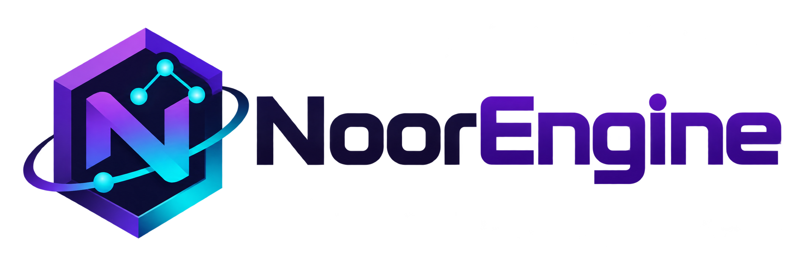
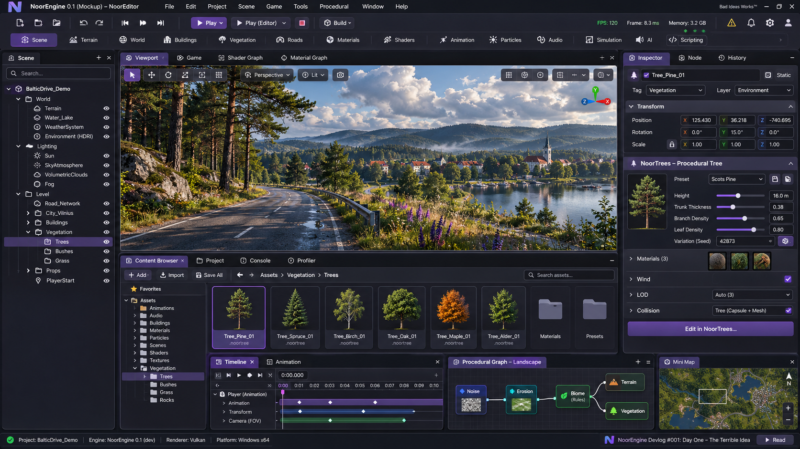
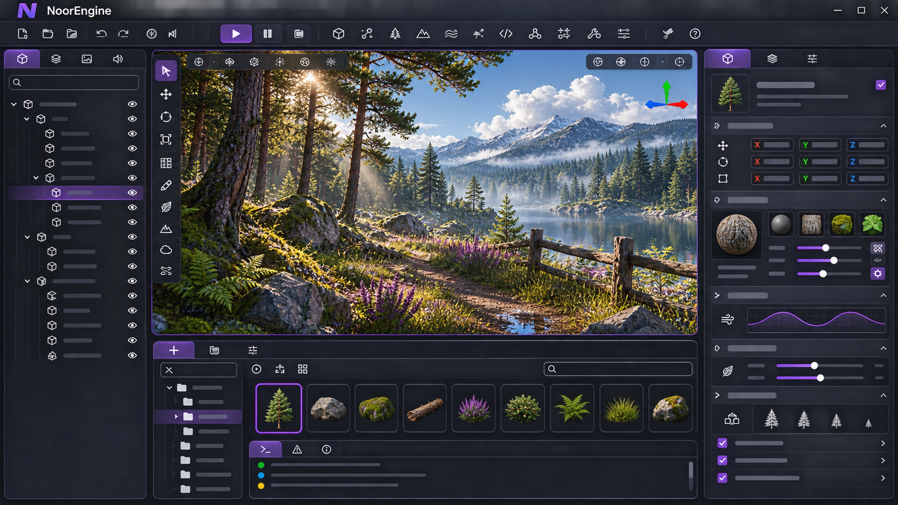
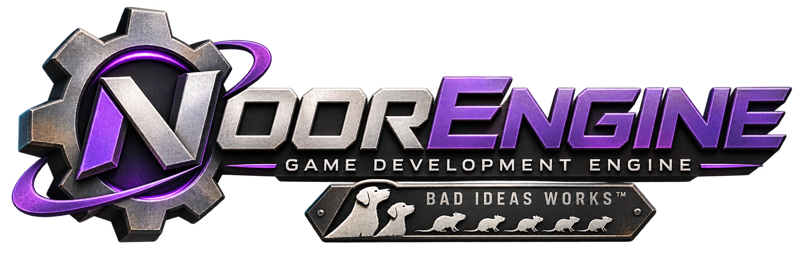

# NoorEngine
## The Big, Slightly Unreasonable Master Design Document

**Studio:** Bad Ideas Works  
**Product family:** NoorEngine · NoorEditor · NoorCode · NoorSDK · NoorTools  
**Status:** Product vision and engineering brief; not an assertion that any feature already exists  
**Initiated:** 2026-11-15  
**Audience:** Sage, Tom, Noor, contributors, and whichever AI inherits this mess  
**Guiding motto:** *Code shall remain understandable to whichever AI inherits this mess.*  
**Document role:** Source of requirements and a starting architecture discussion, **not** a requirement to implement every feature immediately.

> **Bad Ideas Works Development Policy #001**  
> We have decided to make a game engine. Several excellent game engines already exist. This fact has been noted and ignored with due respect.



---

## Contents

1. [Executive vision](#1-executive-vision)
2. [Foundational rules and scope discipline](#2-foundational-rules-and-scope-discipline)
3. [Products and user journeys](#3-products-and-user-journeys)
4. [System architecture](#4-system-architecture)
5. [Plugin, DLL and module architecture](#5-plugin-dll-and-module-architecture)
6. [NoorEditor: the GUI](#6-nooreditor-the-gui)
7. [NoorCode: complete built-in IDE](#7-noorcode-complete-built-in-ide)
8. [Project and asset management](#8-project-and-asset-management)
9. [Scene, object, prefab and component model](#9-scene-object-prefab-and-component-model)
10. [Rendering and graphics](#10-rendering-and-graphics)
11. [PBR, HDRI, shaders and material authoring](#11-pbr-hdri-shaders-and-material-authoring)
12. [Level building, CSG and modeling](#12-level-building-csg-and-modeling)
13. [Terrain generation and manual sculpting](#13-terrain-generation-and-manual-sculpting)
14. [Voxel worlds and hybrid terrain](#14-voxel-worlds-and-hybrid-terrain)
15. [Procedural world-building toolkit](#15-procedural-world-building-toolkit)
16. [Vegetation, trees, rocks and ecosystems](#16-vegetation-trees-rocks-and-ecosystems)
17. [Water, oceans, weather and volumetrics](#17-water-oceans-weather-and-volumetrics)
18. [Animation, characters and cinematics](#18-animation-characters-and-cinematics)
19. [Physics, vehicles, AI and simulations](#19-physics-vehicles-ai-and-simulations)
20. [Audio and sound tools](#20-audio-and-sound-tools)
21. [Networking and multiplayer](#21-networking-and-multiplayer)
22. [First-class 2D development](#22-first-class-2d-development)
23. [Import, export, formats and interoperability](#23-import-export-formats-and-interoperability)
24. [Templates and playable sample games](#24-templates-and-playable-sample-games)
25. [Developer experience, documentation and extensibility](#25-developer-experience-documentation-and-extensibility)
26. [Quality, tests, profiling and diagnostics](#26-quality-tests-profiling-and-diagnostics)
27. [Platforms, builds, packaging and deployment](#27-platforms-builds-packaging-and-deployment)
28. [Licensing, security and maintainability](#28-licensing-security-and-maintainability)
29. [Delivery roadmap: finish foundations, not throwaways](#29-delivery-roadmap-finish-foundations-not-throwaways)
30. [First actionable tasks for Sage](#30-first-actionable-tasks-for-sage)
31. [Acceptance checklists and feature contract](#31-acceptance-checklists-and-feature-contract)
32. [Risks and engineering trade-offs](#32-risks-and-engineering-trade-offs)
33. [Decision register and unresolved questions](#33-decision-register-and-unresolved-questions)
34. [Public devlog and studio voice](#34-public-devlog-and-studio-voice)
35. [Concept artwork inventory](#35-concept-artwork-inventory)
36. [Long-term product definition](#36-long-term-product-definition)

---

# 1. Executive vision

**NoorEngine** is an independently designed, general-purpose game creation ecosystem developed by **Bad Ideas Works**. Its core goal is to let developers build polished 2D and 3D games, complex interactive simulations, large worlds, and procedural environments within a cohesive, attractive, efficient creative application.

Its central feature is not merely a renderer. It is the combination of:

- A serious game runtime with rendering, audio, physics, networking, scripting and resource management.
- A polished integrated GUI and visual editor, **NoorEditor**.
- A full built-in code editor/IDE, **NoorCode**, especially for **C# and Lua**.
- Powerful non-destructive level construction with brushes, CSG, mesh tools, texturing and material painting.
- An interconnected library of procedural tools for terrain, rocks, trees, vegetation, architecture, cities, roads, weather, voxels and simulations.
- Reliable import/export with common game development and DCC formats, HDRI environments, versioned projects, and reusable assets.
- First-class templates, several genuinely playable sample games, and a wide-ranging feature showcase.
- A public, technically honest, occasionally ridiculous devlog, beginning with the first real commit.

**The mission:** Build a game engine that is pleasant to use, powerful enough to grow into, easy to extend, and sufficiently well-structured that a small human-and-AI team can continue development without regular architectural disasters.

**Desired personality:** modern, responsive, clean, readable, professional, a little purple, and never resembling an abandoned debug overlay. No mandatory ImGui-like look for the primary editing experience.

**Reference points, not dependencies or clones:** Unreal Engine, Godot, Unity, Blender, Hammer, Houdini, SpeedTree, Substance Designer, Rider/VS Code, modern simulation and GIS tools. Take good ideas; own the architecture. Study licensing before reusing code.

## 1.1 What "from scratch" means

NoorEngine should be its **own engine**: a clearly defined runtime, editor data model, project format, module contracts and public APIs. It **does not** mean writing proprietary alternatives to operating systems, image codecs, C# compilers, standard parsers, compression libraries or GPU drivers.

Existing open-source engines can be studied as architectural references. Mature libraries can be included when technically and legally appropriate. Every third-party dependency must be explicitly documented.

## 1.2 What success looks like

A developer opens NoorEditor, creates a project from an FPS/2D/third-person template, imports GLB models and PBR textures, creates a scene, edits code within the app, builds terrain and a small house, adds lights and HDRI, plays the game, debugs scripts, profiles a slowdown, and exports a standalone build. No external content-creation application should be required **for basic work**, though specialist external tools must remain welcome.

A procedural-world developer should go much further: combine elevation, biomes, vegetation, road networks, buildings, terrain modifications, shaders, simulation and streaming through shared data and non-destructive workflows.

# 2. Foundational rules and scope discipline

The ambition is intentionally broad. The implementation must be deliberately sequential.

## 2.1 Non-negotiable principles

1. **Real foundations, no disposable showpieces.** Each completed subsystem belongs to the actual engine and has a clean integration path. Avoid temporary "fake engine" implementations that will certainly be thrown away.
2. **Tests are essential.** "No test versions" means no rush to ship gimmicky prototype releases. It does **not** mean skipping automated tests, internal development builds, temporary diagnostic scenes or continuous integration.
3. **No giant rewrites by default.** Incremental, backward-compatible improvement is preferred. Any breaking migration requires a plan, migration tool where feasible, tests and explicit approval.
4. **Modular but practical.** Components should have boundaries without turning every three-line utility into its own DLL.
5. **Editor and runtime separate.** Games must run without editor dependencies. Offline tools and headless utilities should not require the main GUI.
6. **Stable assets and reproducibility.** Every imported and generated asset has identity, provenance, version and deterministic inputs where applicable.
7. **Human-readable project files where reasonable.** Use structured, diffable formats for scenes, resources and settings; use binary storage where performance or payload size justifies it.
8. **C# and Lua are first-class, not accessories.** Documented APIs, code examples, debuggability, script lifecycle and safe error handling.
9. **A beautiful GUI is a requirement.** Performance, accessibility, discoverability and high-DPI handling matter as much as screenshots.
10. **Creation tools share a language.** Consistent object selection, manipulation, scene integration, material/resource references, history and UI patterns.
11. **Good defaults, expert depth.** Beginners can create something useful quickly; professionals can access the low-level controls.
12. **Never silently corrupt a project.** Crash-safe saves, recovery, versioning, validation and migration are mandatory.
13. **Portable outputs.** Assets generated with Noor tools must be exportable when the format can carry their semantics.
14. **Measure before optimizing.** Profilers and diagnostics exist from the outset; performance claims require actual measurements.
15. **Respect licenses.** Each dependency and source asset has a recorded license and redistribution status.

## 2.2 Scope language

Every feature is labeled in implementation planning as one of:

- **Foundation:** needed by multiple other systems and built early.
- **First-class:** a core product capability, delivered as a complete vertical slice when reached.
- **Expansion:** legitimate long-term feature with no immediate implementation promise.
- **Research:** feasibility, benchmark or licensing work required before commitment.

This master spec describes the **target product**, not a single milestone or release checklist.

## 2.3 Why this matters for the team

Bad Ideas Works may have many simultaneous games and tools. NoorEngine must not cannibalize progress by forcing every old project to migrate. Existing games should migrate **only if and when** the engine can support them safely. The engine must be able to develop independently.

# 3. Products and user journeys

| Product | Primary function | Runtime dependency |
|---|---|---|
| **NoorEngine Runtime** | Game execution and core services | Core libraries only |
| **NoorEditor** | Scene/world authoring, inspection, visual tools | Runtime can run in embedded/editor mode |
| **NoorCode** | Built-in IDE, language tooling, debugging | Editor integration; headless language services possible |
| **NoorTools** | Optional procedural generators and specialized editors | Stable SDK; some modules can run headless |
| **NoorSDK** | Public headers/interfaces, scripting bindings, templates, docs | Versioned engine API |
| **NoorProject Hub** | Project creation, discovery, templates, backups, upgrades | Works before project load |
| **NoorBuild** | Headless asset cooking, builds, packaging, deployment | No full graphical editor required |
| **NoorSamples** | Playable example projects and technical showcases | Ordinary public APIs only |

## 3.1 Primary user journeys

**Solo game developer:** Create project → build level → script behaviour → play → debug → export.

**Environment artist:** Import meshes → generate terrain and rocks → place/painter-scatter assets → paint materials → set lighting → validate LODs → export assets/scenes.

**Procedural tool builder:** Create DLL/managed plugin → register nodes and UI → execute graph headlessly → validate deterministic outputs → distribute module.

**World simulation developer:** Load GIS elevation and OSM-style geometry → create roads, buildings, vegetation and simulation data → stream by tile → profile CPU/GPU/memory.

**2D developer:** Create 2D project → sprite/tilemap/camera/physics/UI → animate → code in Lua or C# → package.

**Technical artist:** Author PBR node graph → preview under multiple HDRIs → paint masks → test shader variants and budgets → save material instance.

## 3.2 Explicit early non-goals

- Matching Unreal's most advanced rendering feature set on day one.
- Native editing of every proprietary DCC file format without a bridge.
- A planet-scale multiplayer persistent universe before reliable local scenes exist.
- Building a bespoke general-purpose C# compiler, GUI toolkit, image codec, or physics solver unless research proves necessary.
- Shipping incomplete functionality under impressive names just to fill a website.

# 4. System architecture

## 4.1 High-level dependency picture

```text
             +-----------------------------------------------+
             |               NoorProject Hub                 |
             +--------------------------+--------------------+
                                        |
             +--------------------------v--------------------+
             |                   NoorEditor                  |
             | Scene | Asset Browser | Tool Workspaces | UI   |
             | Inspector | Graphs | Timeline | NoorCode       |
             +---------+---------------------------+---------+
                       |                           |
                 Editor APIs                 NoorSDK / Plugins
                       |                           |
             +---------v---------------------------v---------+
             |              Shared Engine Services            |
             | Assets | Serialization | Jobs | Reflection     |
             | Scene/Components | Time | Events | Diagnostics  |
             +------------------------+-----------------------+
                                      |
             +------------------------v-----------------------+
             |                NoorEngine Runtime               |
             | Rendering | Audio | Input | Physics | Animation |
             | Scripting | UI Runtime | Networking | Streaming |
             +------------------------+-----------------------+
                                      |
             +------------------------v-----------------------+
             |                Platform Abstraction             |
             | Window | Files | Threads | GPU | OS Events     |
             +------------------------------------------------+

        Offline tools and CI call Shared Services / Runtime directly.
        Generated tools are plug-ins, not core architectural owners.
```

## 4.2 Proposed layers

**Platform layer:** OS abstractions, windows, monitors, input, clocks, file I/O, threading, sockets, crash reports, dynamic libraries.

**Foundation layer:** memory allocators, logging, assertions, error types, IDs, reflection/schema metadata, jobs, event channels, math, testing, profiling.

**Resource layer:** asset registry, content-addressed cache where useful, importers, dependencies, resource lifetimes, async loading, serialization and migration.

**World layer:** scene document, object IDs, components, transforms, prefabs, spatial queries, hierarchy, streaming cells, lifecycle and editor/runtime state separation.

**Runtime systems:** renderer, animation, physics, audio, scripting, UI, navigation and networking.

**Authoring layer:** editor UI, gizmos, history, tools, plugin views, graphs, thumbnails, code editing, content management and build profiles.

## 4.3 Technical baseline to investigate, not pre-decide

- **Core:** C++ is a sensible low-level candidate. Use modern C++ features conservatively, with clear build and portability rules.
- **Rendering API:** Vulkan-first is a plausible choice for a modern cross-platform renderer. Evaluate alternatives with a documented decision, including initial debugging, driver coverage and effort.
- **GUI:** Investigate Qt Widgets/Qt Quick/QML or an equivalently robust dockable application stack. The final selection must be based on performance, native viewport integration, theming, accessibility and **actual license obligations**.
- **Game scripting:** embed .NET for C#; use a mature Lua runtime. Avoid inventing binding systems without assessing existing implementations.
- **Audio/physics/import:** evaluate mature redistributable libraries rather than assuming the engine must implement everything internally.
- **Serialization:** define Noor's schemas first, then choose encoding and libraries. Do not couple public project files to internal memory layouts.
- **Build system:** reproducible CMake-style/native builds or another documented equivalent, alongside managed .NET projects.

The initial architecture document must record real pros/cons, benchmark evidence and licenses for chosen dependencies. This document intentionally does not pretend those investigations are finished.

## 4.4 Lifetimes, ownership and threading

- Define **who owns each engine object** and when destruction happens.
- Prefer handles/IDs in persisted references; pointers are runtime implementation details.
- Use an explicit main/editor thread, render submission path, job pool and safe synchronization contracts.
- Define fixed simulation tick vs variable rendering cadence early.
- Require cancellation, progress and failure semantics for background jobs.
- Avoid allowing generator plugins to mutate arbitrary scene state from worker threads.
- Provide stable events for object creation/destruction, resource reload and world unload.
- Separate editor-only metadata from shipped runtime data.

## 4.5 Error handling

All systems need structured error codes/details, descriptive messages, logs, context (asset IDs, object IDs, module versions), and user-facing recovery suggestions where possible. Avoid fatal assertions for recoverable content mistakes. Keep assertions for broken internal invariants.

# 5. Plugin, DLL and module architecture

**Requirement:** NoorEngine supports optional, independently maintained modules. On Windows, many native modules may ship as **DLLs**, but the API must not assume `.dll` is universal. On other platforms, the same concept maps to the native shared-library format or managed assemblies.

## 5.1 Module types

1. **Native runtime plugin:** renderer extension, physics integration, codecs, optional native systems.
2. **Native editor plugin:** editor panels, custom gizmos, asset importers, viewport tools.
3. **Managed C# plugin:** gameplay components, editor automation, code tools, procedural logic.
4. **Lua package:** gameplay scripts, lightweight tooling, events and mods in a defined sandbox/trust model.
5. **Content plugin:** shader packs, trees, building generators, UI components, assets and presets with metadata.
6. **Hybrid plugin:** compiled algorithm module + editor UI + optional data/presets.

## 5.2 Plugin manifest sketch

```json
{
  "id": "biw.noor.trees",
  "name": "NoorTrees",
  "version": "0.1.0",
  "engineApi": ">=1 <2",
  "kind": ["editor", "runtime", "headless"],
  "entry": {
    "windows-x64": "bin/NoorTrees.dll",
    "linux-x64": "bin/libNoorTrees.so"
  },
  "dependencies": ["noor.geometry", "noor.materials"],
  "permissions": ["project.assets.write"],
  "capabilities": ["procedural.asset", "editor.panel", "scene.component"]
}
```

*Illustrative contract only. The exact manifest schema is to be decided and versioned.*

## 5.3 Plugin API rules

- Stable, documented lifecycle: discovery → dependency check → load → register → activate → suspend → unload.
- Versioned SDK and compatibility range.
- No leaking STL structures or C++ exceptions across a binary ABI unless the constraints are precisely controlled; consider a small C ABI at native plugin boundaries.
- Clear memory ownership and allocator rules across module boundaries.
- Registration for scene component types, importers/exporters, editor panels, procedural graph nodes, inspectors and commands.
- Plugin-provided project dependencies must be recorded in the project manifest.
- Plugins fail gracefully: a missing generator must not erase serialized data or corrupt the project.
- Content assets retain a fallback representation where reasonable; editable procedural source may require original plugin.
- Editor plugins have declared permissions; untrusted plugins are not silently loaded.
- Per-plugin diagnostics, versions and load-time reports are visible in NoorEditor.

## 5.4 Cross-tool data contracts

A Noor module must prefer **data exchange**, not calling the private functions of another unrelated tool.

Example:

```text
NoorTerrain -> HeightField / SurfaceMesh / Slope / Drainage / BiomeMap
NoorRoads   -> RoadGraph / RoadSpline / JunctionMesh / TerrainModifier
NoorCities  -> Blocks / Parcels / BuildingFootprints / ZoneMap
NoorArchitect -> BuildingModel / InteriorGraph / Openings / Materials
NoorVegetation -> InstanceSet / SpeciesMap / ExclusionMask
NoorSimulation -> Agents / Routes / StateChannels / Events
```

Common contracts require coordinate system, units, transform, bounds, timestamps/version, stable IDs, seed/provenance, and validity constraints.

## 5.5 Optional module guarantee

A blank 2D project must **not** load voxel terrain, a city generator, volumetric clouds, traffic simulation or every asset processor by default. Plugins activate based on project need. Disabled editor-only tooling does not become a runtime dependency.

# 6. NoorEditor: the GUI

The main editor must be polished, cohesive, reasonably light and responsive. The mockups in `art/editor/` establish **visual direction only**. They are not specifications for exact widget positions or proof of implemented technology.



## 6.1 Core layout

- **Project Hub** at startup: create/open/recent/import/repair/update projects.
- **Central viewport(s):** 3D, 2D, orthographic, game view, split views and preview.
- **Scene hierarchy / outliner:** nested object tree, visibility, lock, layers, tags, filters, multi-select.
- **Inspector:** context-aware properties, validation, tooltips, asset references, searchable sections.
- **Content Browser:** asset folders, tags, thumbnails, dependency views, search and file operations.
- **Bottom panels:** console, profiler, timeline, graph editors, asset imports, tasks, version control.
- **Workspace bar:** Scene, Terrain, Buildings, Roads, Vegetation, Materials, Shaders, Animation, FX, Audio, Simulation, Code.
- **Status line:** active project, scene, renderer, build profile, task status, unsaved state, warnings.

## 6.2 Professional UX requirements

Docking; panels detachable to multiple monitors; saved user layouts; shortcut customization; command palette; complete undo/redo; drag/drop; high-DPI; UI zoom; light and dark themes; contrast options; accessible navigation; keyboard operation for common actions; internationalization readiness; autosave and crash recovery; contextual help.

Editor UI widgets must use a coherent design system: typography scale, spacing, icons, selection, hover states, feedback, keyboard focus, colors and accessible control sizes. A visually polished UI is not an excuse for distracting animations or slow redraws.

## 6.3 Selection/manipulation standards

Every workspace uses shared move/rotate/scale tools, snapping controls, local/world transforms, consistent pivot editing, coordinate readouts, alignment and multi-selection. Mode-specific tools add capabilities without redefining fundamentals.

## 6.4 Important editor behaviours

- **Background work visible:** import/compile/generate shows status, progress, logs, cancel when possible.
- **Non-modal defaults:** dialogs only when necessary. Do not interrupt sculpting to announce routine asset reimports.
- **Undo across modules:** scene changes and tool parameters use a shared command/transaction framework; large operations checkpoint as needed.
- **Preview ≠ commit:** procedural graph previews can be fast/approximate; final builds have explicit quality settings and deterministic results.
- **Presets as assets:** brush presets, generator configs, environment rigs, graphs and workspace layouts can be saved and shared.
- **Editor works offline:** no network login required to access a local project.

## 6.5 App architecture consideration

UI framework selection must be decoupled from runtime gameplay UI. The editor can use a sophisticated desktop toolkit while shipped games use NoorEngine's own runtime UI solution. Avoid forcing every packaged game to ship the whole editor toolkit.

# 7. NoorCode: complete built-in IDE

**NoorCode** is not a syntax-highlighted memo pad. It is a genuine development workspace integrated into the active project, scenes, resources, debuggers, logs and build system.

## 7.1 Essential editing features

- Tabs, split editors, minimap toggle, multi-cursor, block selection, bookmarks, code folding.
- Project-wide search/replace with regex, filters and navigation.
- Syntax highlighting and semantic coloring.
- Autocomplete, signature help, hover documentation, diagnostics, quick fixes.
- Go to definition/implementation, find references, rename symbol, code actions.
- Formatting, indentation rules, snippets, comment toggles and configurable style.
- Bracket pairing, syntax validation, breadcrumbs, symbol outline and navigation history.
- File encoding and line-ending handling, reliable external-file-change detection.
- Error list linked to exact line/column and compiled asset or scene.
- Built-in documentation and engine API browser.

## 7.2 Languages and integration

| Language | Required integration |
|---|---|
| **C#** | .NET project integration, Roslyn-backed language services candidate, compile/debug, engine bindings, references |
| **Lua** | Syntax/LSP support, runtime reload, stack traces, breakpoints if supported by chosen debugger |
| **C++** | Native code editing, project files, clangd-style tooling candidate; external IDE compatibility |
| **Shader languages** | Highlighting, reflection, compile errors, diagnostics, graph/generated-code navigation |
| **JSON/YAML/XML** | Schema-aware validation and navigation for projects and configs |

Do not reimplement professional language analyzers just for branding. Assess established tools and embed/adapt them legally and maintainably.

## 7.3 Debugger

The IDE should offer breakpoints (including conditions when supported), stepping, stack frames, watches, variables, exception breaks, logpoints, call hierarchy and script-to-entity/scene navigation. C# and Lua may require distinct adapters. For native crashes, integrate appropriate platform debugging and crash dumps rather than pretending one debugger handles all cases identically.

## 7.4 Hot reload and edit-and-continue

- Lua: replace/reload scripts where state/lifecycle permits; surface incompatibilities.
- C#: use supported .NET hot-reload mechanisms where practical; structural code changes may still require domain/process restart.
- Native C++: rebuild/restart path unless deliberate hot-reload technology has been validated.
- Asset changes: safe incremental reimport in editor, with dependency tracking.
- UI clearly explains **what changed, what could reload, and whether state was preserved**.

## 7.5 Engine-aware intelligence

Autocomplete should include available scene/component types, resource identifiers, generated script bindings and public plugin APIs. Navigate from a resource reference to its actual asset. Navigate from a component type to documentation and registered properties. Support editor-safe code generators for components and basic templates.

## 7.6 Source control and builds

Git status, staging, diffs, history and conflict awareness in NoorEditor, with optional deeper integrations later. A terminal, build console, tasks and test runner are part of the coding workspace. Source control is not a substitute for project backup.

## 7.7 AI assistance: optional extension

AI code assistance may be added as a modular feature supporting multiple providers or local tools. It must have explicit user permission before reading projects, running commands or changing files; changes appear as reviewable diffs. NoorCode must remain useful **with AI completely disabled**.

# 8. Project and asset management

## 8.1 Project system

Every Noor project has a self-describing project manifest, a version, target platforms, required modules, scripting configuration, renderer profile, input configuration and build presets. A project is a folder (optionally distributable as an archive), not opaque editor-only state.

Illustrative layout:

```text
MyGame/
  MyGame.noorproj
  Assets/
    Models/
    Textures/
    Materials/
    HDRI/
    Audio/
    Animations/
    UI/
  Scenes/
    Main.noorscene
  Worlds/
    World01/
  Scripts/
    CSharp/
    Lua/
  Plugins/
  Generated/
    (source configs + chosen generated content)
  Config/
    Input.noorconfig
    Rendering.noorconfig
  .noor/
    (local derived data; selectively ignored by Git)
```

*Proposed structure, not a rigid final file-format decree.*

## 8.2 Stable asset identity

Each managed asset should have a persistent GUID (or equivalent), a canonical logical URI, original source metadata, import recipe, content hash when appropriate and dependency list. Renaming/moving a file in the editor should preserve references. A missing asset should show a useful repair dialogue, not become an invisible null silently.

## 8.3 Non-destructive importing

- Keep original imported content intact unless user explicitly chooses destructive conversion.
- Store derived optimized assets separately.
- Detect source changes and reimport dependent results.
- Preserve per-asset material/LOD/import settings across reimports.
- Provide import logs, thumbnails, statistics, unit/up-axis information, and warnings.
- Avoid nondeterministic churn in version control.
- Allow bulk import, batch fixes and command-line import.

## 8.4 Crash-safe saving

Atomic save strategy (temporary file + validation + replace where supported), journaling or recovery checkpoints, autosave, backups, separate local editor preferences and project settings. Detect unsaved document states. For very large worlds, use incremental chunk saves rather than rewriting gigabytes on every edit.

## 8.5 Project compatibility

Never load newer schemas without warning. Support migrations via versioned steps, dry-run/backup, diagnostics and tests. Preserve unknown plugin data when safe. Reproducible locking of engine and plugin versions is a strong long-term goal.

## 8.6 Project Hub

New project, import existing, recent, sort/search, location, templates, engine version, dependency health, backups, conversion reports, sample downloads and documentation. Clearly distinguish a newly created project from a sample project copied to a writable location.

# 9. Scene, object, prefab and component model

## 9.1 Common authoring model

Users need visible **entities/objects**, hierarchical transforms and components. Internally the engine can use ECS techniques for high-volume systems, but the editor should not require beginners to understand raw ECS internals.

Proposed hybrid:

- **Entities:** stable IDs, lifecycle, tags, layer membership.
- **Hierarchy:** optional parent/child organization for authoring, transforms and grouping.
- **Components:** transform, mesh, light, audio source, camera, rigid body, scripts, procedural generator output, etc.
- **Prefabs:** reusable object trees, overrides, nested prefabs, variants, update propagation.
- **Scenes:** editable resource documents, instanceable into worlds.
- **World/level:** manages streaming cells, spatial partitions, cross-scene references and simulation ownership.

## 9.2 Serialization requirements

Versioned schemas, deterministic ordering for text diffing, stable object references, prefab overrides, asset IDs rather than fragile absolute paths, safe unknown-component handling, change tracking and selective save.

## 9.3 Editor/runtime separation

Undo history, viewport cameras, panel settings and editor gizmos are not game runtime data. A game can run headlessly without importing the editor. Playing in the editor must have explicit semantics for whether changes persist after stopping.

## 9.4 Scene lifecycle

Define creation, activation, update, fixed update, late update, deactivation, destruction and load/unload hooks. Script APIs must align with component lifetime. Events need safe unsubscription on destruction and reload.

## 9.5 Large-world coordinates

Architect for world origin shifts or camera-relative rendering plus appropriately precise world positions. A single precision choice is not enough: specify rendering-relative transforms, physics origin strategy, networking coordinate encoding, navmesh partitions, and serialization. A 32×32 km or 64×64 km world should be comfortable; much larger or planet-scale worlds are expansion goals requiring further validation.

---
# 10. Rendering and graphics

The renderer should be modern and extensible without claiming that every advanced technique can be delivered in the first phase. Prioritize **correctness, observability, predictable performance and incremental quality**.

## 10.1 Required rendering foundations

- Explicit graphics backend abstraction, renderer/device capabilities, resource lifetime control.
- Vertex/index buffers, textures, samplers, uniform/constant buffers, descriptor/resource binding.
- GPU/CPU synchronization and explicit frame lifetime management.
- Material/shader pipeline management and shader permutation caching.
- Render graph or equivalent dependency tracking for passes, resources and transitions.
- Visible mesh rendering, camera transforms, mesh instancing, scene culling and depth testing.
- Lighting, shadows, PBR, transparency, post-processing and sky environments.
- Debug overlays, GPU markers, passes inspector, timing, overdraw and wireframe.

## 10.2 Rendering path decisions

Select and benchmark a primary path (e.g. forward+/clustered forward or deferred), keeping in mind:

- Hundreds of local lights and shadow budgets.
- Alpha-cutout vegetation and foliage.
- Transparent materials, water and particles.
- MSAA/TAA/upscaling requirements and UI compositing.
- Memory and G-buffer bandwidth.
- 2D needs and multiple editor viewports.
- Compatibility with future effects and optional paths.

Do not claim the engine is both "forward+" and "deferred" everywhere until each mode has been implemented and maintained. A single solid renderer is better than several half-working ones.

## 10.3 PBR and lighting

Use a documented BRDF, physically meaningful roughness/metalness semantics, correct color-space conversions, linear lighting calculations and predictable material inputs. Support directional, point, spot and area-style lights when implemented. Shadow-map resolution, distance, filtering and update strategy should be configurable and profiled.

Advanced targets:

- Shadow atlases and cascade/clipmap-style approaches as validated.
- Dynamic and baked lighting workflows where practical.
- Screen-space or probe-assisted indirect lighting, with scalable GI architecture.
- Reflection probes, screen-space reflections and optional hardware ray tracing later.
- Contact shadows, ambient occlusion, SSS/transmission and emissive effects.

## 10.4 HDR pipeline and display

Internal scene-linear HDR where appropriate; working color spaces documented; exposure/auto-exposure controls; tonemapping; color grading; gamma/display output handling; HDR output support where validated. A material should not mysteriously change appearance after import because a normal map was interpreted as sRGB.

## 10.5 Anti-aliasing and scalability

Start with a robust baseline and include clear settings for resolution scale, sampling, AA, shadow quality, texture streaming, vegetation density, volumetric quality and post-process intensity. Temporal reconstruction and external upscalers are optional, dependent on platform and licensing.

## 10.6 Performance architecture

GPU instancing, material batching where appropriate, LOD meshes, foliage impostors, visibility/occlusion culling, resource streaming, asynchronous upload, shader compilation/cache, frame pacing, CPU/GPU profile markers and deterministic benchmark scenes.

**Important:** performance must be measured on real representative scenes, not inferred from an empty viewport displaying 1,000 FPS. Provide benchmark harnesses for forest, city, terrain, weather and particles.

## 10.7 2D in the rendering engine

2D sprites, tilemaps, canvas layers, cameras, pixel snapping, UI and texture filtering should be genuinely supported, not just 3D planes pretending to be a mature 2D workflow. See Section 22.

# 11. PBR, HDRI, shaders and material authoring

The built-in material suite must feel like a professional creative tool, not a list of texture slots hidden in a properties panel.

## 11.1 NoorMaterials workspace

- Node graph with searchable nodes, comments, groups and reusable subgraphs.
- Base materials, material instances and parameter collections.
- Material preview on sphere, box, plane, terrain, foliage and custom meshes.
- Live preview under selectable HDRIs, light rigs and exposure presets.
- Compile errors linked to graph nodes and generated shader code.
- Clear material domains: surface, decal, terrain, foliage, UI, particle, post-process as needed.
- Parameterized presets and an asset library with thumbnails and favorites.
- Inspectable shader complexity, texture samples and variant counts.

## 11.2 Material channels

Base color/albedo, metallic, roughness, normal, ambient occlusion, emissive, height/displacement where supported, opacity, transmission, subsurface, clearcoat, anisotropy and specialized cloth/hair/foliage options as the renderer grows. Each channel must have documented input ranges and color-space requirements.

## 11.3 Procedural material nodes

Noise families, Voronoi/cellular patterns, ramps, gradients, coordinate transformations, triplanar mapping, curvature approximations where available, edge wear, masks, blending, math, channel packing, texture sampling and object/world-space inputs. Avoid making procedural graphs depend on editor-only execution when runtime evaluation is intended.

## 11.4 Material layering and painting

- Vertex-color paint masks.
- Texture mask painting, fill and erase.
- Multi-layer terrain materials with slope/height/moisture masks.
- Moss, mud, puddles, snow and dirt as configurable layers.
- Surface-projected decals for road paint, leaks, posters, damage and details.
- Material-specific UV/triplanar controls and per-face alignment for CSG.

## 11.5 HDRI environment system

- `.hdr` and `.exr` HDRI environment asset import.
- Orientation/rotation, intensity, exposure and environment visibility controls.
- Correct environment map filtering, irradiance and specular prefiltering as required by IBL implementation.
- Reflection probes with capture/update policies and debug views.
- Separate lighting contribution from visible background if the artist chooses.
- Procedural sky / HDRI blend design, with physically plausible sunlight and atmospheric options.
- Preset gallery (studio, overcast, sunset, night, indoor) and drag/drop assignment.

## 11.6 Shader authoring

Allow both graph-based and textual shaders, with source mapping, compile/reload, include support, diagnostics and documentation. Material graphs must serialize in a diffable, versioned form. For custom code nodes, define allowed contexts and safety constraints.

## 11.7 Textures and compression

Support 8-bit and high-bit-depth sources, correct mipmap generation, normal map import, channel packing, texture atlases where useful, GPU-native formats/cooking, streaming and memory estimates. Compressed formats and transcoders require per-platform checks.

## 11.8 Acceptance story

A user imports an albedo/normal/roughness/metallic texture set, builds a material, previews it under three HDRIs, saves a material instance with different tint and roughness, paints moss on a wall and exports/plays a scene. The result should look consistent in preview and runtime, within documented display/lighting differences.

# 12. Level building, CSG and modeling

NoorEditor must support making environments **inside the engine**, without needing Blender for every wall, stair or doorway.

> Naming note: **NoorArchitect** is the dedicated building/interior generator. "Level Modeling" or "CSG Workspace" refers to editor-native manual level construction. Avoid renaming NoorArchitect back into NoorLevel by accident.

## 12.1 Brush primitives

Box, sphere, cylinder, cone, capsule, plane, wedge, stairs, torus and shape extrusion; exact numeric parameters, dimensions and snapping. Custom brush profiles/splines, symmetry and duplicate/array operations are desirable.

## 12.2 CSG operations

Union, subtract, intersect and replace, with editable operation history. Hollow structures, cut-outs, archways, angled walls and curved corridors should be possible. CSG brush transformations should be stable and predictable when rotated and scaled.

## 12.3 Geometry editing

- Vertex, edge and face selection.
- Extrude, inset, bevel, bridge, loop/slice, flip normals, dissolve and weld.
- Surface alignment, local/world snapping, pivot controls and dimensions.
- Optional smoothing, normals and tangent generation.
- Mesh validation for open boundaries, invalid triangles, self-intersections and UV errors.
- "Convert to optimized mesh" with preservation of editable source/history where feasible.

## 12.4 Materials and UVs

Every CSG face can use a different material. Cutting a doorway into brick should maintain existing face assignments and sensible material coordinates on newly exposed surfaces. Support planar, box, triplanar and other projections; UV translate/rotate/scale and texel-density tools.

## 12.5 Architectural helpers

Walls, floors, ceiling grids, stairs with computed rise/run, arches, doors, windows, beams, columns, roofs and corridors. Helpers should produce geometry editable through shared tools or have an explicitly reversible parametric representation.

## 12.6 Structure and collision

Separate visible geometry from collision representation. Provide collision previews, auto-generation choices and warnings for expensive mesh colliders. Navigation mesh updates should work when static level geometry changes.

## 12.7 Bake/cook distinction

Editor CSG source is editable authoring data; runtime meshes can be triangulated, optimized, partitioned, LOD-generated and collision-cooked. Cooking results are cached, not mistaken for canonical editable sources.

# 13. Terrain generation and manual sculpting

**NoorTerrain** is both a procedural terrain toolkit and a real landscape sculpting workspace.

## 13.1 Terrain representation

A landscape surface may begin as heightfield tiles with appropriate LODs/streaming. The system must document height precision, cell size, axis conventions, coordinate frame, vertical scale, chunk IDs and boundary seams. Terrain can be imported, procedurally generated, painted or sculpted.

## 13.2 Sculpting brush catalogue

| Brush/tool | Purpose | Key controls |
|---|---|---|
| Raise / Lower | Build hills and valleys | Radius, strength, falloff |
| Smooth | Remove unwanted noise | Kernel/strength, mask |
| Flatten | Build pads, fields, plateaus | Target height, blending |
| Ramp | Build slopes and passes | Endpoints, grade, width |
| Terrace | Step-like geological shapes | Step height, softness |
| Noise | Organic detail | Seed, scale, octaves, mask |
| Stamp | Apply custom hill/crater/height shapes | Rotation, scale, strength |
| Hydraulic erosion | Water-shaped drainage | Rain, sediment, iterations |
| Thermal erosion | Talus and slope relaxation | Angle, iterations |
| Wind erosion | Exposed terrain shaping | Direction, strength |
| Spline sculpt | Roads, rivers, paths, trenches | Profile, cut/fill, falloff |
| Paint biome | Region and material/ecology control | Weights, mask, priority |
| Hole mask | Heightfield openings | Boundary, transition, collision |

Brushes require undo/redo, tablets where practical, preview and explicit affected-region indication.

## 13.3 Non-destructive terrain stack

Illustrative layer stack:

```text
Imported DEM / Procedural Base
    ↓
Large-scale erosion / watersheds
    ↓
Manual sculpt additive layer
    ↓
Road / building terrain modifiers
    ↓
Local detail / stamps
    ↓
Biome + material layer masks
    ↓
Compiled render / collision / navigation tiles
```

The editor must preserve editable layers, seed and parameters. Users can override procedural results locally without the next regeneration erasing their work. Rebuild only impacted regions where feasible.

## 13.4 Terrain texturing

Multi-layer material weights; height/slope/moss/snow/wetness procedural rules; manual brush override; texture tiling and macro variation; triplanar rock on steep slopes; virtual/textured streaming when needed for scale; inspectable weight maps and debugging.

## 13.5 Terrain + roads + rivers + buildings

Each tool issues typed terrain modifications rather than directly destroying height data. Roads express cut/fill/cross-section; rivers express bed profile, bank profile and surface path; architecture expresses foundations, retaining walls or terracing. Modifiers have priority and conflict reporting. A raised road crossing a river is not simply flattening away the river.

## 13.6 GIS and real-world sources

For Baltic Drive-like workflows: georeferenced raster import (GeoTIFF where supported), DEM/heightmap import, reprojection via a suitable vetted library if needed, region cropping, tile assembly, resolution resampling, missing-data handling and source provenance.

Important: vertical datum and units, coordinate reference systems, geodetic-to-local transform, pixel alignment and seam behavior **must be explicit**. Incorrect CRS handling can shift roads away from terrain even when individual files look plausible.

## 13.7 Landform and hydrology targets

Mountain ranges, valleys, ridges, drainage basins, lakes, coastlines, rivers, estuaries and wetlands. User-defined seeds should yield reproducible results given fixed inputs and implementation versions. Do not promise physically accurate hydrology in the first terrain release; clearly label artistic vs physically based erosion.

## 13.8 Terrain acceptance story

Import a real DEM or generate terrain; sculpt a slope; paint grass/rock; lay a road and lake; save/reopen; change a generator parameter while retaining a protected manual layer; regenerate affected tiles; play a character moving over correct collision with no visible tile seams.

# 14. Voxel worlds and hybrid terrain

Heightfields are efficient for huge open landscapes but cannot represent fully volumetric caves or overhangs by themselves. Voxel terrain is an **optional first-class expansion**, not a compulsory replacement for heightmaps.

## 14.1 Desired voxel capabilities

- Editable sparse volume/chunks.
- Add/remove/sculpt volume; smooth, stamp, paint materials.
- Convert voxel field to a render mesh with chosen reconstruction method.
- Proper chunk seams and LOD transitions.
- Collision rebuilding and navigation updates.
- Save deltas efficiently for persistent edits.
- Mesh/material export from authored regions.
- Streaming and async meshing/cooking with cancellation.

## 14.2 Hybrid design

Use heightfield terrain for large surfaces; attach voxel or conventional mesh regions where caves, tunnels, diggable terrain and overhangs are needed. Explicitly define seam ownership and collision transition rules. A hole mask on a heightfield does not itself create a navigable cave.

## 14.3 Research decisions

Evaluate density functions, SDFs, sparse storage, marching cubes/dual contouring variants, materials, collision and navmesh update costs. A demonstration that edits a small cave is not enough evidence of scalable editable terrain; benchmark memory, rebuild time and edge integrity.

# 15. Procedural world-building toolkit

This is NoorEngine's strongest potential differentiator: diverse generators that share an underlying **data model and procedural graph language**.

## 15.1 Shared procedural graph system

- Typed inputs/outputs, metadata, units and bounds.
- Deterministic seed propagation and explicit random-stream ownership.
- Preview quality vs final quality.
- Cached intermediate artifacts and dependency invalidation.
- Partial recompute and incremental updates.
- Subgraphs/macros, named pins, comments, groups and reusable assets.
- Execution trace and timing per node.
- Background jobs with progress/cancellation.
- Reproducibility fingerprint: generator version, seed, inputs, options.
- Provenance information for imported world data.
- Error handling: missing inputs, cycles, incompatible versions or units.
- Manual override masks/layers in place of destructive graph edits.

## 15.2 Example procedural pipeline

```text
Source DEM / Seed
       |
       v
   NoorTerrain ----> Slope / Elevation / Drainage ----+
       |                                             |
       +------> NoorRoads ----> RoadGraph --------+    |
       |                                         |    |
       +------> NoorWater ----> WaterBodies      |    |
       |                                         v    v
       +------> NoorCities ----> Parcels ----> NoorArchitect
       |                            |                   |
       +------> NoorVegetation <----+------ Masks -------+
       |                            |
       +------> NoorSimulation <---- RoadGraph / Buildings
       |
       v
  Streamable World Cells + Asset Registry + Runtime Scene
```

In actual execution, cycles must be resolved using planned stages or iteration contracts. For instance, roads may affect terrain, and terrain affects roads; this relationship cannot be represented as an unbounded cyclic graph.

## 15.3 Module catalogue

| Module / workspace | Job | Primary output |
|---|---|---|
| **NoorTerrain** | Terrain generation and sculpting | Heightfields, meshes, landscape masks |
| **NoorVoxel** | Volumetric world editing | Voxel chunks, surface meshes |
| **NoorTrees** | Procedural species-aware trees | Meshes, materials, wind and LOD metadata |
| **NoorRocks** | Procedural stones and geology | Meshes, materials, collision and variants |
| **NoorVegetation** | Ecological/urban vegetation placement | Instance sets, exclusion masks, species maps |
| **NoorRoads** | Road networks and geometry | Road graphs, junction meshes, splines, decals |
| **NoorCities** | City districts and parcels | Blocks, parcels, zones, plans |
| **NoorArchitect** | Buildings, floors, rooms and interiors | Buildings, room graph, door/window openings |
| **Level Modeling/CSG** | Manual in-editor geometry | Editable brushes, optimized meshes |
| **NoorMaterials** | PBR materials and procedural textures | Materials, shader graphs, masks |
| **NoorFX** | Particles and visual effects | Particle systems and effects graphs |
| **NoorWater** | Rivers, oceans and lakes | Water surfaces, wave/flow data |
| **NoorWeather** | Atmosphere and weather | Weather state, sky/fog/cloud settings |
| **NoorAnimation** | Skeletons and procedural animation | Animation graphs, clips and rigs |
| **NoorSimulation** | Agent/economy/environment simulation | State channels, agents, simulation data |
| **NoorTraffic** | Vehicle paths and rules | Road users, intersections, traffic state |
| **NoorMech** | Mechanical/riggable assemblies | Parts, joints, pivot metadata, rig-ready meshes |
| **NoorAudio** | Audio design and mixing tools | Banks, buses, events, spatial emitters |
| **NoorCode** | Scripting and debugging | Scripts, assemblies, tooling metadata |

**Naming note:** The above list is a *vision*, not a promise that each name will become a standalone binary. Group related features in one maintainable module when that is clearly better.

## 15.4 Common coordinate and semantic contracts

No generator may assume its input is in centimeters while another assumes meters. Document units, handedness, up axis, coordinate reference (local/geospatial), UV conventions, transforms, geometric tolerance, material IDs, collision profiles and data ownership.

## 15.5 Generators as headless services

Every substantial procedural generator should be callable from:

1. Its NoorEditor workspace or inspector.
2. Procedural node graphs.
3. A documented scripting API where meaningful.
4. Headless command-line operation for automation.

Do not make the GUI the source of algorithmic truth.

# 16. Vegetation, trees, rocks and ecosystems

## 16.1 NoorTrees

A native procedural asset creator comparable in **workflow ambition** (not immediate feature parity) to tree authoring applications.

**Generation:** trunk curves, branching rules, child branches, leaves/needles, bark, roots, crown shapes, knots, species presets, seed variation, age/growth stage and seasonal variants.

**Rendering:** PBR bark/leaf materials, alpha-cutout foliage, two-sided lighting needs, wind deformation, near/mid/far LODs, billboards/impostors, shadow proxies and per-instance variation.

**Asset tooling:** parameter inspector, interactive viewport, skeleton/branch visualization, material slots, collision proxy, thumbnails, export to common formats, versioned recipes.

**Important constraint:** wind and animation metadata should export when the destination format/engine supports it, and degrade gracefully otherwise. It is incorrect to promise an arbitrary asset export will preserve every custom shader or procedural behaviour.

## 16.2 NoorRocks

Boulders, pebbles, cliffs, layered formations, fracture features, faceted or smoother styles, controlled erosion, moss/lichen masks, UVs/triplanar materials, collision proxies, variants and efficient scatter-ready meshes. Presets should include limestone, granite, sandstone, slate and volcanic forms, without claiming these are scientific simulations unless implemented as such.

## 16.3 NoorVegetation

The vegetation module is **placement/ecology**, not only generating individual trees:

- Species preference maps: biome, moisture, soil, elevation, slope, aspect, temperature and light.
- Layering: canopy, understory, shrubs, grasses, groundcover and deadwood.
- Scatter controls: density, clustering, min spacing, seed, exclusion regions.
- Urban rules: street-tree clearance, road buffers, building proximity, gardens and parks.
- Seasonal appearance and lifecycle metadata where supported.
- Deterministic region generation and regeneration based on changed inputs.
- Spatial streaming, GPU instance sets, density LOD and culling.
- Manual add/remove/paint overrides protected from procedural regeneration.

Large terrain scenes must measure vegetation cost across CPU, GPU, shadow passes, draw calls and memory. Forest beauty is not enough if every tree occupies the main thread.

## 16.4 Shared plant/rock asset contract

Generator recipe + source seed + output mesh/instances + material references + collision representation + wind/animation metadata + LODs + provenance + bounds. A road or building module can issue an exclusion mask instead of reaching inside the tree generator to delete random instances.

# 17. Water, oceans, weather and volumetrics

The environment must be compelling, but each effect should have a clearly documented quality tier, data ownership and performance budget.

## 17.1 NoorWater

- Distinct water bodies: ocean, lake, river, pool and underwater volumes.
- Shoreline contours, rivers following spline or flow networks, lake elevation.
- Appropriate wave systems for open water, shallow water and rivers.
- PBR reflection/refraction/transparency workflows, underwater fog and light attenuation.
- Foam, shoreline wetness, ripples, wakes, wind response and weather interaction.
- Water collision/query API for boats, swimmers, physics and gameplay.
- Water-body debug tools: normals, flow vectors, wave displacement, depth, cost.

Realistic water **appearance** and fully physically accurate fluid simulation are separate goals. A good art-directed approximation is acceptable if behavior is consistent and disclosed.

## 17.2 NoorWeather

Time-of-day and astronomy hooks, directional sun/moon lighting, sky/atmosphere scattering, cloud layers, weather fronts/states, rain/snow, fog, wind and temperature signals. Presets can be authored and blended. Systems should publish data that vegetation, water, audio and gameplay can consume without hard-coded cross-dependencies.

## 17.3 Volumetrics

Height fog, local fog volumes, volumetric shafts, cloud rendering, dust/haze and volumetric particles at scalable quality. Provide preview and debug views, half/quarter-resolution options where appropriate, temporal stabilization and controls for artistic vs physical parameters.

## 17.4 Particle systems: NoorFX

Particle emitters, spawn shapes, lifetime, collision behaviours, curves, force fields, trails, ribbons, mesh particles, GPU simulation when viable, CPU fallbacks where needed, events and parameter binding. Editor graph/timeline with reproducible playback seed, solo/mute and profiling. Effects could include fire, smoke, rain, snow, dust, sparks, debris, splashes and magical/stylized effects.

## 17.5 Weather and gameplay bridges

A central weather state emits standardized quantities (e.g. wind vector, precipitation intensity). Different modules subscribe and interpret them. The same weather does not need to be simulated independently by five plugins.

# 18. Animation, characters and cinematics

## 18.1 Skeletal animation

Bones, skin weights, skeletal hierarchy, imported clips, blend trees, animation state machines, transitions, masks, additive blending, root motion and retargeting. Editor previews with timelines, curves, channels, looping and playback controls.

## 18.2 Procedural animation

IK solvers, aim/look-at constraints, foot placement, spring systems, ragdoll blending, procedural locomotion hooks, morph targets and runtime control channels. Do not promise all procedural animation is automatic simply because assets have a skeleton.

## 18.3 Rigging and import

Support joint/pivot inspection, import transforms, bind pose verification, orientation conventions and human-readable warnings about unsupported constraints. For NoorMech, export rig-ready pivots/joints/parent relations and optionally authored animations.

## 18.4 Sequencer

Timeline tracks for camera, transforms, audio, lights, particles, materials, events, animation and scripted signals. Keyframe interpolation, curves, groups, markers, shot/camera cuts, previews, render/capture output where supported.

## 18.5 Character template needs

First- and third-person controller example characters need working skeletal/animation integration, cameras, sprint/crouch/jump and interaction. They must be built from the public engine framework, not hidden template-specific features.

---
# 19. Physics, vehicles, AI and simulations

## 19.1 Physics foundation

Rigid bodies, shape colliders, static/dynamic/kinematic state, collision layers and masks, raycasts and shape queries, triggers, joints, constraints, CCD where needed, interpolation and collision debugging. Physics is driven at a fixed tick with a documented integration contract. Start with a vetted solver/backend if feasible rather than developing an untested physics engine from first principles.

**Integration:** changing a CSG wall, terrain tile or voxel cave must trigger a safe collision update with clear async completion. Navigation and physics query data should not refer to freed meshes.

## 19.2 Character controllers

Capsule-style movement with slopes, steps, ground adhesion, jumping, crouching, swimming, climbing hooks, ladders and moving platform interactions. Support both FPS and third-person modes, camera handling and separate animation authority. Controllers should have simple, robust defaults and expose tuning in the inspector.

## 19.3 Vehicles

Wheel/contact models, suspension and traction approximations, steering/braking, differential/drive definitions, collision, damage hooks, seats, camera rigs, input mapping and telemetry. More advanced vehicle dynamics are optional specialized modules. Expose useful data to C# and Lua; avoid burying every tuning constant in compiled C++.

## 19.4 Navigation and AI

Navmesh/grid and other navigation approaches where appropriate; agents, obstacles, path requests, avoidance, hierarchical/streamed navigation and debug visualizations. Support behaviour trees or utility AI as a future authoring mode, with straightforward scripting of behaviours from the beginning.

## 19.5 General simulation architecture

**NoorSimulation** should not be a monolithic "simulate everything" black box. It is a common scheduling/data/event framework for independent domains:

- Traffic and pedestrian movement.
- Population/agent activity.
- Economy, supply/demand and services.
- Environmental processes and ecology.
- Mechanical systems and joints.
- Village/city infrastructure, transport and schedules.

Define simulation ticks, spatial partitions, state versioning, event buses, persistence, deterministic seeds where feasible and profiling. Some algorithms can be non-deterministic across platforms; do not advertise total determinism without evidence.

## 19.6 Simulation GUI

Entity population stats, event inspectors, timescale, pause/step, entity selection, heatmaps and route overlays. Users must be able to observe *why* a traffic jam or AI loop occurred.

# 20. Audio and sound tools

Audio is a core runtime system, not an afterthought hidden behind a play-sound function.

## 20.1 Audio runtime

- Sample playback, streaming music and ambient loops.
- Audio buses, hierarchical mixes, mute/solo and snapshots.
- Spatial 3D sound, listener handling, distance attenuation and Doppler where viable.
- Occlusion/obstruction hooks with physics queries; reverberation and environmental zones.
- Volume, pitch, fades, crossfades, random variants and event-based playback.
- Voice concurrency, priorities, stealing policies and performance counters.
- Pause/resume, device switching, mute and accessibility audio options.

## 20.2 NoorAudio editor workspace

Waveform preview; trimming/slicing **without corrupting the original source**; loop markers; cue/event graph; bus mixer; live meters; effects chain; attenuation curves; environmental reverb presets; random selection; layered events; event auditioning while the scene runs.

## 20.3 Format handling

Import WAV, OGG/Vorbis, MP3 and FLAC where licensed libraries support them; choose internal codecs/containers per platform and usage. Streaming/compression policy must distinguish short sound effects from hour-long music. Preserve sample rate, channels, loudness info if present and license metadata where useful.

## 20.4 Future extensions

Procedural synthesis, voice chat, subtitles/caption event markers and more advanced acoustic simulation. Voice chat is connected to networking/privacy and should not be conflated with ordinary game audio playback.

# 21. Networking and multiplayer

Networking needs an **architectural place early**, even if rich multiplayer features ship long after the first single-player project.

## 21.1 Fundamentals

- Transport abstraction (reliable/unreliable channels appropriate to protocol).
- Sessions, discovery/connect/disconnect and explicit connection states.
- Server/client authority model for gameplay and world changes.
- Component/property/event replication policies, interest management and update rates.
- Input commands, prediction/reconciliation where warranted, interpolation and lag compensation as specialized systems.
- Dedicated headless server path; listen server support as a different deployment mode.
- Entity ownership, spawn/despawn and streaming-aware replication.
- Content/version checks and deterministic identifiers.

## 21.2 Trust and security

Never trust arbitrary client claims about position, inventory or damage. Validate packet sizes, schema versions, sender permissions and action rates. Include malformed-packet tests, connection throttling and safe failure paths. Modding must define what clients and servers agree to load.

## 21.3 Networking diagnostics

Bandwidth by entity/channel, RTT, jitter, packet loss, interpolation delay, prediction corrections and replication range overlays. Provide simulated latency/loss presets for internal testing.

## 21.4 C# / Lua APIs

User-facing networking APIs should not require raw socket expertise to make a simple multiplayer example. Offer controlled components/RPCs/messages with permissions. Keep transport-level concerns available to advanced developers.

## 21.5 Sample: small two-player session

A separately playable multiplayer sample should launch two clients and one local/dedicated server, synchronize character movement and an interactable object, demonstrate disconnect/reconnect behavior, and include instructions for network conditions and port configuration.

## 21.6 Scope guardrail

Networked physics, enormous procedural streaming worlds and persistent MMO-scale servers are **different problem classes**. The design should allow them to be researched, not claim they arrive automatically from replication primitives.

# 22. First-class 2D development

NoorEngine is not a 3D-only editor with decorative sprite support.

## 22.1 2D runtime

Orthographic/pixel-accurate cameras; sprite rendering; animation frames/atlases; tilemaps; parallax; 2D transforms; 2D lights/shadows where implemented; layers and draw ordering; 2D physics/collisions; particle integration; UI; scalable text and localization support.

## 22.2 2D authoring

Tile palette and brush, terrain autotile rules where appropriate, sprite slicing, flipbook animation, 2D gizmos, multiple tilemap layers, sorting preview, collision painting, navigation, pixel-grid/snap modes, camera previews and texture filtering controls.

## 22.3 2D + 3D mixture

Support 2D overlays in 3D scenes and billboard sprites where appropriate. The coordinate and render rules must be explicit, especially scaling, UI space, depth and sorting. A 2D platformer project should not load terrain generation modules.

# 23. Import, export, formats and interoperability

**Principle:** Support popular standards exceptionally well before claiming superficial compatibility with dozens of formats. Always separate "import", "export", "read-only", "bridge" and "planned" in actual product documentation.

## 23.1 Target format matrix (vision, subject to feasibility/licensing)

| Domain | Priority targets | Important constraints |
|---|---|---|
| **3D interchange** | `.gltf`, `.glb`, `.obj` | glTF/glb first-class for modern asset transfer; OBJ usually lacks advanced animation/material semantics |
| **Professional 3D** | `.fbx`, `.usd`, `.usda`, `.usdc`, `.stl`, `.dae` | SDK/license support varies; scene semantics/rigs may not transfer 1:1 |
| **Specialty** | `.abc` Alembic, `.usdz` | Target workflows separately; don't promise identical editing fidelity |
| **Blender** | `.blend` via bridge or Blender-mediated import | Do not assert universal native `.blend` parsing |
| **Textures** | `.png`, `.jpg/.jpeg`, `.tga`, `.tif/.tiff`, `.bmp`, `.webp` | Preserve bit depth, profile, alpha and orientation as appropriate |
| **HDR / GPU textures** | `.hdr`, `.exr`, `.dds`, `.ktx2` | Color spaces, compression targets and mip chains matter |
| **Audio** | `.wav`, `.ogg`, `.mp3`, `.flac` | Decode/encode licensing and target-platform codecs |
| **Heightfield** | 16-bit `.png`, `.raw`, raster formats, ASCII grids | Units, height scale, no-data and precision |
| **Geospatial** | GeoTIFF, selected GIS vectors, OpenStreetMap-derived inputs | CRS, geodetic transform, provenance; use vetted parsing/reprojection tools |
| **Volumetric** | `.vdb`, NanoVDB-oriented interchange | Sparse fields, density semantics and runtime budgets |
| **Animation** | `.gltf/.glb`, `.fbx`, `.bvh` | Bone axes, bind pose, retargeting and curve support |
| **Data** | `.json`, `.yaml`, `.xml`, `.csv` | Schema validation, versioning and encoding |
| **Shaders** | Source and compiled representations per backend | Compiler compatibility and backend limitations |
| **Engine-native** | Versioned `.noorproj`, `.noorscene`, materials, graphs, presets | Data model controlled and migrated by NoorEngine |

The product should eventually expose a **capabilities matrix** (actual import/export status and limitations) rather than using this target list as marketing copy.

## 23.2 Round-trip expectations

- Geometry, transforms, normal/tangent direction, material slots, units and animation should survive the supported round trips **within explicitly documented limits**.
- Advanced Noor materials, procedural graphs and custom effects may need baking or export-specific extensions.
- Export choices: source meshes, compiled meshes, textures, animation, collision and simplified PBR material sets.
- Diagnostics should identify what was not exported rather than silently dropping features.
- Import settings and source metadata should be repeatable in headless builds.

## 23.3 Animation and material semantics

Don't confuse a file extension with complete semantic support. FBX can contain features that importers handle differently; glTF is not a general replacement for every DCC authoring graph; USD carries scene composition complexity. Publish supported profiles and test scenes per format.

## 23.4 HDRI pipeline

Environment import must handle equirectangular maps, high dynamic range, prefiltering/caching, thumbnails and preview exposure without destroying the original data. High-bit-depth formats need clear color-management rules.

# 24. Templates and playable sample games

**Templates and samples serve distinct roles:** templates are clean starting projects; samples are completed, documented, runnable demonstrations of the *real* engine API.

## 24.1 Project templates

| Template | Contents | Intentionally not included |
|---|---|---|
| **Empty 3D** | Camera, render setup, input and scene | Unnecessary demo world |
| **Empty 2D** | Canvas/camera, input, 2D scene | 3D runtime modules that aren't needed |
| **First-Person** | Character controller, camera, interactions | Full FPS campaign |
| **Third-Person** | Character, follow camera, basic animation | Quests and large-world data |
| **2D Platformer** | Sprite controller, basic tiles, physics | Large sample art/game levels |
| **Top-Down 2D** | Movement, tilemap, camera, collisions | Generic 3D features |
| **Vehicle** | Vehicle rig, chase camera, basic track | Simulation of an entire city |
| **Multiplayer** | Two-peer/server structure, spawn logic | Massive online backend |
| **Open World** | Streaming world cells, terrain placeholder | Everything turned on by default |
| **City Simulation** | Roads/buildings/agent starter integration | A complete city economy |
| **Shader/FX** | Material graph and particle test scene | Full production art assets |
| **Custom** | Save reusable user template | Hidden untracked dependencies |

Templates should be editable at creation: project name, folder, C#/Lua choice, renderer preset, starter plugins, input scheme, scene orientation and target platforms. Users can register their own templates.

## 24.2 Playable example games

### Example A: NoorFPS

A compact, polished first-person training/shooter scene with movement, sprint, crouch, jump, aim, firearm, recoil, projectiles/hitscan as documented, damage, target dummy or enemy AI, footsteps, spatial audio, effects, HUD, pause menu and saved settings. Showcase source scripts, animation and profiler markers. Do not use template-only secret APIs.

**Proves:** 3D renderer, input, physics, audio, C#/Lua APIs, animation, UI, basic AI and packaging.

### Example B: NoorThirdPerson

A small exploration environment with third-person follow camera, walking/running, jump, swim and interact; an animated character, a simple inventory and collectibles. If climbing isn't ready, do not present it as an implemented sample feature.

**Proves:** camera system, animation graph, controller, materials, interaction and saved state.

### Example C: NoorPlatformer2D

A short level with sprites, tilemaps, physics, checkpoints, parallax, particles, HUD, audio and a complete start-to-finish loop.

**Proves:** a genuine 2D pipeline, not 3D-only engine infrastructure.

### Example D: NoorWorldShowcase

An explorable landscape featuring heightmap/sculpted terrain, procedural forest, rocks, road, a small village, lake/river, sky and weather. Includes access to the underlying generator graphs, manual overrides and streaming inspector.

**Proves:** interconnected procedural modules, streaming and tool interoperability.

### Example E: NoorFeatureLab

A curated interactive gallery of PBR materials, HDRI sets, dynamic lights/shadows, shader examples, particles, fog/volumetrics, water, CSG, animation, collision, audio and scripted behaviours. Each station has an explanation and editable source.

**Proves:** isolated engine features, regression reproducibility and educational value.

### Example F: NoorNetworkLab (when networking matures)

A tiny multiplayer experience showing join/host/server, synchronized movement, replication of a moving object, disconnect and authority rules.

**Proves:** actual supported networking behaviours and diagnostic tooling.

## 24.3 Samples as contract tests

Each sample should:

- Open with the current compatible engine version.
- Build and run with documented prerequisites.
- Use public APIs and packages only.
- Include `README.md`, controls, scene map and feature descriptions.
- Have smoke tests and, where possible, performance/reference captures.
- Be covered by compatibility checks when an engine API changes.

## 24.4 Scripting parity

Provide equivalent small basic behaviours in both **C# and Lua**, so users can compare syntax and engine patterns. Not every sophisticated sample must have duplicate full implementations unless it serves a clear learning purpose.

# 25. Developer experience, documentation and extensibility

## 25.1 Documentation structure

- Getting Started: install → first project → first scene → first script → export.
- User Manual: editor, 2D/3D, materials, CSG, terrain, animation, audio and networking.
- API Reference: C++, C#, Lua, generated schemas and plugin capabilities.
- Tool Authoring: custom components, graphs, importers, editor panels and asset formats.
- Cookbook: practical workflows (make a tree, build a house, import DEM, create FPS controller).
- Migration Guides: project/module/API version transitions.
- Troubleshooting: errors, crashes, slow import, lost asset, renderer validation.
- Architecture Decisions: rationale, alternatives, consequences and review dates.

## 25.2 Learning integration

Searchable built-in help; hover descriptions; "show in scene" and "open script" links; examples associated with property panels; first-use tours that are optional and dismissible. New users should not have to watch a one-hour video to discover where material assignment lives.

## 25.3 Public SDK

Documented ownership, threading, lifetime and error contracts. Samples of native, C# and editor plugin creation. Versioning/deprecation policy, release notes and plugin compatibility tools. Consider a module test harness that can load a plugin headlessly and validate registration and serialization.

## 25.4 Distribution ecosystem

Eventually support a browsable package library with manifest, checksums, version compatibility, authorship, licensing and safe installation. A public marketplace is **not** required before basic plugin installation works. Local folders and source-controlled packages should remain first-class.

# 26. Quality, tests, profiling and diagnostics

Testing is what makes a "do it properly" engine possible. An engine without observability becomes a shrine to mysterious bugs.

## 26.1 Required testing layers

| Layer | Examples |
|---|---|
| **Unit** | Math transforms, serialization, GUIDs, curves, path parsing, plugin version matching |
| **Integration** | Import model → create resource → instantiate → save/reopen |
| **GPU/reference** | Shader renders, material captures, texture sampling, frame output under known settings |
| **Tool validation** | CSG booleans, terrain brush undo, node graph cache invalidation |
| **Simulation** | Fixed-tick update, agent lifecycle, route consistency |
| **Networking** | Malformed packets, join/leave, authority, simulated latency/loss |
| **Round-trip** | Import/export geometry, asset reimport, project migration |
| **Performance** | Forest, city, particle-heavy scene, terrain flight, editor startup, import times |
| **Crash/recovery** | Autosave, interrupted write, plugin load failure, missing asset recovery |
| **Usability** | Full keyboard navigation, HiDPI, screen scales, undo history, panel restore |

## 26.2 Observability from the first milestone

- Structured logs with severity, category, timestamp, thread, module and object/asset IDs.
- Console filters, links to sources and errors.
- CPU frame profiler, task/job timeline and allocator/memory views.
- GPU markers and pass timing when available.
- Renderer stats: visible meshes, triangles, draw calls, shadow passes, GPU time, resource memory.
- Asset/import reports and expensive dependency traces.
- Debug overlays: colliders, navmesh, light bounds, shadow cascades, streaming cells, terrain tiles and network interest areas.
- Crash reports/minidumps on supported OS; symbol files retained for local diagnosis.
- Regression-test reference scenes and logs attached to build results.

## 26.3 Benchmark plan

Initial baseline benchmarks should run at fixed resolution/quality in repeatable scenes:

1. Empty world: CPU/editor baseline.
2. Dense forest: foliage, shadows, instancing.
3. Lake coast: transparency, reflections, atmosphere.
4. Roadside town: buildings, decals, traffic, occlusion.
5. Terrain flight: streaming and LOD transitions.
6. FX storm: particles, volumetric weather and lighting.
7. 2D tilemap: batching, physics and animation.
8. Procedural regeneration: changed tile/graph output time and memory.

Record test hardware, driver, engine commit, settings, median and frame-time percentiles. Define budgets based on measured performance and chosen target hardware rather than making unsupported claims about perfect frame rates.

## 26.4 Save/undo invariants

- Undo then redo restores a logically equivalent state.
- Save/reopen preserves scene object IDs, materials, graph parameters and overrides.
- A failed import cannot damage the original asset.
- A crashed plugin cannot silently delete unknown serialized plugin data.
- A generator produces identical expected outputs for fixed seed/input/version, within documented tolerances.

## 26.5 Definition of feature completion

A feature isn't done when its screenshot looks convincing. It is done when it has **working behaviour, editor controls if needed, serialized state, usable public APIs, meaningful errors, tests, sample usage, docs, performance notes and compatibility consideration**.

# 27. Platforms, builds, packaging and deployment

## 27.1 Initial target and growth path

A Windows-first desktop editing workflow is sensible for the team's current environment, but platform APIs must be abstracted so Linux and potentially macOS support are not made impossible. The actual supported platform list is a release decision, not merely a compile-time macro.

## 27.2 Runtime vs editor builds

- Editor build with full authoring tools.
- Standalone client build without editor-only DLLs/UI assets.
- Headless/dedicated server build where applicable.
- Headless import/cook/build command-line tool.
- Debug/development/release profiles with symbols and reproducible metadata.

## 27.3 Build/cook pipeline

Resolve project/plugins → validate dependencies → import/cook assets → compile shaders/scripts → strip editor-only metadata → package target-specific resources → produce executable/package → generate build report.

Build UI must show what is being cooked, why something was rebuilt, warnings, sizes and elapsed time. Support incremental builds and cache validation.

## 27.4 Installation and updates

Editor installation should be versioned; installed engines can coexist when projects require it. Project manifests should pin compatible engine/plugin versions. Migration requires backup and a clear report; never automatically destructively upgrade all user projects.

## 27.5 Source distribution

Keep project content independent of machine-specific paths; document third-party runtime requirements and redistributed components; include checksums/signatures when distributions mature. Installers are separate from project archives.

# 28. Licensing, security and maintainability

## 28.1 Third-party policy

For each library, record: name, repository/official source, exact version, license, allowed use/distribution, modifications, build flags, security considerations and upgrade path. A dependency being "open source" does not automatically mean its license is compatible with the intended distribution model.

Especially review GUI toolkit licensing, proprietary interchange SDKs, codecs, physics components and embedded language toolchains.

## 28.2 Security

- Treat imported files and plugins as untrusted inputs.
- Bound memory allocations, parse sizes and decompression limits.
- Validate project paths against directory traversal.
- Sandbox untrusted scripts/plugins only if a real enforceable sandbox is implemented; never label ordinary in-process Lua or native DLL loading as secure isolation.
- Explicit permission scopes for optional AI agents, remote integrations and plugins.
- Security updates and dependency tracking.

## 28.3 Maintainability

Consistent code conventions, explicit ownership, small APIs with examples, tests, static analysis, format/lint CI, architecture decision records and structured issue tracking. No magic global state as a default integration strategy.

## 28.4 Contributor workflow

A contributor should be able to clone, build, run a simple sample, execute tests and inspect logs using a published setup guide. The work must remain understandable to Sage, Noor, Tom, and whatever assistant shows up in 2031 wondering why the sky system knows about the inventory manager.

---
# 29. Delivery roadmap: finish foundations, not throwaways

This is a **dependency-based roadmap**, not a schedule. No deadlines, feature counts or release dates are invented here. A milestone is complete only when its exit criteria pass. Work on multiple areas may overlap when dependencies allow; quality gates still apply.

## Milestone 0 — Repository, contracts and foundation

**Goal:** Create a maintainable place to build the engine before scattering subsystems across the repository.

**Deliverables:** repository organization, build/CI, style rules, logging, assertions/errors, test runner, math conventions, resource IDs, schema/version policy, memory/thread model proposal, first ADRs, module/SDK proposal and a small bootstrap application.

**Gate:** A fresh clone can build and run tests from documented steps; logs and crash diagnostics work; basic modules load/unload; tooling versions are recorded.

**Why it is not a throwaway:** The bootstrap code becomes foundation code. Any diagnostic application can remain a permanent developer utility.

## Milestone 1 — Window, input, graphics device and first true viewport

**Goal:** A robust application rendering real geometry with a real frame loop.

**Deliverables:** window/monitor/input services, device/swapchain, resource management, shaders, basic mesh rendering, camera, resize/minimize recovery, color handling, GPU diagnostics, sample scene and stress tests.

**Gate:** Reliable lifecycle through resize, minimize, device loss where recoverable, monitor change and application exit; visible mesh renders consistently; build and graphics diagnostics are useful; automatic smoke test runs.

**Caution:** A rotating triangle is a valid technical test, not a "NoorEngine release".

## Milestone 2 — Projects, assets and scenes

**Goal:** Save actual content reliably.

**Deliverables:** project manifest, asset GUIDs, import registry, textures/meshes, scene/component document, prefab basics, serialization, save/reopen, undo/redo foundation, resource hot reload and error reporting.

**Gate:** A scene survives rename/move/reimport; tests prove asset references remain intact; migrations/backups can be exercised; a command-line validation runs without editor GUI.

## Milestone 3 — NoorEditor base application

**Goal:** A professional editor that can author, save, reopen and play simple scenes.

**Deliverables:** selected UI toolkit, dockable layout, 3D viewport, hierarchy, inspector, content browser, gizmos, play/stop, commands/shortcuts, preferences, project hub and theme foundation.

**Gate:** A new project can be created and a scene can be edited without manually changing config files; layout persists; HiDPI behavior is checked; multiple-window and undo cases are tested.

## Milestone 4 — Core scripts and everyday gameplay

**Goal:** Make actual interactive projects, not just view static meshes.

**Deliverables:** C# and Lua runtime lifecycle/bindings, input events, physics basics, camera and character controllers, initial in-editor code editing, build/run scripts, debug logs, gameplay UI and audio playback.

**Gate:** A developer writes a script from NoorCode, runs a character, plays a sound, saves a scene and exports a working build; a compatible basic FPS or 2D sample can be created using public APIs.

## Milestone 5 — PBR lighting, HDRI and materials

**Goal:** Make the engine visually credible and artist-friendly.

**Deliverables:** calibrated PBR path, material assets, texture set import, material editor MVP with extensible graph architecture, HDRI IBL, sky/environment configuration, lighting/shadow controls and profiling.

**Gate:** A PBR sample displays predictable materials under different HDRIs; importer preserves color spaces; changes serialize; render tests detect regressions.

## Milestone 6 — Manual creation tools

**Goal:** Enable meaningful level creation directly in the editor.

**Deliverables:** brush primitives, CSG operations, surface materials, collision cooking, mesh export, material/UV painting baseline, terrain sculpting basic brushes, undo and asset integration.

**Gate:** Build a small house and landscape with in-editor tools, save/reopen, run character collision, export meshes, and verify no destructive editor dependency leaked into runtime.

## Milestone 7 — Procedural graph and first generation tools

**Goal:** Implement reusable generation infrastructure before many specialized generators.

**Deliverables:** typed procedural node graph, cache/invalidation, seeds, progress, headless operation; then terrain, trees and rocks as selected first real clients.

**Gate:** Given fixed inputs and versions, outputs are reproducible; local override survives regeneration; changed regions invalidate only appropriate results; output can be used outside the generator.

## Milestone 8 — Animation, FX, water, weather and richer worlds

**Goal:** Grow the creative toolset with complete vertical slices.

**Deliverables:** skeletal animation, improved particle editing, sky/weather, water bodies, volumetrics and streaming in technically sensible order. These can be separate milestone groups if needed.

**Gate:** Each has editor authoring, runtime behavior, serialization, docs, perf notes and tests. A feature that merely draws something for a frame is not finished.

## Milestone 9 — Roads, architecture, cities, vegetation ecology and simulation

**Goal:** Deep modular procedural world building.

**Deliverables:** road graph, road/terrain modifiers, building footprints and rooms, parcel/city generation, vegetation placement and simulation interfaces; GIS integration developed as a specific data-pipeline capability.

**Gate:** One change to an input (e.g. road alignment) triggers reliable dependent updates and protects manual overrides; whole workflow can be automated headlessly; a streamed world demo loads without corrupt references.

## Milestone 10 — Advanced systems, wider platforms and mature distribution

**Goal:** Expand with confidence: voxel terrain, advanced networking, sophisticated audio, vehicles, more rendering features, deeper modeling and multiple supported desktop platforms.

**Gate:** Independent compatibility and performance gates for each expansion. Do not rename the entire engine as a new product every time a subsystem is upgraded.

## 29.1 Continuous parallel work

Documentation, design system, tests, import fidelity, performance harness, code editor experience, crash recovery, devlog and API migration policy continue through **every** milestone. They are not a final polish phase.

## 29.2 Principles for choosing the next task

1. Does this unlock multiple other systems?
2. Can we complete it to an observable, testable standard?
3. Is it the simplest stable public API we can provide?
4. Will it create a migration burden we can avoid now?
5. Is there enough instrumentation to tell whether it works?
6. Does this feature belong in the core or in an optional module?
7. Can the same logic run without the GUI?

# 30. First actionable tasks for Sage

This is the **recommended first work packet** for the engineering lead. Do not dump all 18 module implementations into one coding request.

## Work packet A: read and challenge the spec

- Review this document and mark contradictions, excessive coupling, unclear assumptions and missing dependencies.
- Return a short summary of the initial engine architecture, candidate technologies and major risks.
- Define explicit technical vocabulary for `entity`, `component`, `scene`, `world`, `asset`, `resource`, `plugin`, `module`, `editor tool` and `generator`.
- Identify the minimum engine *kernel* that other features can safely depend on.
- Separate **decisions already approved**, **proposals needing approval**, and **future ambitions**.

## Work packet B: inspect technology choices

Evaluate, without overengineering:

- Native build system and compiler/toolchain.
- Graphics backend and renderer organization.
- GUI toolkit, docking and embedded viewport architecture, including licensing.
- .NET hosting/API generation strategy and Lua embedding.
- Logging/profiling/test framework.
- Physics/audio/import library candidates and their redistribution obligations.
- Project/asset file schema and content-cache model.

Document findings as short Architecture Decision Records rather than relying on chat history alone.

## Work packet C: establish the repository

Suggested structure:

```text
NoorEngine/
  README.md
  LICENSE               # choose only after licensing decision
  CONTRIBUTING.md
  CMakeLists.txt         # if CMake selected
  engine/
    foundation/
    platform/
    resource/
    scene/
    rendering/
    input/
    physics/
    audio/
    scripting/
    networking/
  editor/
    app/
    ui/
    workspaces/
    inspectors/
    content_browser/
    code/
  sdk/
    native/
    csharp/
    lua/
    plugin_api/
  modules/
    terrain/
    trees/
    rocks/
    # more modules only once needed
  tools/
    build/
    asset_cooker/
    diagnostics/
  samples/
    minimal_3d/
    # future normal example projects
  tests/
    unit/
    integration/
    graphics/
    compatibility/
  docs/
    architecture/
    decisions/
    user_manual/
    devlog/
  third_party/
    manifest.json
```

This structure is illustrative; reorganize based on actual dependency boundaries. Never create 30 empty components simply to show off a directory tree.

## Work packet D: first meaningful evidence

The first finished engineering increment should demonstrate:

- Successful clean build, tests and CI.
- Window creation and reliable lifecycle.
- Explicit logging and error diagnostics.
- A deliberately small actual renderer capability on the chosen backend.
- Documented next dependency and known limitations.

Its log entry should say exactly what works and what does not.

## Work packet E: branding and website

Use the provided mockups and logo concepts as **references**. Choose one direction after visual review, then generate appropriate real product assets: wordmark, square icon, monochrome variant, light/dark version and app resource sizes. The concepts are raster images, not magically editable vectors. The website should link architecture notes, screenshots, progress and honest devlogs.

# 31. Acceptance checklists and feature contract

## 31.1 Universal feature acceptance checklist

A feature can be marked **Implemented** only when applicable boxes pass:

- [ ] A clear behavior contract and non-goals are documented.
- [ ] User-facing controls work in the expected editor workspace.
- [ ] Runtime behavior works when the editor is absent.
- [ ] C# and/or Lua API exposed where appropriate.
- [ ] Configurations and resources serialize and survive reopen.
- [ ] Undo/redo behaves correctly for authoring operations.
- [ ] Errors are visible, actionable and traceable in logs.
- [ ] Unit and/or integration tests exist.
- [ ] Representative sample/tutorial exists.
- [ ] Profiling counters or timing are visible where performance matters.
- [ ] Asset and module versioning/migration considerations are addressed.
- [ ] Third-party license/asset provenance has been recorded.
- [ ] Headless path exists for algorithms/importers where appropriate.
- [ ] A failed operation does not leave corrupted project data.

Features may be "experimental" in a private development branch, but must not be presented as complete in the public capability matrix.

## 31.2 Workflows that must eventually be end-to-end

| Workflow | Minimum observable success |
|---|---|
| **Blank project** | Create → save → reopen → run → package |
| **Mesh import** | Import GLB → material slots → scene instance → export |
| **PBR/HDRI** | Import maps + HDRI → preview → save → play consistent result |
| **CSG building** | Create brushes → subtract door → apply per-face material → collision → save |
| **Terrain sculpt** | Import/generate → sculpt → paint → road modifier → save/reopen |
| **Voxel cave** | Edit volume → mesh/collision → terrain seam → persistent edit |
| **Procedural tree** | Generate → variation/LOD → material → export → runtime place |
| **Road/city** | Draw road → terrain change → parcels/buildings → undo/regen |
| **NoorCode** | Edit C#/Lua → diagnostics → run → breakpoint → fix |
| **Animation** | Import rig → blend/retarget → runtime animation → timeline edit |
| **Audio** | Import sound → event/mixer → spatial source → runtime playback |
| **Networking** | Host/join → spawn → sync → disconnect → diagnostics |
| **2D** | Tilemap/sprite/physics → gameplay script → level → package |
| **Plugins** | Install versioned module → author content → disable safely |
| **Large world** | Stream cells → origin management → stable references/collision |

## 31.3 Product-level checklist

- [ ] Main editor remains polished and responsive under normal project load.
- [ ] It has a complete project management workflow.
- [ ] A developer can use supported built-in scripting without external IDE.
- [ ] A developer can still choose a preferred external IDE.
- [ ] The material editor supports editable PBR and HDRI environments.
- [ ] The CSG/modeling workspace supports material assignment and UV control.
- [ ] The terrain editor supports manual and procedural layers.
- [ ] Plugins can be installed/disabled/updated under version constraints.
- [ ] Template projects start cleanly; sample projects are truly playable.
- [ ] Published capability claims match actual working features.
- [ ] Every public release has release notes, known limitations and sample compatibility results.

# 32. Risks and engineering trade-offs

| Risk | Why it matters | Practical mitigation |
|---|---|---|
| **Feature explosion** | Many half-finished systems, no usable engine | Milestone gates, vertical slices, clear status labels |
| **Editor dominates runtime design** | Shipped games inherit desktop-app dependencies | Strict process/module boundary, headless tests |
| **ABI fragility** | DLL updates break projects | Versioned API, C-compatible boundary where appropriate, tests |
| **Asset ID instability** | Moving/renaming files breaks scenes | Stable GUIDs, registry, migration and reimport tests |
| **Naive world coordinates** | Jitter/physics failure at large distances | Coordinate architecture decided early, targeted tests |
| **GUI choice mismatch** | Beautiful mockup, sluggish/incompatible app | UI prototype only for choosing tech, measured integration |
| **C# hosting complexity** | Reload/debugging and lifecycle bugs | Host strategy ADR, supported feature matrix, tests |
| **Voxel memory/performance** | Large editable terrain overwhelms systems | Sparse chunks, benchmarks, optional modules |
| **Procedural cycles** | Roads/terrain/cities invalidate each other endlessly | Typed staged graph, explicit iteration and ownership |
| **Rendering ambition** | Endless shader work, no usable tool | Correct PBR base before advanced GI, measured tiers |
| **Format over-promising** | Import says success but destroys animation/materials | Supported profiles, round-trip tests and warnings |
| **Networking too late** | Entity/authority model hard to retrofit | Early ownership/IDs/tick policy, later feature rollout |
| **Networking too early** | Infrastructure work stalls all game creation | Architectural hooks early, full stack later |
| **License incompatibilities** | Cannot redistribute editor/SDK as intended | Third-party manifest and legal review before adoption |
| **Unsafe module execution** | Crashes or malicious project content | Permissions, validation, isolate where possible, no false sandbox claims |
| **AI-created technical debt** | Inconsistent patterns and undocumented magic | Code review, test gates, architecture docs, small changes |
| **Benchmark illusions** | Fantastic empty-scene FPS hides forest stalls | Repeatable varied benchmarks, frame-time distributions |
| **Project format churn** | Old work impossible to reopen | Schema migrations, backups, compatibility suites |

## 32.1 Hard trade-off reminders

- **Plugins versus simplicity:** modular systems are valuable, but granular DLLs have overhead and ABI costs. Optimize for maintainable boundaries.
- **Non-destructive versus performance:** authoring data can remain rich while runtime receives optimized cooked data. They need not be the same representation.
- **Professional IDE versus engineering time:** embed proven language tooling and focus effort on engine-aware integration.
- **Visual effects versus frame budgets:** give every effect a quality tier, cost and fallback.
- **Large worlds versus simulation:** rendering visible terrain is not equivalent to simulating all distant agents. Define active/dormant/offline policies.
- **Cross-platform versus velocity:** choose the first supported platform consciously and leave clean interfaces for the next, instead of pretending all platforms are already supported.

# 33. Decision register and unresolved questions

No false certainty. The following areas need actual decisions.

## 33.1 Decisions agreed at product-vision level

- Name: **NoorEngine**.
- Studio: **Bad Ideas Works**.
- Completely independent engine architecture rather than an engine fork.
- Reference/adopt open-source solutions where appropriate and legally suitable.
- Core game creation **and** polished integrated visual authoring.
- No default ugly debug-style GUI; professional editor design.
- C# and Lua are intended first-class gameplay languages.
- Independent optional feature modules, including procedural generators.
- Serious built-in code editor, material editor, CSG modeling and terrain sculpting.
- Support for HDRI, PBR, common file formats and real projects.
- Templates, playable examples and feature lab.
- Public funny/technical devlog from day one.
- Long-term, deliberate engineering rather than a rushed demo release.

## 33.2 Decisions still to be made

| ID | Decision | Questions / evidence needed |
|---|---|---|
| ADR-001 | Core language and toolchain | C++ standard, compilers, CI, platform targets |
| ADR-002 | Graphics backend | Vulkan-first? Alternatives? Validation/debug cost? |
| ADR-003 | Main GUI framework | Qt variant? license, docking, performance, viewport embedding |
| ADR-004 | Scene model | Hybrid hierarchy/ECS representation, prefab override rules |
| ADR-005 | Project serialization | Canonical schemas, human-readable vs binary boundary |
| ADR-006 | Asset registry | GUID strategy, import recipe model and caches |
| ADR-007 | Native plugin ABI | C ABI, version negotiation, ownership and lifecycle |
| ADR-008 | .NET hosting | Runtime version, assembly loading/reloading and debugging |
| ADR-009 | Lua integration | Runtime, binding layer, package/loading policy, debugging |
| ADR-010 | Physics stack | Existing solver candidate, collision cooking and determinism limits |
| ADR-011 | Audio stack | Library, mixers, spatialization, target platform support |
| ADR-012 | PBR shading model | Units, BRDF, color space and path trade-offs |
| ADR-013 | World coordinates | Precision, origin strategy and streaming IDs |
| ADR-014 | Procedural graph | Typed data contracts, cached outputs, invalidation |
| ADR-015 | Geo pipeline | CRS, vertical datum, raster/vector support |
| ADR-016 | CSG kernel | Geometry robustness, UV/material inheritance, editable source |
| ADR-017 | Networking architecture | Authority, ticks, replication model and server modes |
| ADR-018 | Build/distribution policy | Versioning, installer/package formats and public milestones |
| ADR-019 | Licensing | Engine licensing and compatibility with dependencies |
| ADR-020 | Branding direction | Modern purple/cyan vs industrial metal, light/dark use |

## 33.3 Suggested ADR format

```markdown
# ADR-XXX: Decision name
Status: Proposed | Accepted | Rejected | Superseded
Context:
Options:
- A: benefits / costs / constraints
- B: benefits / costs / constraints
Decision:
Consequences:
Evidence / benchmark:
Migration or reversal strategy:
Reviewed by:
```

# 34. Public devlog and studio voice

The devlog should start with the **first real day of development**, not after the first attractive screenshot. It should be funny but never invent progress. Human and AI contributions should be represented accurately; contributor names should reflect actual consent and practice.

## 34.1 Devlog entry format

```markdown
# NoorEngine Devlog #NNN — [Absurdly Accurate Title]
Date:
Build / commit:

## This week we actually did
## What we learned
## What broke (and why)
## Benchmark / screenshot / evidence
## Known limitations
## Next engineering target
## Bad Ideas Works Award for Questionable Decisions
```

For an extended issue, include both the approachable narrative and a link to an in-depth technical post or ADR. Never hide regressions behind jokes.

## 34.2 Recurring comedy features

- **Sage vs. Reality:** the weirdest real bug of the week.
- **Feature Request of the Apocalypse:** one ambitious request and its actual dependency chain.
- **The Compiler Has Opinions:** brief excerpt of a real error and the fix.
- **What Could Possibly Go Wrong:** the risk acknowledged before implementation.
- **Build of the Week:** one measured accomplishment, including what still doesn't work.

## 34.3 Suggested initial entry

See `docs/DEVLOG_001_DAY_ONE.md`. Its "completed features" count is deliberately zero, because a design document does not magically compile into a renderer. Do not publish implementation claims until Sage confirms them.

## 34.4 Branding and writing tone

Friendly and technically competent. Humour aimed at our own ambition and engineering mistakes, not at individual people. Show real screenshots and tests. Avoid pretending mockups are functioning editor captures. Label concept art **CONCEPT** until replaced by screenshots of the actual program.

# 35. Concept artwork inventory

These images accompany the package and are **inspirational mockups/brand concepts**, not proof of software that already exists.

## 35.1 Editor concepts

**NoorEditor full-workspace concept:**


**NoorEditor cleaner UI concept:**



## 35.2 Logo directions

**Modern purple/cyan wordmark, transparent background:**


**Industrial/metallic wordmark incorporating Bad Ideas Works motifs, transparent background:**



**Additional square emblem/icon concept:**


**Artwork limitations:** These are generated raster PNG concepts. They can guide branding; official launch assets should be refined into scalable and monochrome variants. PNG transparency varies by image; the UI concepts are screenshots/mockups and are not intended as transparent logos.

# 36. Long-term product definition

NoorEngine succeeds if users can do real work, with minimal friction, while the technology remains inspectable and maintainable. It must offer both **manual artistry** and **procedural power**. A house can be made from CSG brushes, built through a parametric architect tool or imported from Blender. A mountain can come from a heightmap, erosion generator or sculpt brush. A forest can be painted by hand or distributed from ecological rules. All approaches should coexist without fighting each other.

The final ambition is big:

- **Create** 2D and 3D projects from professional templates.
- **Program** with C#, Lua and extensible native systems inside a proper IDE.
- **Build** levels with editable geometry, materials, UVs and decals.
- **Shape** landscapes and voxels, sculpt and paint them non-destructively.
- **Generate** trees, rocks, roads, cities, buildings and simulations as interoperable modules.
- **Render** PBR environments with HDRI, dynamic lighting, particles and volumetrics.
- **Animate** characters, machines, cameras and scenes.
- **Hear** spatial sound through an integrated mixer/event system.
- **Play and test** complete examples in FPS, third-person, 2D and world-building scenarios.
- **Ship** projects without requiring the editor at runtime.
- **Expand** the engine with versioned plugins and public tools.
- **Understand** what is happening through excellent documentation, logs, profilers and debugging.

**Practical rule:** Build it slowly. Build it for real. Finish useful vertical slices. Keep source files and formats open enough to escape from. Never sacrifice safety and maintainability merely to put another checkbox on a feature list.

> *Bad Ideas Works: A very serious workshop for ideas that really ought to have been discussed twice.*

---

## Appendix A — Master requirement index

| Area | Must eventually provide |
|---|---|
| Editor | Dockable polished GUI, multiple viewports, scene tree, inspector, browser, saved layouts |
| Code | C#/Lua first-class, autocomplete, debugger, Git, tests, builds, external IDE support |
| Rendering | PBR, dynamic lighting/shadows, sky, HDRI, diagnostics, scalable quality |
| Materials | Node graphs, instances, PBR maps, paint masks, texture/vertex painting, decals |
| Modeling | Primitives, CSG, editable operations, mesh tools, snapping, UV and face materials |
| Terrain | Procedural/heightmap import, sculpt brushes, layered editing, GIS and streaming |
| Voxels | Optional volumetric sculpt, caves, collisions, streaming and seam handling |
| Procedural | Typed graphs, seeded generation, headless use, dependency/caching and overrides |
| Nature | Trees, rocks, ecological vegetation placement, wind, season presets and LODs |
| Cities | Road graphs, streets, junctions, parcels, architecture and interior rooms |
| Environment | Water, ocean/rivers/lakes, weather, volumetrics, particles, time of day |
| Animation | Skeletal, blending, IK, retargeting, timelines, procedural animation |
| Physics | Collisions, rigid bodies, queries, joints, controllers, vehicle hooks |
| Audio | Spatial audio, buses, events, preview, mixers and streaming |
| Networking | Transport, authority, replication, headless server, metrics and security |
| 2D | Sprites, tilemaps, physics, animation, cameras and UI |
| Assets | Stable IDs, non-destructive reimport, standard formats, export and provenance |
| Projects | Versioned manifests, migrations, templates, autosave, recovery and portable builds |
| Learning | FPS, third-person, 2D, world showcase, feature lab and networking example |
| Dev operations | Automated tests, performance harness, crash logs, ADRs, CI and docs |
| Public story | Funny, factual devlog from day one, labeled concepts and real milestones |

## Appendix B — One-paragraph brief to hand to an assistant

**Build NoorEngine as an independent, maintainable game-engine ecosystem by Bad Ideas Works.** Prioritize a clean low-level core, separable runtime/editor, plugin API, robust projects/assets/scenes, C# and Lua integration, professional NoorEditor UI and built-in NoorCode IDE. Its long-term creation tools include PBR/HDRI materials, CSG/mesh modeling, manual terrain sculpting and heightmap/GIS import, voxel terrain, procedural trees/rocks/vegetation, roads/cities/buildings, animation, particles, volumetrics, weather, water, physics, audio, networking, simulation and standard format import/export. Include clean templates, playable FPS/third-person/2D examples, a features showcase and an honest funny devlog. Study suitable open-source engines and libraries, respect licenses, and use measured, tested, incremental milestones. **Do not attempt to implement this entire specification in one coding task; first review it, propose technical decisions and establish the foundational architecture.**

## Appendix C — Change log for this specification

- **2026-11-15:** Initial consolidated master vision from the NoorEngine planning conversation. All features are **targets**, not implemented status claims. Added art references, module interfaces, quality gates, example projects, templates and devlog policy.
