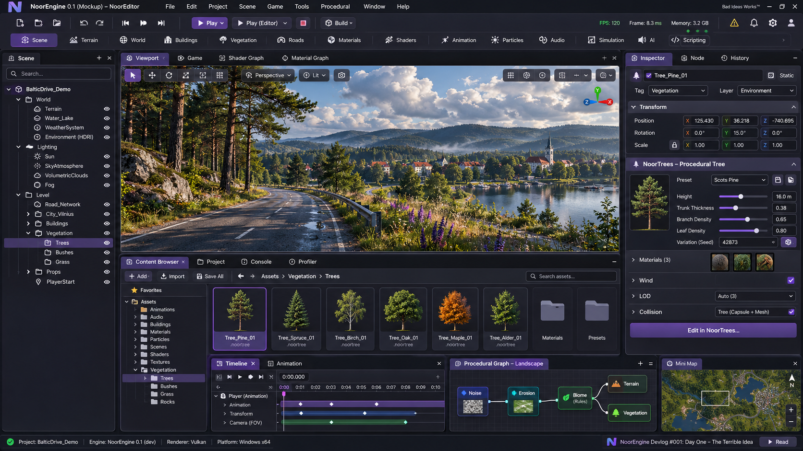
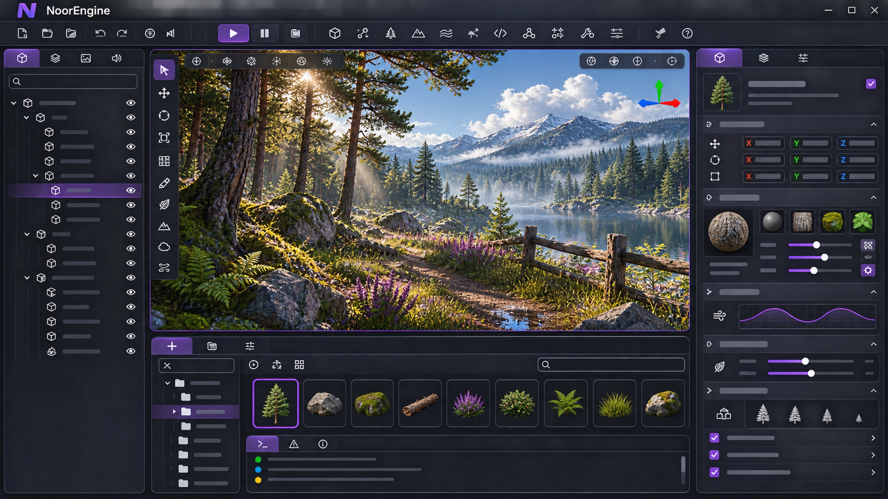
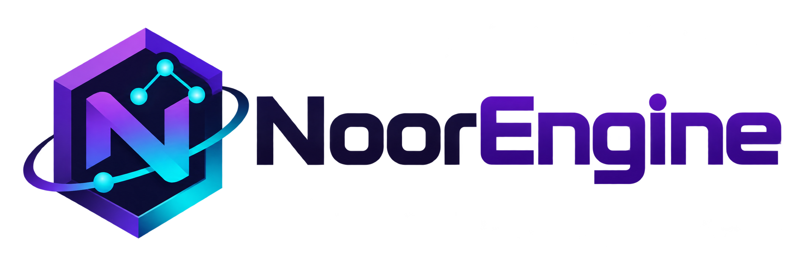
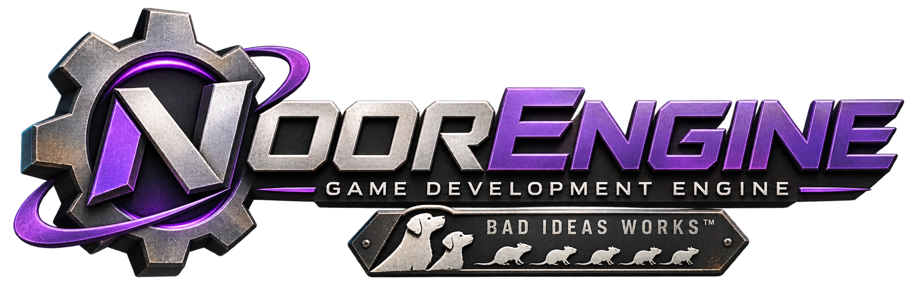
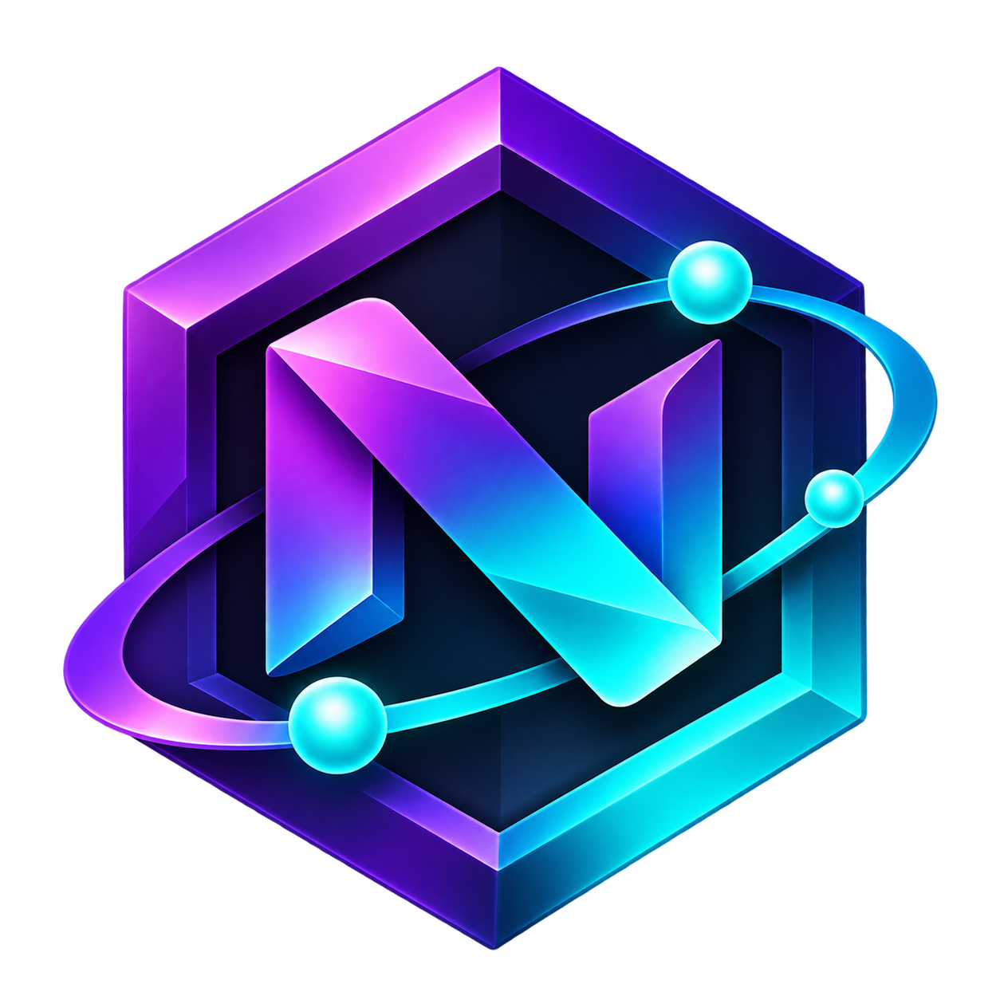

# NoorEngine Design Package

**Bad Ideas Works | Concept and engineering planning bundle | 2026-11-15**

> We are building our own engine. We have excellent reasons. They remain classified.

## Open these first

1. **[`NOORENGINE_MASTER_SPEC.md`](NOORENGINE_MASTER_SPEC.md)** — the complete, extensive product vision and actionable technical design brief (36 major sections, roadmap, module catalog, examples, quality gates and first engineering tasks).
2. **[`docs/SAGE_START_HERE.md`](docs/SAGE_START_HERE.md)** — a concise handoff for Sage: what to do first and what **not** to rush into.
3. **[`docs/DEVLOG_001_DAY_ONE.md`](docs/DEVLOG_001_DAY_ONE.md)** — funny but factually honest draft of the first public devlog.
4. **[`docs/ART_ASSET_MANIFEST.md`](docs/ART_ASSET_MANIFEST.md)** — explanations of all included editor mockups and logo/icon concepts.

## Artwork

### NoorEditor mockups

### Wordmarks

### Emblem

## Important distinction

Everything in the artwork is **concept art**. The specification describes what NoorEngine **should become**. Nothing in this archive claims that NoorEditor, its renderer or its sample games have already been implemented.

## Working philosophy

- A serious engine, not a fork or disposable prototype.
- Existing libraries and open-source solutions are allowed after license/engineering review.
- No forced public "test releases"; do use private development builds and automated testing.
- Stable foundations before complex toolsets.
- C#, Lua, attractive GUI, procedural tools, projects, examples, diagnostics.
- Funny devlog from the first actual day of development.

**Studio motto:** Code shall remain understandable to whichever AI inherits this mess.
