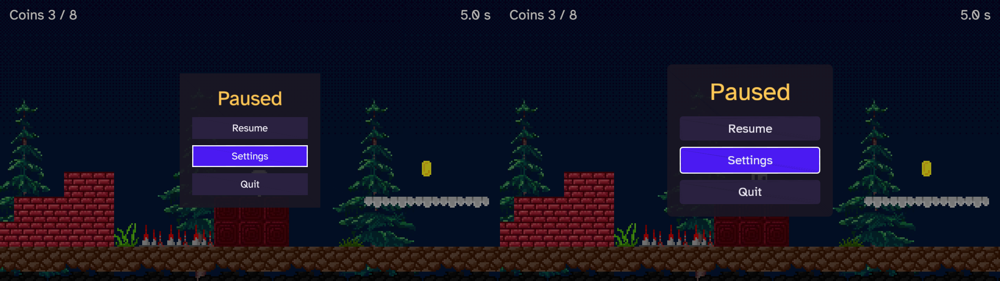

# ADR-041: Game UI, our own widgets or RmlUi

**Status:** Accepted (Tom, 2026-11-21, after the spike and the licences were explained)
**Date:** 2026-11-21

## Context
Gameplay foundations, part 6 ([plan](../milestones/M9_GAMEPLAY_PLAN.md)): games need real UI. Pause menus, settings with
sliders and toggles, inventories with scrolling lists, text boxes for names, dialogue, with layout that adapts, themes,
focus moved by keyboard and gamepad, made in a UI editor. Today there's only the HUD: rectangles and SDF text a script
draws every frame (`noor.ui`).

The plan said: build the same pause menu both ways, then decide. That's what this ADR is based on.

## The spike
`tools/ui_spike` (built only with `-DNOOR_UI_SPIKE=ON`; it fetches RmlUi 6.3 and FreeType 2.14.3): the same pause menu
(a dimmed screen, "Paused", Resume / Settings / Quit, focus on Settings, the same colours and font) made with

- **A, our own widgets:** a small retained tree (panels that stack, labels, buttons, focus), read from a JSON layout,
  laid out in the HUD's 720-unit space, drawn as HUD commands (`own_ui.cpp`, 204 lines; `pause.json`, 6 lines);
- **B, RmlUi** (MIT): an RML document styled with RCSS, its HTML/CSS-like files (`pause.rml`, 40 lines); our side is a
  render interface and a system interface (`rml_ui.cpp`, 119 lines).

Both draw through one CPU rasterizer into pictures, over a frame of NoorPlatformer:

*Left: our own. Right: RmlUi. (The faint diagonals in RmlUi's buttons are the spike rasterizer blending shared triangle
edges twice; a GPU doesn't.)*

| | A: our own | B: RmlUi |
|---|---|---|
| The menu | Close, but every piece hand-made: centring, stacking, the focus frame | Rounded corners, flexbox, `:focus` styling, from the stylesheet |
| Cost a frame (layout and triangles) | 0.014 ms (re-reading the JSON every frame, on purpose) | 0.002 ms (it keeps laid-out geometry until something changes) |
| What exists already | What we write | Flexbox and block layout, text boxes (selection, clipboard), scrolling, images, transitions and animations, data binding to models, spatial navigation for keyboard and gamepad (`nav-up` and friends), a debugger, 54,000 lines that games have shipped with |
| Text | Our SDF text: sharp when scaled, one renderer with the HUD | FreeType bitmaps per size (hinted, crisp at that size); a second text renderer beside the HUD's |
| Authoring | Our JSON; the editor's UI builder is ours to make | RML and RCSS, readable by anyone who's seen HTML and CSS; the editor's UI builder is still ours to make, and can show a live RmlUi page |
| Scripts | Ours to design (Lua and C# the same) | Its Lua plugin is for standard Lua, not Luau: we bridge Lua and C# ourselves (events, data models) |
| Renderer work | Textured, scissored overlay drawing (images, scroll areas) | The same: textured, scissored geometry and textures it creates |
| Size | Small | The spike (our game library, RmlUi and FreeType) is a 6.6 MB program |
| Licences | Ours | RmlUi MIT; FreeType's own licence (BSD-style, credit in the docs) |

## Decision
**RmlUi**, behind our own API. Games and the editor talk to `noor.ui` (Lua), `Ui` (C#) and `.noorui` documents (RML
files under our name and our docs); RmlUi stays an implementation detail of the `ui` module, so it could be replaced
without breaking games. The HUD stays as it is for quick text and bars (`noor.ui.text`, `noor.ui.rect`).

Why: the renderer work is the same either way, and everything after it (layout, text input, scrolling, animation, data
binding, gamepad navigation) is years of work RmlUi has already done and others have shipped with. My lean before the
spike was our own; the spike showed the gap is much bigger than the look of one menu.

## Consequences
- The `ui` module wraps RmlUi: render interface on the Vulkan renderer (textured, scissored geometry), system and
  file interfaces on our platform and project, input from our input map (gamepads come with part 6b).
- Fonts: FreeType becomes a dependency. The HUD keeps its SDF font; UI documents use FreeType.
- Scripts: our own bridge for Lua (Luau) and C#: events on elements (`click`, `change`), data models bound from scripts.
- The editor's UI builder (later in part 6) edits `.noorui` files and shows them live with RmlUi.
- Built games carry RmlUi and FreeType (statically linked) and their licence notices (from part 6a: `licenses/`).

## Notes since
- 6c: RmlUi's effects (filters, layers, masks, gradients, transforms) run in our Vulkan renderer, in the UI's own layers
  blended in sRGB like a browser; a frosted panel blurs the game behind it ([Game UI](../ui/GAME_UI.md#effects)).

## Open
- Text quality at large sizes, and on 4K screens: FreeType renders each size it's asked for; check memory with many sizes.
- Whether to move the HUD to RmlUi too later (one text renderer) or keep both.

## Reviewed by
Sage (spike and recommendation); Tom (accepted, 2026-11-21).
