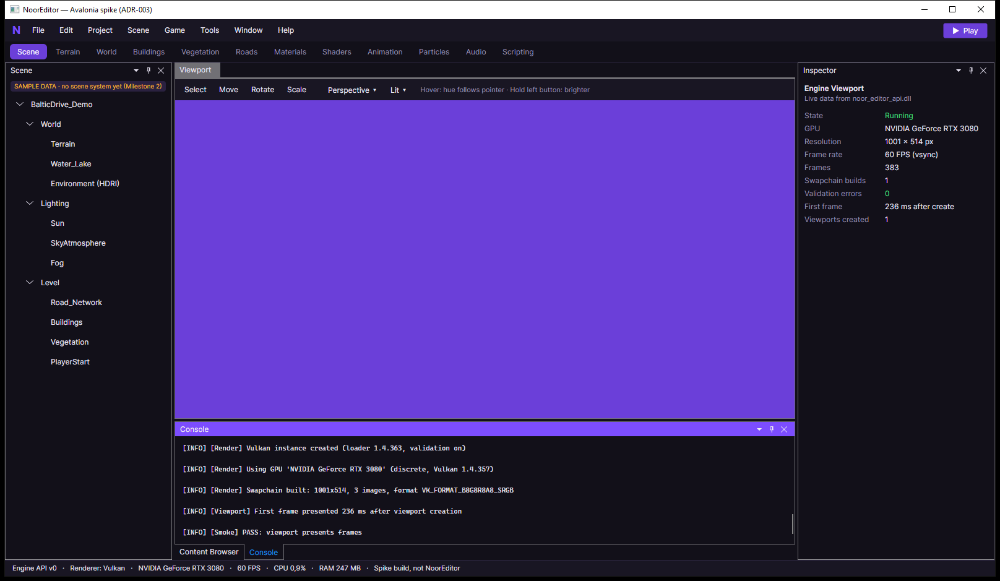
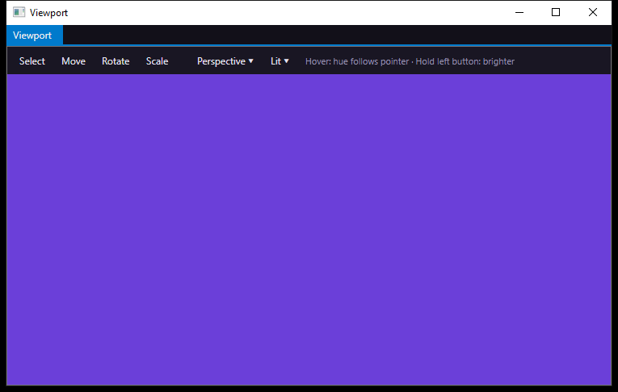

# NoorEngine Devlog #003 — The Purple Rectangle Gets a Job

**Date:** 2026-11-15
**Build / commit:** Avalonia viewport spike (ADR-003)

## This week we actually did

Last time, we had a purple rectangle in a window. Today the purple rectangle moved into an
office. It has colleagues now: a Scene panel, an Inspector, a Console and a Content Browser.

The question was simple and expensive: **what should NoorEditor's user interface be built
with?** Tom's earlier experiment with ImGui was retired with full honours. The candidate was
**Avalonia**, a modern C# UI framework, plus a docking library called **Dock**. Instead of
trusting screenshots on the internet, we built a test editor and made it prove itself.

*This is a real screenshot, taken by the spike's automated test.* The purple area is the
engine's actual Vulkan viewport, drawn by the engine on its own thread. The Inspector and the
status bar show live engine data. The Console shows the engine's real log. The scene tree and
the content browser are **sample data**, and they say so in yellow.

## Build of the Week 🏆

An automated test that opens the editor, measures it, resizes it, rips the viewport out into
its own floating window, and checks that nothing broke:

| | |
|---|---|
| Frame rate | 60 FPS (the monitor's vsync limit) |
| Viewport created → first frame | 236 ms |
| Program start → first frame | 1.6 s |
| Floated viewport → rendering again | 363 ms |
| Vulkan validation errors | 0 |
| CPU | under 1% of the machine (Debug build) |

Verdict: **Avalonia it is** (ADR-003 is now *Accepted*).

## Sage vs. Reality

1. **The empty office.** The first run showed "No documents open" and nothing else. The
   docking library's builder politely accepted our panels and then put none of them in.
   We now add them by hand, and the test prints the whole layout tree to prove it.
2. **The screenshot incident.** The first version of the screenshot code copied whatever was
   on screen at the window's position. Tom had another app open on top. The screenshot was of
   *that*. It was deleted on the spot, and the capture code now asks our own window to draw
   itself (Win32 `PrintWindow`), so it can never photograph anything else again. Lesson: tests
   that take screenshots must only ever see their own app.
3. **The floating window that never floated.** Dock needs to be told how to create floating
   windows. Without that, "float this panel" just quietly removed the viewport. One line later,
   it floats.

## What Could Possibly Go Wrong

Native windows inside UI frameworks have a classic problem called *airspace*: the engine's
viewport always draws on top, so docking hints could hide behind it when you drag panels with
the mouse. Our test floated the panel with code, not by dragging. That, plus high-DPI screens,
is next on the checklist.

## Known limitations
- **Update:** a real human hand (Tom's) has now tested it. The hue follows the mouse, clicking
  flashes it brighter, and dragging panels around to dock them works.
- Not yet tested: high-DPI (125%+), live drag-resize, and keyboard focus.
- Every viewport creates its own GPU device, so floating takes ~360 ms. The real editor will
  share one device.
- The floating window's tab is Windows-blue instead of Noor-purple. A crime, soon corrected.
- This is a spike, not NoorEditor. The Play button does nothing. It says so if you hover it.

## Next engineering target
- CI for unit tests on GitHub Actions.
- Shared Vulkan device for multiple viewports.
- Milestone 1: GPU memory allocation, shaders, the first real triangle.

## Bad Ideas Works Award for Questionable Decisions
**Winner:** Building an entire fake editor around a purple rectangle just to find out whether
a UI library is good.
**Defence:** It was. And the purple rectangle now has a business card.

---
*Bad Ideas Works — Code shall remain understandable to whichever AI inherits this mess.*
