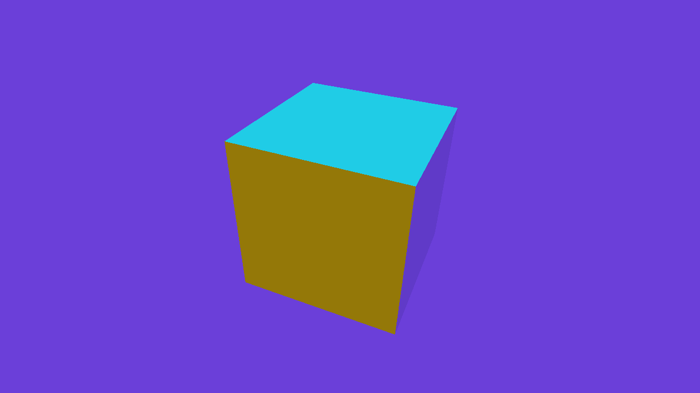

# NoorEngine Devlog #004 — The Triangle Was a Cube All Along

**Date:** 2026-11-15
**Build / commit:** Milestone 1, first increment

## This week we actually did

Every engine's rite of passage is the first triangle. Our spec even warns about it: *"A rotating
triangle is a valid technical test, not a NoorEngine release."* So we skipped the triangle and
drew twelve of them, arranged as a cube, because we are mature professionals.

*Real frame, copied back from the GPU by the engine itself (`noor_diag --screenshot`).*

What it took to get here:
- **A math library** with written-down conventions (ADR-022): right-handed, +Y up, meters,
  and *reverse-Z* depth, a trick that keeps distant mountains from flickering in big worlds.
- **Shaders** written in HLSL, compiled during the build by DXC, baked into the engine.
- **GPU memory management** with VMA, a well-tested open-source allocator.
- **Meshes, a depth buffer, a pipeline and a camera.** The renderer now draws things, not just
  colors.

## Build of the Week 🏆

A test that looks at the picture. The renderer can now copy a finished frame back from the GPU,
and an automated test checks real pixels:

| Probe | Expected | Got |
|---|---|---|
| Background corner | exactly Noor purple `#6B3FD9` | `#6B3FD9` ✅ |
| Cube front face | purple-ish | `#613BC9` ✅ |
| Cube top face | cyan-ish | `#1FC4DD` ✅ |

That one test proves the color conversion, the camera projection, triangle winding and the depth
buffer all work, on every run.

## Sage vs. Reality

**The test that had never failed.** All 27 tests passed on the first try, which is when an engineer
should get nervous. A test that has never failed might not be able to fail. So we sabotaged the
engine on purpose and flipped the triangle winding. The cube turned inside out, the test saw the
dim orange inside of the back face where cyan should be, and failed loudly. Sabotage reverted.
The test has now earned our trust.

## What Could Possibly Go Wrong

Look closely at the screenshot: the cube's purple face is nearly invisible against the purple
background. Noor's color scheme is so consistent that it camouflages our own geometry. This is
not a bug. It is a *brand*.

## Known limitations
- One hard-coded shader and one light. Materials, textures and real lights are later milestones.
- Uploading a mesh waits for the GPU to finish; deleting one waits for the whole GPU. Fine for a
  cube, not for a forest.
- The editor viewport still only shows a purple clear; it doesn't draw meshes yet.
- Still on the Milestone 1 list: input services, GPU timing markers, device-loss recovery, and
  stress tests.

## Next engineering target
- GitHub Actions CI for the unit tests.
- Milestone 1, continued: input, a free-fly camera, GPU timings, more than one mesh.

## Bad Ideas Works Award for Questionable Decisions
**Winner:** Painting the background the same color as the cube.
**Defence:** Brand consistency is a feature.

---
*Bad Ideas Works — Code shall remain understandable to whichever AI inherits this mess.*
