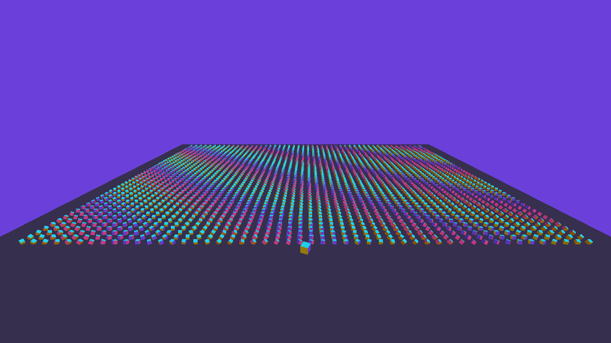

# NoorEngine Devlog #005 — 2,500 Cubes Walk Into a Bar

**Date:** 2026-11-15
**Build / commit:** Milestone 1, second increment

## This week we actually did

Last time we had one cube. You could look at it. You could not do anything else.

Now you can **fly**. Hold the right mouse button to look around, WASD to move, Q and E to sink
and rise, Shift to hurry, mouse wheel to change speed. The cube finally has a floor to stand on,
and if you ask nicely (`noor_diag --cubes 2500`) it gets 2,500 friends.

*Real frame, read back from the GPU. Every cube is its own draw call and spins on its own schedule.*

New under the hood:
- **Keyboard and mouse input**, by physical key position, so WASD stays WASD on French and German keyboards.
- **A free-fly camera**, with seven unit tests making sure "forward" is forward and looking down
  doesn't make you dive into the floor.
- **GPU timing.** The engine now asks the graphics card how long each frame took.
- **Clear errors when the GPU crashes.** Instead of a cryptic code, you get a plain explanation
  and a hint to grab a RenderDoc capture.
- **A stress test** with 2,500 cubes and validation layers on, in the automatic test suite.
- **CI.** GitHub now builds and tests every change automatically. Its first run failed because
  GitHub's machines didn't have the Visual Studio version we'd hard-coded, so now CI finds
  whatever version is there.

## Build of the Week 🏆

| 2,500 cubes, 2,502 draws/frame | CPU per frame | GPU per frame |
|---|---|---|
| Release, validation **on** | 9.0 ms | 0.085 ms |
| Release, validation **off** | **0.38 ms** | 0.061 ms |

Measured on an RTX 3080 at 1280×720. The screen refreshes at 60 Hz, so the engine spends most of
each frame waiting for it.

## Sage vs. Reality

The first stress run reported **10 milliseconds** of CPU time to draw 2,500 cubes. That's a lot.
Sage prepared a speech about optimization.

Then we measured properly: the Vulkan validation layers check every single command we send, and
that checking took **96%** of the time. Without them, the engine needs 0.38 ms. The speech has been
filed under *Measure Before Optimizing*, which is rule 14 of our own spec.

## What Could Possibly Go Wrong
2,500 separate draw calls is the slow way to draw 2,500 identical cubes. GPUs can draw thousands of
copies in one call (*instancing*). We'll do that when a real scene needs it, which a forest will.

## Known limitations
- If the GPU crashes, we explain it clearly, but you still have to restart. Recovering by
  itself is not implemented yet.
- Minimizing the window and moving it between monitors still haven't been tested.
- One light, vertex colors, no textures. Materials come in Milestone 5.

## Next engineering target
- Close out Milestone 1: minimize/restore and multi-monitor checks, then decide what's left.
- Milestone 2: projects, assets and scenes, including importing Noor Interchange GLB files.

## Bad Ideas Works Award for Questionable Decisions
**Winner:** Adding 2,500 cubes to find out whether one cube was fast.
**Defence:** Now we know. Also, it looks like a very organised rave.

---
*Bad Ideas Works — Code shall remain understandable to whichever AI inherits this mess.*
