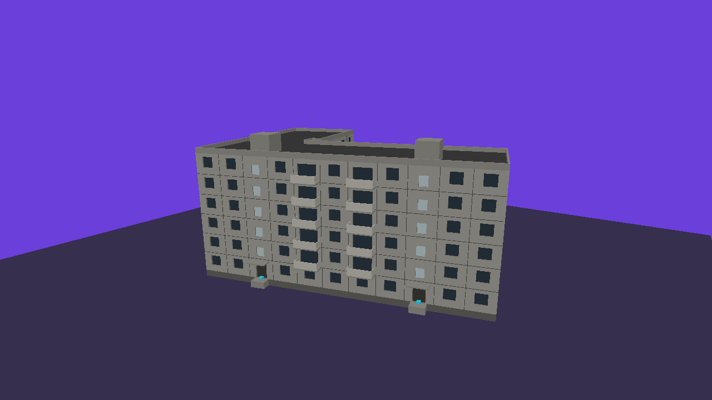

# NoorEngine Devlog #007 — A Panel Block Moves In

**Date:** 2026-11-15
**Build / commit:** Milestone 2, first increment

## This week we actually did

Until today, NoorEngine could draw cubes and forget them the moment you closed the window. Today
it learned to **remember things**, and its first real guest moved in: a Warsaw panel block,
generated by our own building generator, BadBuilding.

*Real frame from NoorEngine. The building was generated by BadBuilding from an OpenStreetMap
footprint and exported in our Noor Interchange format. The small cyan cubes on the steps are the
entrance markers, the hints a game uses to know where people walk in.*

What's new:
- **Projects.** A folder with a `.noorproj` file, an `Assets/` folder and a `Scenes/` folder.
- **Every asset gets a permanent ID**, stored in a little `.noormeta` file next to it. A building
  from BadBuilding keeps the ID BadBuilding gave it, so regenerating it doesn't break anything.
- **Scenes** are saved as plain text that Git can show line by line. Saving the same scene twice
  produces exactly the same file, byte for byte.
- **A GLB importer** that reads geometry, colors, the node hierarchy and all the Noor Interchange
  data: entrances become markers, the invisible collision mass becomes a collider.
- **`noor_cli`**, a command-line tool that creates projects, imports assets, builds scenes and
  checks them, without opening a window. CI runs it on every push.

## Build of the Week 🏆

The test that guards Milestone 2's most important promise: **you can move or rename a file and
nothing breaks.** It builds a scene with the building, renames the file inside the engine, then
moves it to a different folder *behind the engine's back*, the way you would in Windows Explorer.
The engine recognizes the file by its content, re-attaches its ID, and the scene still works.

Then it deletes the file, and the engine correctly says which entities are now missing a building.

## Sage vs. Reality

All the new tests passed on the very first run, which, as regular readers know, makes us nervous.
So we read the test's own log line by line and checked every step really happened, and that the
failure at the end failed for the right reason.

The one real surprise came from the data: BadBuilding's random seed for this building is
**13,795,972,169,680,155,491**, a number too big for the "normal" kind of 64-bit integer. An engine
that read it carelessly would silently turn it into a negative number, and regenerate a different
building. It's now written down as a rule: seeds are read as *unsigned* 64-bit numbers.

## What Could Possibly Go Wrong
The engine only reads base colors for now, no textures. That's fine for BadBuilding's blockout
look, but a forest of trees from NoorForm will need textures. Proper materials are Milestone 5.

## Known limitations
- No undo/redo, prefabs or automatic reload of changed files yet (rest of Milestone 2).
- Moving an asset inside the engine doesn't take its BadBuilding side files (recipe, manifest) along yet.
- LOD files are recognised but only the most detailed version is shown.

## Next engineering target
Milestone 2, continued: undo/redo, prefabs, hot reload of changed assets, and file format migrations.

## Bad Ideas Works Award for Questionable Decisions
**Winner:** Testing a game engine's file system by secretly moving a Soviet-era apartment block
between folders.
**Defence:** The block didn't notice. Neither did the scene. That was the point.

---
*Bad Ideas Works — Code shall remain understandable to whichever AI inherits this mess.*
