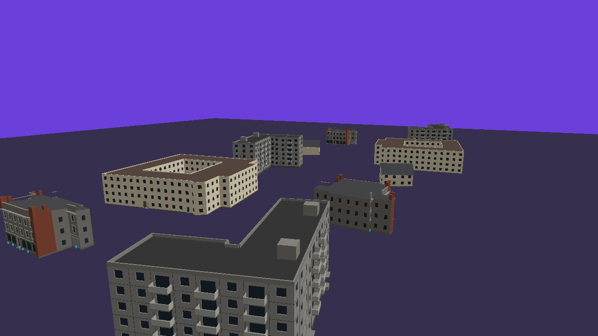

# NoorEngine Devlog #009 — One Street, Four Buildings, Twelve Copies

**Date:** 2026-11-15
**Build / commit:** Milestone 2 complete

## This week we actually did

**Prefabs.** You build something once, a building, a street lamp, a bus stop, save it as a
prefab, and place it as many times as you like. Change the prefab, and every copy changes. Change
*one* copy (rename a wall, move a window, remove the balconies) and that copy remembers its own
changes, while still following everything else from the original.

*Real frame. Four buildings generated by BadBuilding (a PRL panel block, a pre-war tenement, a
courtyard block and a house), each turned into a prefab, then placed twelve times along a street.*

The scene file for that street contains **12 entries**: one per building, saying only which prefab
and where. When NoorEngine loads it, the prefabs unfold into **412 objects**. Edit a prefab and
the street updates by itself, live, while it's on screen.

Also in the box:
- Prefabs inside prefabs ("a street prefab made of lamp prefabs"), and *variants* (a prefab that is
  another prefab with a few changes).
- Protection against a prefab that contains itself. Yes, someone will try. NoorEngine now says
  "that's a cycle" instead of trying forever.
- Every object unfolded from a prefab gets the same ID on every load, on every computer, so
  nothing that points at it ever breaks.

## Build of the Week 🏆

A test that turns the panel block into a prefab and then checks that **every single mesh** of the
unfolded copy sits in *exactly* the same place as before, to a tenth of a millimetre. Prefabs that
move things around by accident would be worse than no prefabs at all.

## Sage vs. Reality

The script that built the demo street failed with a mysterious "Clear-Item" error. It turns out
that in PowerShell, `cli` is a built-in shortcut for *Clear-Item*. Sage had named a helper
function `Cli`. PowerShell helpfully tried to clear the project folder instead of running our tool.
It didn't succeed. The helper is now called `Invoke-Noor`, and we are all a little older.

## Milestone 2: done ✅

Projects, permanent asset IDs that survive renames and moves, a GLB importer for our generators'
buildings, saved scenes, undo/redo, format upgrades with backups, hot reload and prefabs. The full
review, with evidence for every requirement and five honestly listed exceptions (textures being
the big one), is in `docs/milestones/M2_REVIEW.md`.

## Next engineering target
**Milestone 3: NoorEditor.** Everything built so far finally gets a face: a real editor window
with the scene tree, an inspector, a content browser and an undo button.

## Bad Ideas Works Award for Questionable Decisions
**Winner:** Naming a function after a command that deletes things.
**Defence:** It was a very short function. It is now a very careful function.

---
*Bad Ideas Works — Code shall remain understandable to whichever AI inherits this mess.*
