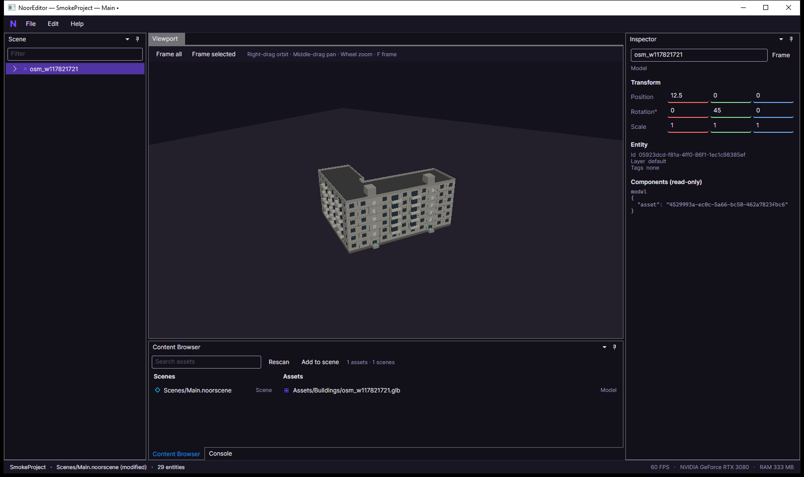
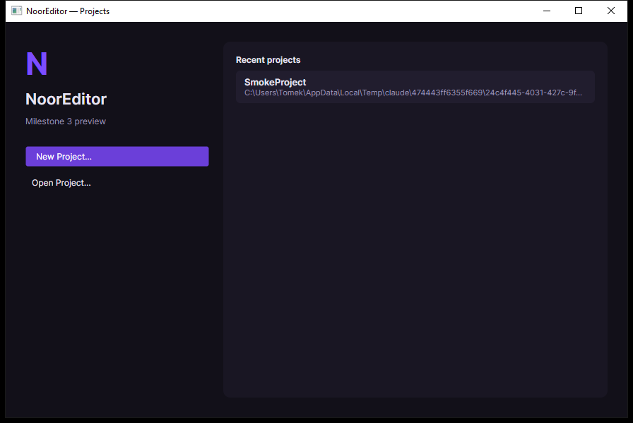

# NoorEngine Devlog #010 — The Engine Gets a Face

**Date:** 2026-11-15
**Build / commit:** Milestone 3, part 1

## This week we actually did

**NoorEditor exists.** Not a mockup or a spike with sample data: a real editor window where
you open a project, drop a building into a scene, move it, turn it, rename it, undo all of it,
and save.

*Real screenshot, taken by the editor's own self-test. The panel block was placed from the
Content Browser, then moved to x = 12.5 and turned 45° by typing into the Inspector.*

What's in it:
- **A project hub**: your recent projects, plus New and Open.
- **The viewport**: the engine draws the scene on its own thread. Right mouse button orbits,
  middle button pans, the wheel zooms, **F** frames whatever you selected.
- **Scene tree**: everything in the scene. Things that come from a prefab are shown greyed out,
  because you change those in the prefab, not in the copy.
- **Inspector**: name, position, rotation and scale. Every value you change is one undo step.
- **Content Browser**: your scenes and models. Double-click a model and it lands in the scene.
- **Console**: what the engine is saying.
- **Ctrl+Z, Ctrl+Y, Ctrl+S** do what you'd expect, and the editor asks before throwing away
  unsaved work.

## The important invisible part

The editor doesn't keep its own copy of the scene. The **engine** owns the scene, the undo
history and the asset list; the editor shows what the engine tells it and asks the engine to
make every change. So there is exactly one truth, and every change made from anywhere is
undoable. (Decision record: ADR-025.)

## Build of the Week 🏆

The editor tests itself. One command builds it, opens it, creates a project, adds a building
*through the same code a double-click uses*, types into the inspector (including `12,5` with a
comma, because that's how Polish keyboards type decimals), undoes, redoes, saves, reads the saved file back,
deletes the building, brings it back, tears the viewport off into its own window, and fails if
the GPU or the engine complained even once. 27 checks, about 15 seconds.

## Sage vs. Reality

Sage wrote a tidy little `Transform` type for positions and rotations. The compiler pointed out
that Avalonia, the UI library, *also* has a `Transform`, and asked which one we meant. In fairness,
the other one rotates buttons. Ours rotates apartment blocks. They now have separate names.

## Not yet (honestly)

No move/rotate handles in the viewport yet, no clicking on objects in the viewport to select
them, components are read-only, and there's no Play button. The panel layout isn't remembered
between runs yet (the window size is).

## Next engineering target
**Milestone 3, part 2**: gizmos (drag to move and rotate), clicking in the viewport to select,
a selection highlight, and saving your panel layout.

## Bad Ideas Works Award for Questionable Decisions
**Winner:** Giving an editor a self-test that opens windows on the developer's screen and clicks around.
**Defence:** It only takes pictures of its own windows. Sage checked. Twice.

---
*Bad Ideas Works — Code shall remain understandable to whichever AI inherits this mess.*
