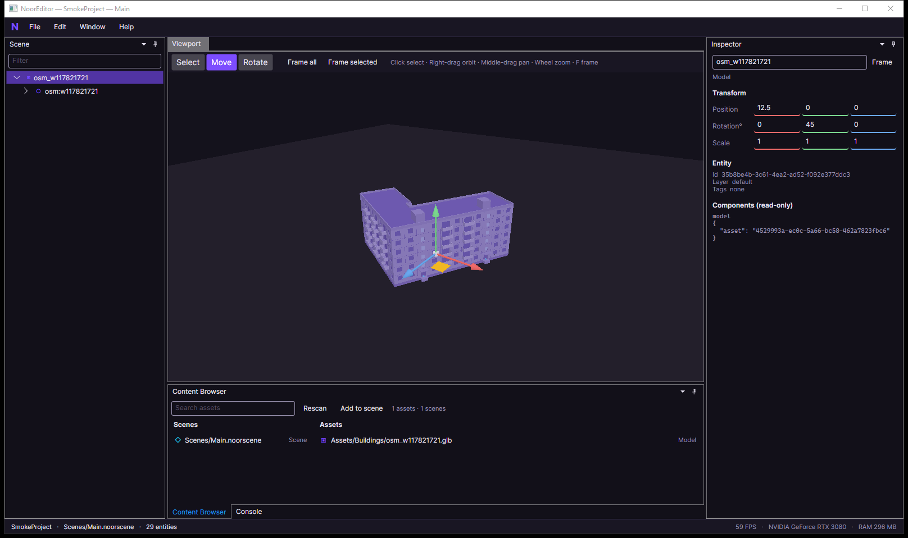

# NoorEngine Devlog #011 — Grab the Arrow

**Date:** 2026-11-15
**Build / commit:** Milestone 3, part 2

## This week we actually did

**You can click things now.** Click a building in the viewport and it's selected (it turns
purple). Click it again and you go one level deeper, to the part you clicked. Click the sky and
the selection goes away.

**And you can grab them.** Press **W** and three arrows appear on the selected object: drag the
red one and the building slides along X, the green one lifts it, the blue one moves it along Z,
and the little yellow square slides it across the ground. Press **E** and you get three rings:
drag one to turn the building. Let go, and that's one step in the undo history, labelled "Move"
or "Rotate".

*Real screenshots, taken by the editor's self-test in the middle of its own clicking around.*

Also: the editor now remembers how big you made your panels, and **Window ▸ Reset Layout** puts
everything back if you get creative.

## How it works, briefly

The viewport runs on its own thread and knows the camera, the mouse and the meshes, so that's
where clicks are turned into "you hit this wall of that building" and drags into "3 metres along
X". But the viewport is not allowed to change the scene. It *reports* what happened, and the
editor turns that into a normal, undoable command, the same kind the Inspector sends. While you
drag, the viewport shows a preview, so it feels instant. (Decision record: ADR-025, addendum.)

## Build of the Week 🏆

The self-test now uses the mouse. It sends mouse messages to the editor's own viewport window
(never to the rest of the desktop) and:
- clicks the building and checks the whole building got selected;
- clicks again and checks it went one level deeper;
- clicks the sky and checks the selection cleared;
- grabs the red arrow and drags it exactly 3 metres. Result: **3.019 m**. Close enough for the
  checks, and it's a mouse;
- grabs the green ring and turns the building 40°. Result: **39.6°**.

Then it undoes both, and checks that the panel sizes are saved and restored.

## Sage vs. Reality

The test's second click was supposed to go "one level deeper" into the building, and it kept
selecting the whole building again. The editor was fine. The second click landed on the
**green arrow**, which stands right in the middle of the building once it's selected, so the
editor (correctly) treated it as the start of a drag that went nowhere. The test now switches to
the Select tool first, like a person would. Sage has been outsmarted by an arrow.

## Not yet (honestly)

No snapping to a grid, no scale gizmo, the gizmo is always aligned to the world (not the object),
one object selected at a time, and the selection is a tint rather than an outline.

## P.S. Fly mode

Ten minutes after the first real try of the gizmos, the obvious question arrived: "no fly mode?"
Now there is. **Hold the right mouse button** and look around; **W A S D** fly, **Q** and **E** go down and
up, **Shift** goes 4x faster, and the wheel changes your speed. Orbiting moved to
**Alt + left-drag**, like in the big engines. The self-test flies too: it holds the right button,
presses W for 0.6 seconds, and measures how much closer it got to the building: 4.8 metres.

## Next engineering target
Finishing Milestone 3: snapping, a scale gizmo, and component editing in the Inspector, then the
milestone review.

## Bad Ideas Works Award for Questionable Decisions
**Winner:** Teaching a test to use a mouse.
**Defence:** It's the only user that never complains, never gets tired and always reports its
results to three decimal places.

---
*Bad Ideas Works — Code shall remain understandable to whichever AI inherits this mess.*
