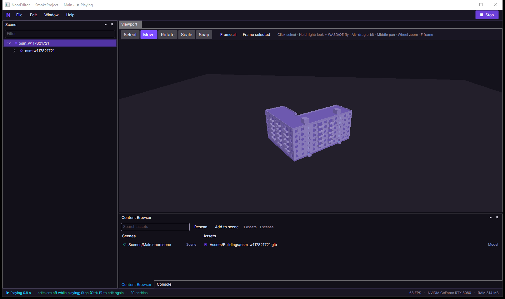
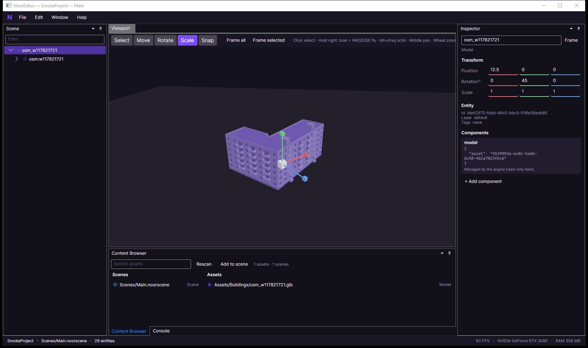
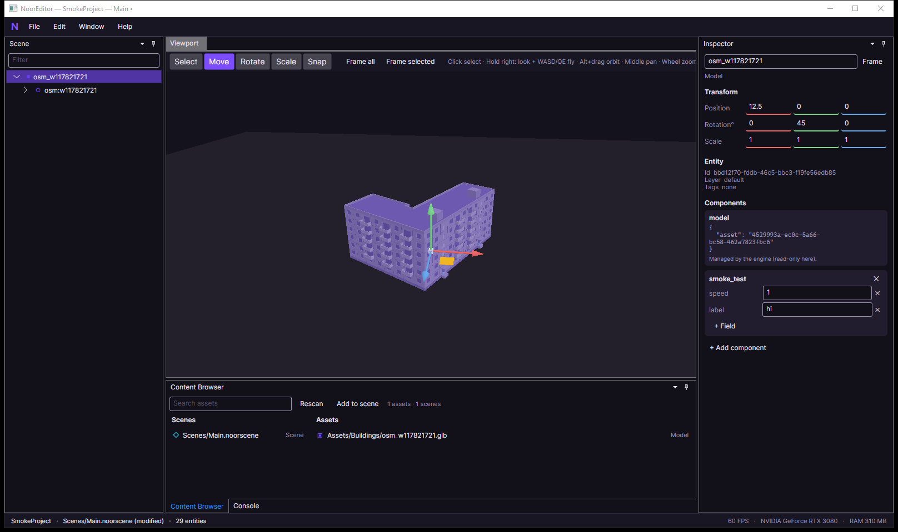

# NoorEngine Devlog #012 — Press Play

**Date:** 2026-11-15
**Build / commit:** Milestone 3 complete

## This week we actually did

**Milestone 3 is done.** NoorEditor can create a project, build a scene, save it, open it again,
and now **play** it.

**Play / Stop.** Press **▶ Play** (or Ctrl+P) and the engine runs a *copy* of your scene. There
are no scripts yet (that's Milestone 4), so the copy can only do one built-in trick: anything with
a `rotator` component spins. Press **■ Stop** and the copy is thrown away. Your scene is exactly
as you left it, because the copy was never your scene.

**The rest of the editing kit:**
- **Scale gizmo (R)**: handles along the building's *own* axes (they turn with it), plus a white
  cube in the middle to scale evenly.
- **Snapping**: switch on **Snap** and moves land on a 1 m grid, turns on 15° steps, scales on
  0.1 steps. Hold **Ctrl** while dragging to flip it for one drag.
- **Preferences**: fly speed, mouse sensitivity, gizmo size, snap steps.
- **Components in the Inspector**: edit numbers, text, on/off switches; add and remove fields and
  whole components. Every change is one Ctrl+Z.
- **Live reload**: if a building's file changes on disk (a generator rebuilt it, say), the editor
  notices and the viewport shows the new version within a second.

## Build of the Week 🏆

The editor's self-test now has **61 checks** and takes about 25 seconds. On top of last week's
clicking and dragging, it now:
- pulls the scale handle to double the width (result: **2.01×**);
- makes a snapped move that lands exactly on **x = 15**;
- rewrites the building's file on disk and waits for the viewport to say "Reloaded";
- tears the Inspector off into its own window, renames the building through it, and undoes it;
- adds a spinner at 30° per second, presses Play, waits a second (**29°**), tries to edit (refused,
  politely), presses Stop, and checks the building is back where it was.

## Sage vs. Reality

1. The first scale test failed, and it was right to. Clicking dead centre on the gizmo did a
   calculation with a line of length zero, which is the computer equivalent of dividing by
   zero. Fixed before it ever reached the editor.
2. A new undo test failed because the *test* kept a pointer to a scene snapshot that had already
   been thrown away. Once the test held on to the snapshot, it passed.

## The honest part: what's not done

The full review is in `docs/milestones/M3_REVIEW.md`. The big one: the milestone asks for HiDPI
to be **checked**. The editor's maths is built for it, and a test checks the pixel sizes match,
but so far that has only run on a 100% display. Someone needs to run it once at 125% or 150%.
Also: panels you drag to a different dock don't remember their new home yet, and new files
dropped into the project need a click on **Rescan** to appear.

## Next engineering target
**Milestone 4: scripts and everyday gameplay.** C# and Lua, input, physics basics, a character
you can walk around with, sound, and a build you can run outside the editor.

## Bad Ideas Works Award for Questionable Decisions
**Winner:** Shipping a "Play" button whose only game is "watch a building spin".
**Defence:** It's the most reliable game we've ever made. Zero bugs reported. Five stars from
the building.

---
*Bad Ideas Works — Code shall remain understandable to whichever AI inherits this mess.*
