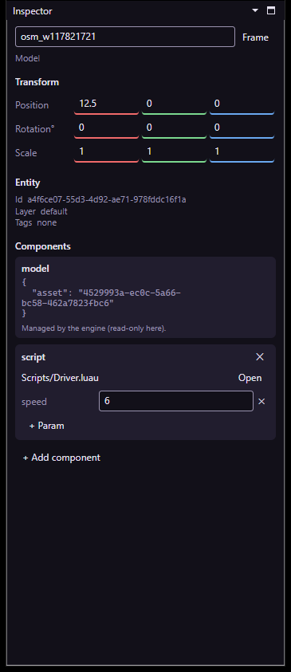

# NoorEngine Devlog #013 — The Buildings Take Orders

**Date:** 2026-11-15
**Build / commit:** Milestone 4, parts 1–2

## This week we actually did

**Milestone 4 started**, the one where scenes stop being pictures and start being games. First
we wrote down the big decisions: C# runs on .NET 10, physics will be **Jolt**, sound will be
**miniaudio**, and Lua will be **Luau**, the Lua dialect Roblox built so millions of strangers'
scripts can run without breaking anything.

**Part 1: a real game loop.** A new `runtime` module runs the game: every frame, in a fixed
order, with a steady 60-times-a-second beat for physics. Keys are named by what they *do* ("jump",
"move_x"), not what they *are*, so a project can remap them in one file.

**Part 2: Lua scripts.** In the Inspector: **Add component ▸ Lua script…**, type a name, and a
script file appears with a template. Write a few lines:

```lua
function Driver:on_update(dt)
    local x = noor.input.axis("move_x")
    self.entity:translate(vector.create(x * self.params.speed * dt, 0, 0))
end
```

Press Play, press D, and the building drives off down the street.



Scripts run in a **sandbox**: no files, no programs, no messing with the engine's own tables. A
script stuck in an endless loop is stopped after a quarter of a second. A script that crashes
says exactly where ("Driver.luau, line 7") and switches itself off for that object. The game
keeps running.

## Build of the Week 🏆

The editor's self-test is up to **74 checks**. The new ones create a Lua script through the
Inspector, write some code into it, give it a speed of 6 m/s, press Play and hold D for 0.6 s:
the building moved 3.4 m (the first frames of a key press are not instant, and that's fine).
Then they tap Space and check it turned exactly 90°, once, not once per frame.

## Sage vs. Reality

1. The editor's self-test suddenly failed every drag, by the same 8.869 m two runs in a row.
   The code was fine. When a mouse button goes down, Windows helpfully sends one "the mouse
   moved" message with the *real* cursor's position, and the real cursor was parked over the
   editor window. The test now feeds the viewport its own pretend mouse.
2. The first Lua test run: 6 of 8 passed, and 2 crashed. The scripts were fine; the *test* gave
   its pretend entity an id before deciding what the id was. C++ class members are created in the
   order you write them, not the order you'd like.

## Next engineering target
**Part 3: physics.** Jolt, colliders made from BadBuilding meshes, and a capsule that walks and
jumps around the street.

## Bad Ideas Works Award for Questionable Decisions
**Winner:** Teaching a five-storey panel block to drive.
**Defence:** It has excellent visibility from the driver's seat.

---
*Bad Ideas Works — Code shall remain understandable to whichever AI inherits this mess.*
