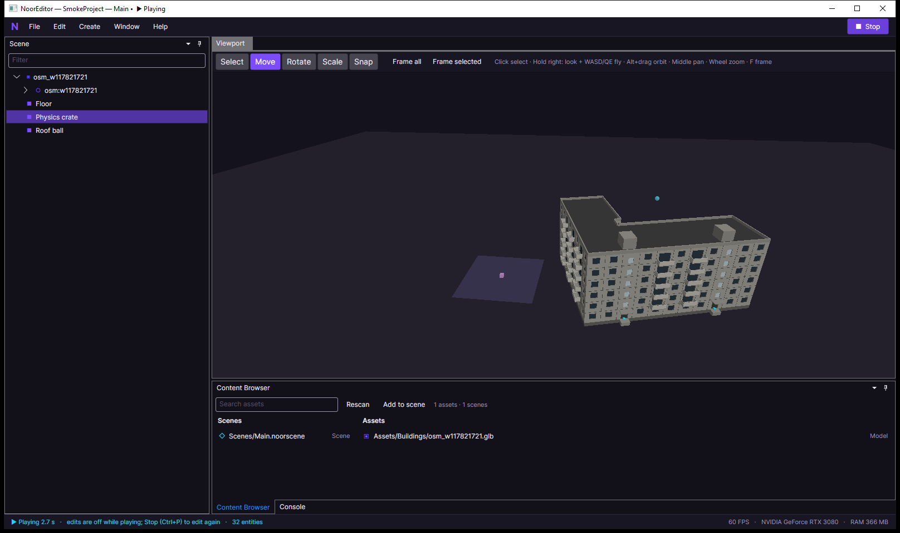
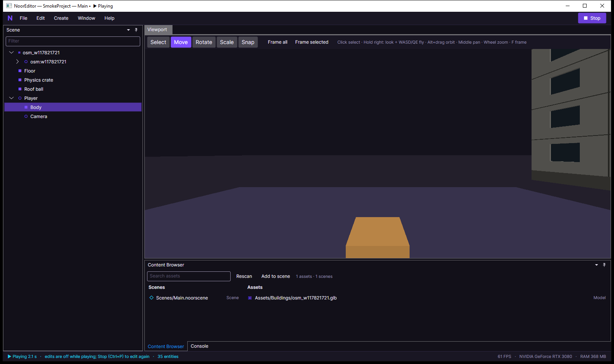

# NoorEngine Devlog #014 — Somebody to Walk Around

**Date:** 2026-11-15
**Build / commit:** Milestone 4, part 3

## This week we actually did

**Physics.** NoorEngine now uses **Jolt**, the physics engine behind some very large games. In
the editor: **Create ▸ Physics crate**, press Play, and it falls, lands and stays put. Balls
bounce. A static "mesh collider" turns a whole BadBuilding block into something solid: we dropped
a ball from 60 metres and it came to rest on the roof, 32 metres up.

**Somebody to walk around.** **Create ▸ Player (first person)** makes a player: a capsule that
walks, slides along walls, steps up kerbs, follows slopes and jumps, a camera at eye height, and
a short Lua script that does the steering. Press Play, click into the view (that grabs the mouse
for looking), and walk around with W/A/S/D. **Esc** always gives the mouse back.

*Real screenshots, from the editor's own self-test.*

The player script is plain Lua that you can open and change: walking speed, sprint, jump height,
mouse sensitivity are Inspector values; how they're used is twenty-odd readable lines.

## Build of the Week 🏆

The self-test got a body. It now creates a player on the floor, presses Play, checks that the
picture really comes from the player's eyes, holds W (3.1 m forward, feet still on the floor),
taps Space (a 1.23 m jump; the maths says 1.27 m for that jump speed), clicks to capture the mouse
and presses Esc to release it. 91 checks. It never takes your real mouse: it uses a pretend one.

## Sage vs. Reality

1. **The crate that kept leaving.** A crate lands on the floor and comes to rest. Physics engines
   save effort by putting resting objects to "sleep", and Jolt, when it does, quietly forgets
   what the sleeping object was touching. So scripts were told "the crate has left the floor"
   while it lay perfectly still on the floor. NoorEngine now notices that the crate fell asleep,
   not off, and only reports a real departure.
2. **The Space bar that pressed buttons.** In play mode, Space sometimes did nothing. It turned out
   the editor had passed it on to whichever editor button last had focus, and the button
   politely "clicked". Keys typed into the game view now stay in the game view.
3. **A test bug, twice.** Twice this week a test fixture handed out an id before deciding what the
   id was (C++ builds members in the order they're written). Both times the tests failed loudly,
   which is exactly their job.

## Next engineering target
**Part 4: C# scripts**, the same API as Lua, for people who prefer braces.

## Bad Ideas Works Award for Questionable Decisions
**Winner:** Dropping a ball onto a panel block from sixty metres, on purpose, in a test that runs
every time anyone builds the engine.
**Defence:** The building has never once complained.

---
*Bad Ideas Works — Code shall remain understandable to whichever AI inherits this mess.*
