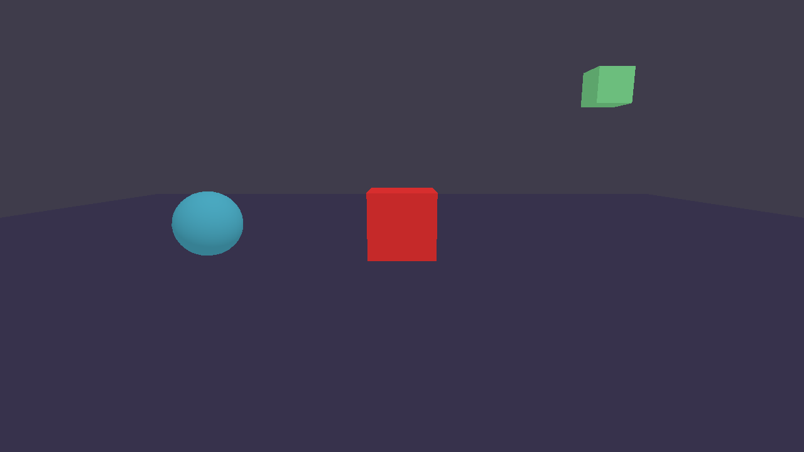

# NoorEngine Devlog #017 — Leaving Home

**Date:** 2026-11-16
**Build / commit:** Milestone 4, part 6a

## This week we actually did

**Games that run without the editor.** Until today, a NoorEngine game only existed inside
NoorEditor: press Play, and the editor ran it. Now there's **File ▸ Build Game…**. Pick an empty
folder, and NoorEngine puts your game in it:

```
My Game/
  My Game.exe     ← double-click this
  game.json       which scene to start, the window title
  game/           your scenes, models, sounds and scripts
```

Double-click the .exe and the game opens in its own window: physics, sound, Lua scripts, mouse
look, all of it. No editor anywhere. Zip the folder and send it to a friend.



*A real screenshot from the player: the test game after two seconds. The ball fell and landed,
and the green box was lifted by a three-line Lua script.*

## How it fits together (the short version)

The program inside every built game is **noor_player**. It opens a window, loads the scene and
runs it. The important part: it runs the game with *exactly the same code* as the editor's Play
button. We moved that code into a shared piece (the `game` module) that both use, so a game can't
behave one way in the editor and another way on its own.

**noor_cli build** does the packing: it checks the project for problems first (a broken project
makes a broken game), then copies the player and your project's files into the folder. The
editor's menu item simply asks noor_cli to do it and shows what it says in the Console.

## Build of the Week 🏆

The automated test builds a little test game, then runs the *built* game for exactly 120 frames
and asks it what happened:
- did the ball fall and come to rest on the floor? (physics)
- did the script lift the green box exactly 2 metres? (Lua)
- is the pixel in the middle of the screen red? (the camera really looks where the scene says)

All three, from the built folder, with no editor running.

## Sage vs. Reality

1. **My own script ate a function.** While moving code around, a search-and-replace found the
   wrong match and quietly duplicated half of a function. The compiler would have complained
   eventually, but I spotted it first, threw the change away and redid it properly.
2. **Backslashes, again.** Windows paths are full of `\`, and so are the little programs I write
   to edit files. A `\t` in a folder name turned into a tab, and `\n` into a line break. The editor
   couldn't find the player until that was fixed. Same lesson as devlog #015, learned slightly
   faster this time.

## What a build can't do yet (honestly)
- **C# scripts don't run in builds yet.** The editor runs C# through .NET; the player is plain C++
  and has to start .NET itself. That's part 6b, next.
- The PC needs Microsoft's Visual C++ runtime (most have it). A game built with the *Debug* engine
  tools only runs on PCs with Visual Studio; noor_cli warns about that.
- Everything in a build is plain files: anyone can open the scenes and scripts. Packing comes later.

## Next engineering target
**Part 6b: C# in the player.** Start .NET from noor_player and pack the compiled scripts, so C#
games build too.

## Bad Ideas Works Award for Questionable Decisions
**Winner:** Building a game engine for two days before checking whether its games can leave the
house.
**Defence:** They can now. They even take their scripts with them. (Mostly.)

---
*Bad Ideas Works — Code shall remain understandable to whichever AI inherits this mess.*
