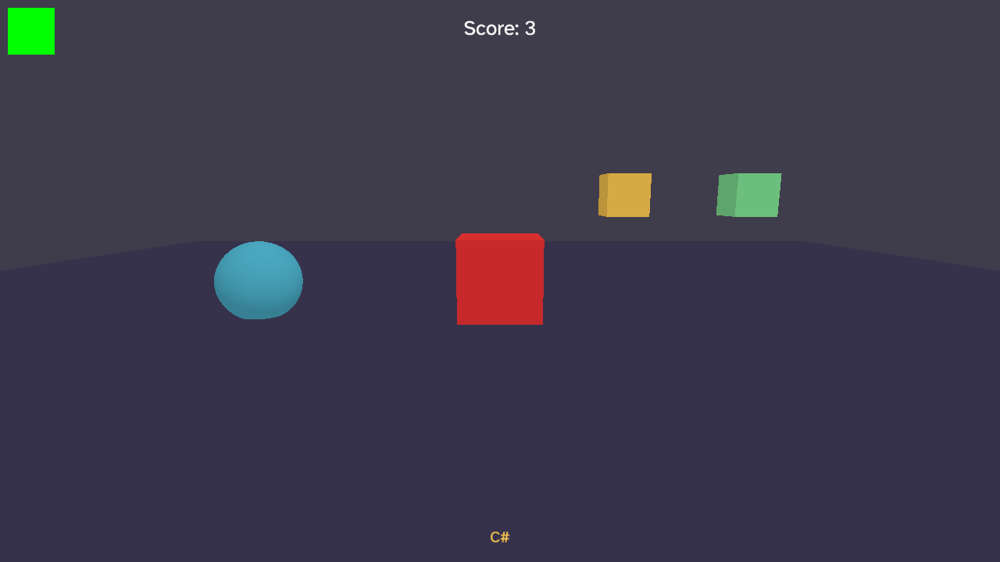
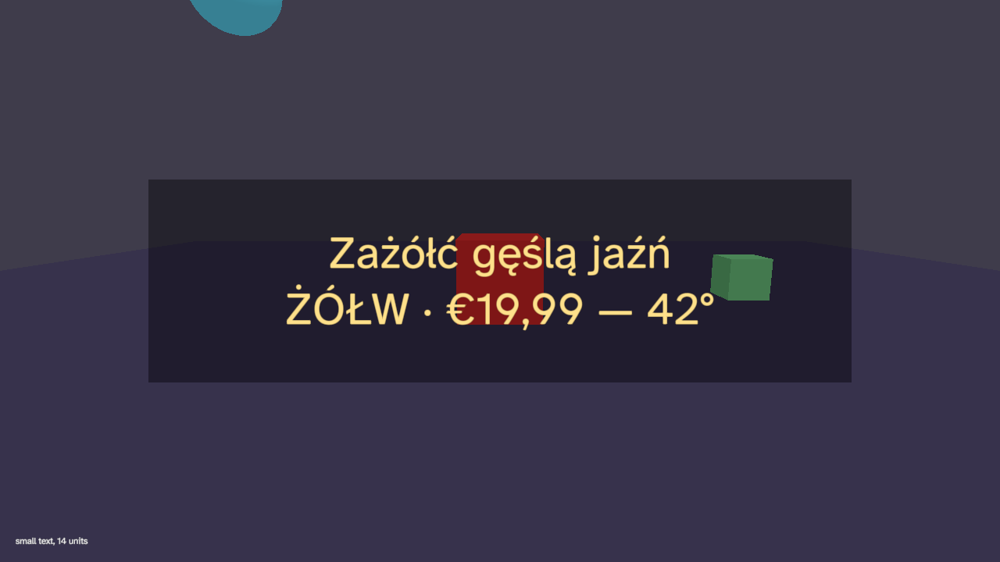

# NoorEngine Devlog #019 — Words on the Screen

**Date:** 2026-11-16
**Build / commit:** Milestone 4, part 7a

## This week we actually did

**A HUD.** Games can now put text and shapes on the screen: a score, a crosshair, a health bar,
"Press E to open". One line in a script:

```lua
noor.ui.text("Score: 3", 0, 20, { size = 32, anchor = "top" })
```

```csharp
Ui.Text("C#", 0, -20, 24, "#F2C14E", "bottom");
```



*A real screenshot of a built game. The green square and the score come from a Lua script, the
yellow label at the bottom from a C# script.*

Positions are measured in "UI units": the screen is always 720 units tall, so a HUD looks the
same in a small window and full screen. You say where something sits with an **anchor**: "top",
"center", "bottom right"... `anchor = "center"` puts it in the middle, which is exactly what a
crosshair wants.

The first-person player template uses it straight away: a small crosshair while you look around,
and a hint, "Click to look around · Esc gives the mouse back", until you've clicked.

## How it fits together (the short version)

The engine now draws in two layers: the 3D scene first, then a flat layer on top for the HUD.
Text comes from a font built into the engine, **Atkinson Hyperlegible**, made by the Braille
Institute to be easy to read (free, under the SIL Open Font License). When a game starts, the
engine turns each letter into a small "distance map" (for every pixel: how far it is from the
letter's edge). From that, letters can be drawn sharply at any size, tiny or huge.

And yes, it speaks Polish:



## Build of the Week 🏆

The automated test runs the built game and checks the *pixel* where the green square should be:
it has to be green. It also counts the triangles the HUD produced: 48 for the Lua test ("Score: 3"
is 7 letters plus the square), 60 when the C# label joins in. If a letter goes missing, the count
is off and the test fails.

## Sage vs. Reality

**The "n" that lost its arch.** Big text looked great. Small text, at 14 units, read "small text,
14 urits": the arch of the "n" had vanished. Letters are prepared at a large size and drawn
smaller, and at a quarter of the size each screen pixel was only looking at one point of the
letter, so thin strokes slipped between the points. Now every pixel looks at four points and
averages them. "units" is "units" again. No test would have noticed: this one was caught by
zooming into a screenshot.

**Caught by yesterday's trap.** Two of the new tests had a semicolon in their names, the exact
mistake that hid fifteen tests yesterday. This time the guard we added made them fail loudly
instead of passing quietly. Renamed in a minute. Traps work.

## Next engineering target
**Part 7b: NoorCode.** A code editor inside NoorEditor, so scripts can be written and fixed
without leaving it.

## Bad Ideas Works Award for Questionable Decisions
**Winner:** Testing the HUD with the sentence "Zażółć gęślą jaźń".
**Defence:** It contains every Polish letter with a tail, an accent or a dot. If the engine can
say it, it can say anything. (Tom can say it too, which is more than Sage can claim.)

---
*Bad Ideas Works — Code shall remain understandable to whichever AI inherits this mess.*
