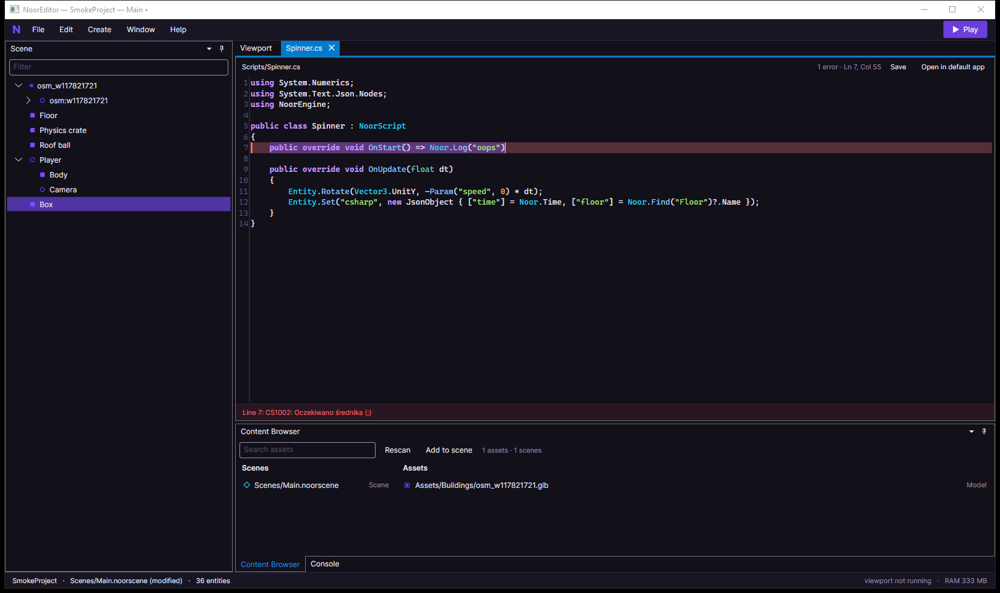

# NoorEngine Devlog #020 — A Place to Write

**Date:** 2026-11-16
**Build / commit:** Milestone 4, part 7b

## This week we actually did

**NoorCode, the first version.** Scripts can now be written inside NoorEditor. Click **Open** on a
script in the Inspector and it opens as a tab next to the viewport: Lua and C# in colour, line
numbers, find with Ctrl+F, Ctrl+S to save. If the game is running, it picks up the saved script
straight away, as before. Pressing Play saves your scripts first, the way an IDE's Run button does.

*A real screenshot from the editor's automated test. It typed a missing semicolon on purpose.*

**Errors point at their line.** When a script breaks (a Lua error, a C# compile error, a C#
exception), the line gets a red bar and the message appears under the editor. In the Console the
same error has a small `Spinner.cs:7 ↗` link: click it, and NoorCode opens the script with the
cursor on that line. No more counting lines in Notepad.

Prefer your own editor? Preferences ▸ Scripts still picks VS Code, Rider, Notepad++… NoorCode has
an "Open in …" button for it, or untick "Open scripts in NoorCode" to skip it altogether.

## How it fits together (the short version)

The text editing is **AvaloniaEdit** (MIT), the editor control from the Avalonia project we
already build the editor with. We wrote the colour rules for Lua and C# ourselves, in the editor's
own palette. Each open script remembers its text separately from the tab you see, so dragging a
tab out into its own window doesn't lose what you typed.

## Build of the Week 🏆

The automated test opens a script and types a missing semicolon. It presses Play, which saves the
script first. The compiler refuses, and the test checks that the red mark lands on line 7, that
the Console's link points at line 7, and that following the link puts the cursor there. It also
types the letter "e" into the script. Outside the code editor, E switches to the Rotate tool;
inside, it has to be just an "e". (Letters typed into code becoming editor shortcuts would have
been a very fun bug.)

## Sage vs. Reality

**"Oczekiwano Ļ›rednika".** The C# compiler talks in the PC's language, which here is Polish.
"Expected a semicolon" came out as "Oczekiwano Ļ›rednika": the "ś" was read in the wrong
character encoding. Both places that read the compiler's output now ask for UTF-8 and read it as
UTF-8. Found by looking at the screenshot, again.

## Not yet

This is the MVP. No code completion, no error checking while you type, no debugger. Those need
"language services" (Roslyn for C#, an analyser for Luau), and they're a bigger piece of work.
Open tabs aren't remembered between sessions yet either.

## Next engineering target
**Part 8: NoorFPS-lite**, a small sample shooter (walk, jump, shoot targets, sounds, HUD) in C#
with a Lua twin, and then the Milestone 4 review.

## Bad Ideas Works Award for Questionable Decisions
**Winner:** Testing the code editor by making the compiler say "you forgot a semicolon" in Polish.
**Defence:** Every programmer's first error message, in every language. Now with diacritics.

---
*Bad Ideas Works — Code shall remain understandable to whichever AI inherits this mess.*
