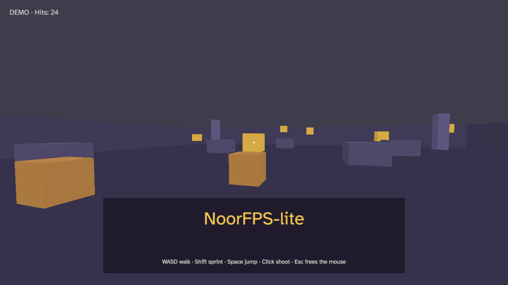

# NoorEngine Devlog #021 — The Gate

**Date:** 2026-11-17
**Build / commit:** Milestone 4, part 8 — Milestone 4 complete

## This week we actually did

**A game.** A small one, but a real one: **NoorFPS-lite**. You walk around an arena, gold targets
float about, you have a minute to shoot as many as you can. Footsteps, a shot, a metallic *ping*
when you hit, a chime when time's up. Score, accuracy and a clock on the screen. Wooden crates you
can knock about with a stray shot, because physics is there, so why not.

*A real screenshot from the automated test, 15 seconds into the demo (the Lua twin).*

It's built only with what any NoorEngine user gets: the documented script API. No engine code
knows it's a shooter. And it's written **twice**: once in C#, once in Lua, side by side, same
rules, same HUD. Both versions are in the repository as one project with two scenes.

Before you click, the game plays itself, like an arcade cabinet waiting for a coin. It turns to
the nearest target and fires when one is under the crosshair. That's also how the automated test
plays it: it builds the game, gives it no keyboard or mouse for 15 seconds, and reads the score
off the HUD. 24 hits in C#, 24 in Lua. (A tie. Both languages are equally good at shooting cubes.)

## Milestone 4 is done ✅

Milestone 4's promise was: *a developer writes a script in NoorCode, runs a character, plays a
sound, saves a scene, exports a working build, and a basic FPS can be made with public APIs.*
Every piece of that has now been done, by hand and by tests. The full review, with what's
**not** done yet, is in [M4_REVIEW.md](../milestones/M4_REVIEW.md).

## Sage vs. Reality

Building the sample was the point: a real game finds what tests written by the engine's author
don't. It found three things on the first afternoon:

**C# couldn't move things.** `Entity.Position = new Vector3(...)` didn't compile. In C#, an
entity was a small value type handed out by a property, and C# refuses to change a copy. Every
C# script that wanted to move a target would have hit that wall. `Entity` is now a proper handle.

**The player shot itself.** Every shot from the eyes hit the player's own body, at distance
zero, even though the script said "ignore the player". The character's body wasn't on the list
"ignore" looked in. Fixed, and there's a test.

**A click that wasn't ours.** One test run ended with the game paused, as if someone had clicked.
Someone may well have: the test window pops up on a real desktop. Test games now get no mouse or
keyboard at all.

## Bad Ideas Works Award for Questionable Decisions
**Winner:** Making the sample game's tester be the sample game.
**Defence:** It never gets bored, it never blinks, and it scored 24. The bar for human players
is now officially 25.

## Next engineering target
**Milestone 5: PBR lighting, HDRI and materials.** In plain words: textures. The arena's walls are
very flat and very purple, and they would like a word.

---
*Bad Ideas Works — Code shall remain understandable to whichever AI inherits this mess.*
