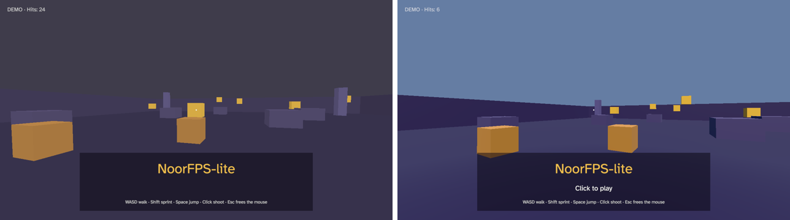
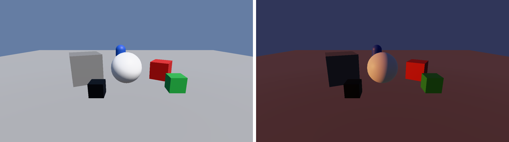

# NoorEngine Devlog #022 — Let There Be Lux

**Date:** 2026-11-17
**Build / commit:** Milestone 5, part 1

## This week we actually did

**A real sun.** Until today, NoorEngine's "light" was a trick: every surface got a bit brighter
when it faced a fixed direction, and that was it. Now the scene is lit the way the real world
is, in real units: the sun at 100,000 lux (bright sunshine), the sky at 8,000 nits, and a virtual
camera exposure, like a photographer choosing how much light to let in.

*Real screenshots. Left: yesterday. Right: today. Same scene, same colours, just honest light.*

Light now goes through a proper chain: the scene is drawn into a high-dynamic-range picture
(numbers can go far beyond "white"), and a **tonemapper** squeezes that range into what a screen
can show, the job a camera's sensor and film do. The HUD and editor gizmos are drawn after that,
so a white label stays exactly white.

Because the sun is now a thing, you can move it: **Create ▸ Sun**, then rotate it. Sunrise,
noon, sunset:

*The two scenes the automated tests draw every time. Left: the default day. Right: a 20,000 lux
orange sun low on the right, a dim sky, and the camera opened up to match.*

## Build of the Week 🏆

**Tests that look at pictures.** Every test run now draws those two scenes and compares them with
stored reference pictures. The comparison shrinks the screenshot first (small driver differences
average out) and allows a little tolerance. But a different picture must fail, so there's a test
that checks exactly that: daylight compared against the sunset reference has to fail, or the judge
is asleep. From now on, if a change quietly makes things darker, bluer or broken, a test says so.

## Sage vs. Reality

**Correct, and too dark.** The first physically correct picture was gloomy. Two reasons, both
instructive. First, our sample's purple floor reflects about 4% of the light, like charcoal. That
looked fine under the old fake light and looks like charcoal under a real sun. Second, a piece of
physics was missing: every real surface reflects a little of the sky, even matte ones. Without
that, shadows went pitch black. Adding the sky reflection fixed the shadows, and opening the
virtual camera one stop (EV 14 instead of 15) fixed the rest.

**The sunset that was midday.** The first "sunset" was a washed-out blue mess, because you could
change the sun but not the sky: an orange evening sun under a bright noon sky. Skies come from
HDRI photos in part 5. Until then, the sun brings its own sky colour along.

**The linker that came from somewhere else.** One build configuration ran without Visual
Studio's environment, and CMake quietly picked up a different linker from another toolchain on
the PC, and saved empty compiler settings while it was at it. Fixing the linker made the next
build fail somewhere else entirely, inside Microsoft's own headers. The real fix was a clean
configure (the downloaded libraries were kept), and a lesson written down: always configure
from the right environment.

## Next engineering target
**Part 2: textures.** Pictures on surfaces. PNG, JPEG, 16-bit images, the textures inside GLB
models, and making sure a normal map never gets mistaken for a colour picture.

## Bad Ideas Works Award for Questionable Decisions
**Winner:** Lighting a game about shooting cubes with 100,000 lux.
**Defence:** That's what the sun actually delivers on a clear day. The cubes deserve the truth.

---
*Bad Ideas Works — Code shall remain understandable to whichever AI inherits this mess.*
