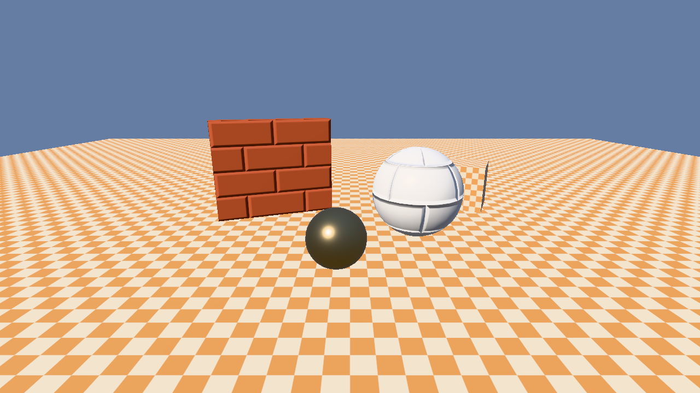

# NoorEngine Devlog #023 — The Wall Has Textures

**Date:** 2026-11-17
**Build / commit:** Milestone 5, part 2

## This week we actually did

**Textures.** Pictures on surfaces, at last. Drop a PNG or JPEG into a project's `Assets` folder
and the engine imports it. In the editor, **Add to scene** puts it on a cube. And they're not
just stickers:

*A real screenshot from the automated tests. The brick wall is a flat box: the bricks are a
"normal map".*

A **normal map** is a texture that doesn't store colour but direction: for every pixel, which
way that bit of surface faces. The light uses those directions, so a perfectly flat box shows
bricks sticking out and mortar sinking in, with lit edges on the sun's side and shaded edges on
the other. The white ball wears the same map.

The checker floor shows the other half of the job, **mipmaps**: smaller and smaller copies of a
texture for when it's far away. Without them, a distant checker turns into shimmering noise.
With them, it fades smoothly into the distance.

## Build of the Week 🏆

**The engine knows what kind of picture it's looking at.** A colour photo, a roughness map and a
normal map are all PNG files, but they must be treated differently: colours are stored "gamma
encoded" for the eye, the others are plain numbers. Mixing them up is a classic bug: normal maps
that point the wrong way, roughness maps that come out darker. NoorEngine reads the file name
(`bricks_normal.png`, `rock_roughness.png`, `wood_albedo.png`) and picks the right kind. Each
file's kind is stored next to it and can be changed.

We tested the guessing on a real texture library: albedo, normal, roughness, AO, height, depth,
curvature, cavity and packed ORM maps, all classified correctly. Mostly. The first try took
"depth" and "curvature" maps for colour photos. Fixed before it bit anyone.

## Sage vs. Reality

**The white that wasn't there.** The texture table reserves slot 0 for "plain white", the
default when a surface has no texture. My code treated "slot 0" as "any free slot, please", so
white moved in next door and slot 0 stayed empty. The graphics driver's validation layer spotted
it on the first run: "image view is NULL". Thirty seconds to fix, but it's exactly why every test
runs with validation turned on.

**The texture that outlived its renderer.** Moving the editor's viewport into its own window
crashed the editor, but only after a texture had been shown. When a viewport closes, its
renderer is shut down by hand, and the textures it had loaded were cleaned up a moment *later*,
by asking a renderer that no longer existed. The editor's own end-to-end test does exactly that
move, so it caught it the first time it ran. Textures now go first.

**Honest numbers.** A 1254×1254 texture takes 8 MB of graphics memory as it is. A real game
level has hundreds of them. Texture compression (GPU formats about a quarter of the size) is on
the list for part 7, now with numbers behind it instead of a hunch.

## Next engineering target
**Part 3: materials.** One file that says "this surface is brick: this colour picture, this
normal map, this roughness", reusable everywhere, plus the textures inside GLB models and
"make a material from this folder of textures".

## Bad Ideas Works Award for Questionable Decisions
**Winner:** Building a brick wall to test a game engine.
**Defence:** Every 3D programmer's first normal map is bricks. It's the law. We are simply
law-abiding.

---
*Bad Ideas Works — Code shall remain understandable to whichever AI inherits this mess.*
