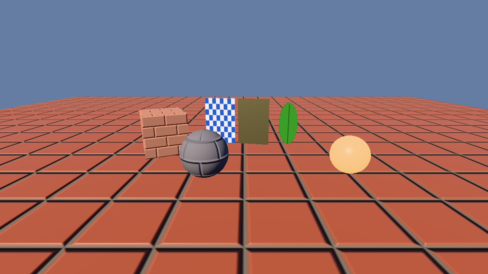

# NoorEngine Devlog #024 — What Things Are Made Of

**Date:** 2026-11-17
**Build / commit:** Milestone 5, part 3

## This week we actually did

**Materials.** Yesterday a surface was "a colour, maybe a texture". Now it's a *material*: one small
file that says "this is brick": this colour picture, this normal map, this roughness, maybe some
glow. Put it on a box, a ball, a whole floor. Change the file, and everything wearing it changes,
even in a game that's already running (about half a second later).

*A real screenshot from the automated tests.*

What's in that picture:

- **The floor** is a texture *set*: a colour picture, a normal map and an "ORM" map (three maps
  in one: shadows in the grout, roughness, metalness). One command, `noor_cli make-material`, or
  one button in the editor, **Make material**, looks at the file names and builds the material.
- **The dark ball is an instance** of the brick material: "brick, but dark grey, and the pattern
  twice as small". It doesn't copy anything. Change the brick and the ball follows.
- **The three panels are one 3D model** (a GLB file) with three materials inside it, including
  a texture packed into the model file itself and a **cutout** leaf: the square is still there,
  but the see-through part of the picture isn't drawn.
- **The orange ball glows.** Emissive materials give off their own light colour.

## Build of the Week 🏆

The materials sit in one table on the graphics card, next to the texture table from part 2. Each
draw just says "material number 7", so a scene can have hundreds of different materials without
the engine needing hundreds of different shaders. Same idea as the textures: give everything a
number, and look it up when needed.

## Sage vs. Reality

**The capsule that smeared.** To test with real-world textures, I turned a bark set from a real
texture library into a material and put it on a ball and a log. The ball looked great. The log's
straight middle was streaky: the built-in capsule gave that whole part a single row of the
texture. Now the texture is spread by distance along the surface. Spheres look exactly as before,
and the golden-image tests checked that for free.

**The test that wasn't looking hard enough.** Cutout materials use a shader feature (`discard`)
that needs a graphics feature switched on. The picture tests didn't notice, because they ran
without the Vulkan validation layer, and the picture looked fine. The older diagnostics tests run
with validation on and caught it at once. Now the picture tests run with validation too, and fail
on any error. A test that can't see a problem can't catch it.

## Not yet
See-through glass (blending: sorted and drawn after everything else), and a proper material
editor with a live preview ball (part 6). Gold looks a bit dull for now: metal shows its
surroundings, and surroundings (HDRI skies) arrive in part 5.

## Next engineering target
**Part 4: lights and shadows.** Things finally cast shadows, and lamps and spotlights join the
sun.

## Bad Ideas Works Award for Questionable Decisions
**Winner:** Testing a game engine's materials on a leaf.
**Defence:** The leaf is the reason cutout materials exist. Every forest in every game is mostly
squares pretending very hard to be leaves.

---
*Bad Ideas Works — Code shall remain understandable to whichever AI inherits this mess.*
