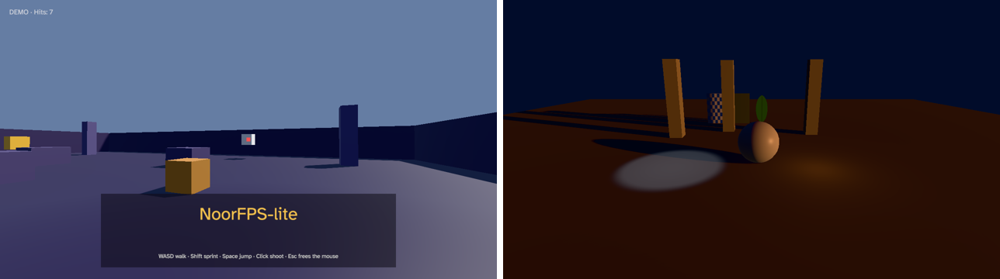

# NoorEngine Devlog #025 — Things Cast Shadows Now

**Date:** 2026-11-17
**Build / commit:** Milestone 5, part 4

## This week we actually did

**Shadows.** Until today, objects floated: lit nicely, but nothing told your eyes where they
touched the ground. Now the sun casts shadows, and the world suddenly has weight.

*Real screenshots. Left: the sample game, which didn't change a line to get shadows. Right: the
new test scene at dusk.*

**And lamps.** Point lights (a bulb) and spotlights (a torch, a street lamp) join the sun. Their
brightness is in **lumens**, the number on a light bulb's box. A 60-watt-style bulb is about
800 lumens. A spotlight puts its lumens into its cone, so a narrow beam is brighter than a wide
one, like a real torch. At noon you can't see a lamp at all (true in real life too: the camera is
set for sunshine); at dusk, or indoors with the exposure turned up, they light the scene.

## How shadows work (the short version)

The engine draws the scene a second time from the sun's point of view, but only depth: "what's
the first thing the sunlight hits here?". Then, for every pixel on screen, it asks: "is something
between me and the sun?".

One such picture can't be sharp both at your feet and 80 metres away, so there are four, each
covering a stretch of distance. Near ones are sharp, far ones are coarse. They are called
**cascades**.

## Build of the Week 🏆

**Shadows that sit still.** The classic flaw of cascaded shadows is shimmering: walk forward and
the shadow edges crawl and sparkle, because the shadow pictures slide by fractions of a pixel.
NoorEngine's cascades keep a fixed size and move only in whole shadow-pixel steps. A unit test
moves the camera a tiny bit and checks that the shadow picture moved by exactly whole pixels.
Another checks that every corner of the view is covered by its cascade. Plain maths, tested
without a graphics card.

## Sage vs. Reality

**The spotlight you couldn't see.** The first version spread a spotlight's lumens over a whole
sphere and then cut out the cone, so a narrow 8000-lumen spot made a pool you had to squint to
find. That's technically one way to define it, and nobody means it when they say "a bright
spotlight". Now the lumens go into the cone, and the test scene's spot is a clear, soft-edged
circle.

**Leaves cast leaves.** The cut-out leaf from last week casts a leaf-shaped shadow, not a square
one. That needed the shadow pass to look at the leaf's texture too. A small thing, but it's the
difference between a tree and a stack of cardboard squares.

## Not yet
Shadows from lamps (only the sun casts for now), hundreds of lamps at once (16 per frame today),
and per-cascade culling (everything is drawn into all four shadow pictures; fine for now, measured
in part 7).

## Next engineering target
**Part 5: HDRI skies.** A photo of a real sky lights the scene, and shiny things finally have
something to reflect. The gold panel has been waiting very patiently.

## Bad Ideas Works Award for Questionable Decisions
**Winner:** Measuring game lamps in lumens.
**Defence:** Next time you change a light bulb, you'll know exactly what to type into
NoorEngine. Practical engine design.

---
*Bad Ideas Works — Code shall remain understandable to whichever AI inherits this mess.*
