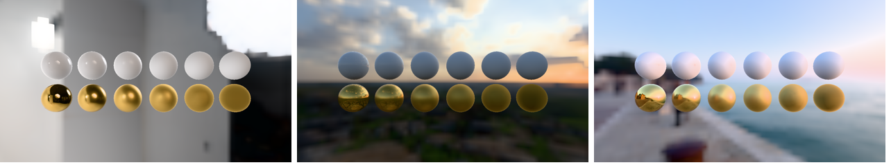

# NoorEngine Devlog #026 — The Gold Finally Shines

**Date:** 2026-11-17
**Build / commit:** Milestone 5, part 5

## This week we actually did

**Skies made from photos.** An HDRI is a panoramic photo of everything around one spot, with the
real brightness of every part kept (the sun is thousands of times brighter than a shadow, and the
file remembers that). NoorEngine now uses one to light the whole scene: the sky above, the ground
below, a building on the left. It also shows the photo as the sky behind everything.

*Real screenshots from the automated tests: the same twelve balls under three free HDRIs from
Poly Haven (CC0). The skies are blurry because the test copies are tiny (256×128 pixels); a real
HDRI is sharp.*

**The gold finally shines.** Since part 3 the gold panel looked like old olive paint, because
metal mostly shows what's around it and there was nothing around it. Now the mirror-smooth gold
ball on the left reflects the studio's lights, the hills, the waterfront. Going right, the balls
get rougher and the reflection blurs into a soft glow, like real metal. The white balls pick up
the colour of each place: cool in the evening, warm in Venice.

No HDRI? Then a procedural sky does the same job: blue overhead, pale at the horizon. So even a
plain scene's metals have something to reflect.

## How it works (the short version)

Asking "what does the sky look like from here, blurred for this roughness?" for every pixel
would be far too slow. So the engine prepares the answers once, when the HDRI is loaded:

- a set of **blurred copies of the sky**, one per roughness step, from sharp to very soft;
- **nine numbers per colour** (spherical harmonics) that describe the soft light a matte surface
  gets from every direction. Nine numbers for a whole sky, and the result is very hard to tell
  from the real thing.

Both are saved in the project's cache, so the work happens once.

## Build of the Week 🏆

**A test with a known answer.** If the whole sky has the same brightness L, the light falling on
any surface is exactly π × L, whichever way it faces. That's a textbook result. A unit test
builds a perfectly even sky and checks that the engine gets π × L everywhere and that every
blurred copy stays the same brightness. Physics homework, automated.

## Sage vs. Reality

**The grey sky.** The first procedural sky came out a dull grey-blue. It's a gradient now: the
real sky colour overhead, paler and brighter towards the horizon, which is what an actual sky
looks like (we look through more air near the horizon).

**The studio that blew out.** Studio HDRIs are bright: the white balls under it were pure white,
with no shape left. One stop less exposure (EV 13 instead of 12) brought the shading back. Real
photographers do the same thing on a shoot.

**Two suns.** An HDRI already contains its sun. The engine used to add its own default sun on
top of it, which would have lit outdoor scenes twice. Now a scene with an HDRI gets no default
sun; add one only if you want sharp sun shadows.

## Next engineering target
**Part 6: the material editor.** A panel with a live preview ball, so materials can be tuned by
eye under different skies instead of edited as text.

## Bad Ideas Works Award for Questionable Decisions
**Winner:** Lighting a game engine with a photo of Venice.
**Defence:** The light is free, the view is lovely, and nobody has to pay for the gondola.

---
*Bad Ideas Works — Code shall remain understandable to whichever AI inherits this mess.*
