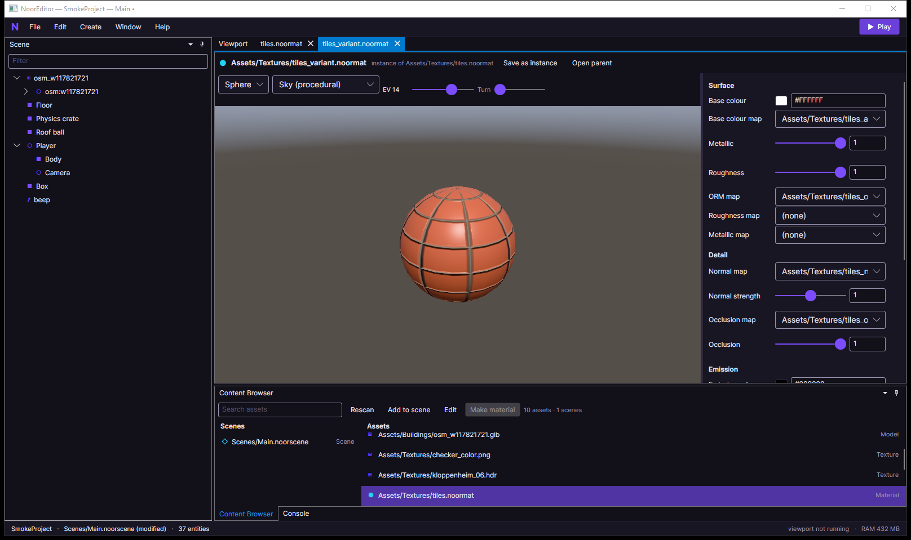

# NoorEngine Devlog #027 — Turn the Knob, Watch the Ball

**Date:** 2026-11-17
**Build / commit:** Milestone 5, part 6

## This week we actually did

**A material editor.** Until now a material was a small text file: you typed `"roughness": 0.4`,
saved, and looked at the scene to see what happened. Now you double-click the material and get a
tab with a ball wearing it, next to every setting. Drag the roughness slider and the ball goes
from mirror to matte while you drag.

*A real screenshot from the automated editor test: an instance of the tiles material with its
tiles four times smaller. The rest (textures, roughness, everything) comes from its parent.*

- **Preview**: sphere, cube or plane; lit by the default sky or any HDRI in the project, with an
  exposure slider and a knob that turns the sky around the ball.
- **Colours in hex**, the way paint programs show them. The file keeps the linear numbers the
  renderer wants; the editor converts both ways.
- **No Save button.** Every change goes into the file a moment later, so the scene and even a
  running game update too. Ctrl+Z takes it back.

## Instances, now with buttons

Part 3 added instances to the file format ("the same as that material, but…"). Now there's a
button. **Save as instance** makes a new material that starts out identical to its parent. Change
the tile size and only the tile size is stored. The fields it changes turn cyan with a little ↺
next to them, which hands the field back to the parent. Change the parent's roughness later and
every instance follows.

## Build of the Week 🏆

**One engine, two pictures.** The engine already sent the editor's viewport a "snapshot" of the
scene to draw. The preview is the same thing: a tiny one-object scene sent down a second
channel, drawn by a second viewport. The new engine code is about a hundred lines, because the
renderer, the materials, the HDRI lighting and the camera were all already there.

## Sage vs. Reality

**The dropped camera.** The first preview drew an empty sky. It had asked the camera to frame the
ball before the ball existed, and that request was quietly thrown away. Now the preview frames
its object when it first appears.

**The black screenshot.** The test took its picture of the instance's preview 0.6 seconds after
opening the tab. Starting a new viewport takes longer than that. The test now waits for the
preview to draw ten frames first, which is also the more honest thing to check.

**Tall boxes.** The number boxes next to the sliders stretched to fill their rows, like a tower of
tiny skyscrapers. Centred now.

## Next engineering target
**Part 7: quality and measurement.** Anti-aliasing (MSAA), a passes inspector, texture
compression if memory needs it, and the texture import-settings panel that slipped from part 6.

## Bad Ideas Works Award for Questionable Decisions
**Winner:** Removing the Save button.
**Defence:** Nobody has ever lost work to a Save button they couldn't find. And there's Ctrl+Z.
