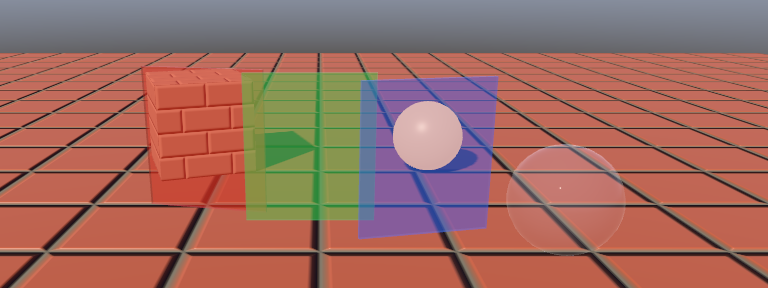

# NoorEngine Devlog #028 — Through the Glass, and the Bill

**Date:** 2026-11-17
**Build / commit:** Milestone 5, part 7

## This week we actually did

**Glass.** Materials can now be see-through. Until today a `"blend"` material quietly turned into
a cutout (fully there or fully gone, like a leaf). Now it's drawn the way glass is: after
everything solid, from the farthest pane to the nearest, so overlapping panes mix in the right
order.

*A real screenshot from the new `Glass` render test. The clear ball on the right is almost
invisible: what you see is the sky reflected in it, which is what glass really does.*

**Smooth edges.** The scene is drawn with four samples per pixel (MSAA), so the jagged staircase
on edges is gone. You can switch it off or up to 8× in Preferences.

**A Render panel.** The editor shows what each frame costs: GPU time per pass as bars, how many
things were drawn, how much memory textures, meshes and the frame itself use.

**Exposure presets.** "Overcast", "Indoor lamps", "Street at night"… a click instead of
remembering that indoor light wants EV 8.

## The bill (numbers, not guesses)

The plan for this part said: measure first, then decide. So we did, on four scenes:

- Every scene takes **1–2 ms** of GPU time on an RTX 3080, against 16.7 ms available per frame.
- The most expensive part is **shadows** (four 2048² maps every frame). The engine now skips
  objects that can't reach a shadow map: 113 of 264 shadow draws in the editor's test scene.
- **4× MSAA** costs a few tenths of a millisecond and 42 MB of memory. It stays on.
- **Texture memory** is tiny in our tests, but the arithmetic for real assets isn't: one material
  made of three 2k textures is 64 MB. Twenty of them is 1.3 GB. So **texture compression** is
  next on the list, before Uncounted 2 brings real texture sets.

All the numbers: [MEASUREMENTS.md](../rendering/MEASUREMENTS.md).

## Build of the Week 🏆

**The test that wouldn't die.** The release build kept crashing on start, deep inside Vulkan. It
wasn't the engine. A filter on the build output stopped reading after ten lines, and that quietly
stopped the build halfway, leaving a program glued together from old and new pieces. Finishing
the build fixed it. Lesson filed: never cut a build's output short while it is still running.

## Sage vs. Reality

**The wobbly stopwatch.** The first table said 8× MSAA was *faster* than 4× in one scene. It
isn't. The scenes are so small that the GPU dozes at low clock speeds and wakes up at random. The
document now says to read the numbers as rough sizes, not decimals.

**Glass is not tinted glass.** Real coloured glass filters the light behind it: red glass makes
everything behind it red. Ours mixes its colour over what's behind, which looks right for thin
panes and wrong for a thick bottle. Filtering ("transmission") is on the list for later.

## Next engineering target
**Part 8: the PBR sample and the Milestone 5 review.** A material showroom scene, textured walls
in NoorFPS-lite, and an honest look back at the whole milestone.

## Bad Ideas Works Award for Questionable Decisions
**Winner:** Measuring the speed of a scene so small the graphics card fell asleep.
**Defence:** At least now we know it snores at 1.4 ms.
