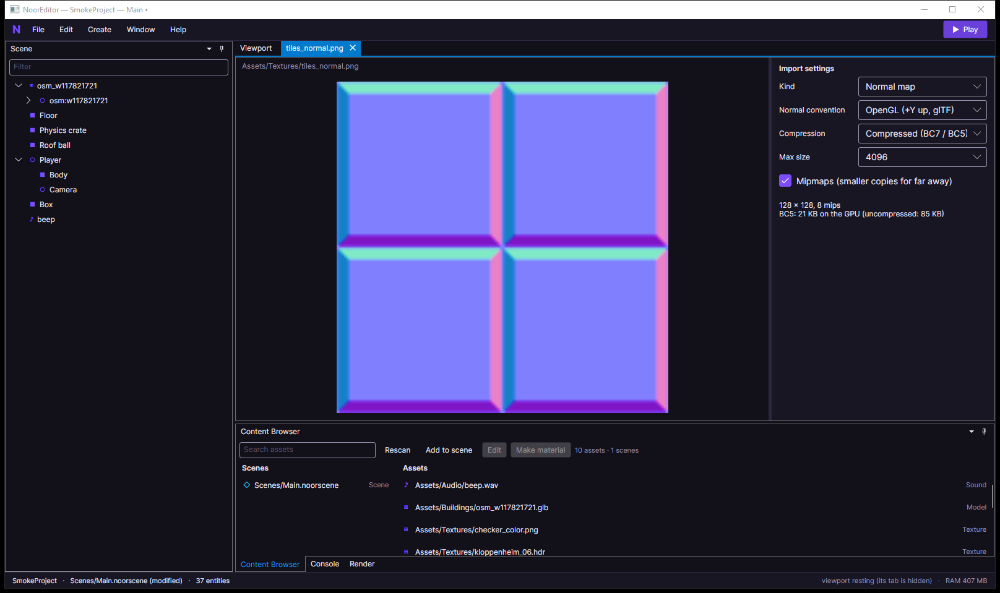

# NoorEngine Devlog #029 — A Quarter of the Bark

**Date:** 2026-11-17
**Build / commit:** Milestone 5, texture compression

## This week we actually did

**Textures take a quarter of the memory.** Last devlog did the sums: one material made of three
2K textures is 64 MB of graphics memory, so twenty of them won't fit on many graphics cards. Now
every texture is **block-compressed** when it's imported: the GPU stores each 4×4 square of
pixels in 16 bytes instead of 64, and unpacks it in hardware while drawing.

- Colours and packed data maps use **BC7**, the best-looking of these formats.
- Normal maps use **BC5**, which keeps only two of the three directions. The third is worked out
  in the shader (a normal is always one unit long, so two numbers are enough).
- HDR skies stay as they are (they need a different format, BC6H, which comes later).

We tried it on a real PBR texture set: oak bark, 1254 pixels square. Each map went from 8 MB to
2 MB. Compressing the three maps took about a second, once; after that they load from the cache
as fast as before. Rendered side by side, the two pictures differ by 0.06 out of 255 per colour
on average. We couldn't see a difference, and we looked hard.

**A texture settings tab.** Double-click a texture in the Content Browser and you get its import
settings: what kind of map it is, compression on or off, maximum size, mipmaps. It also shows
what it costs: "BC5: 21 KB on the GPU (uncompressed: 85 KB)". Pixel art that must stay exact can
switch compression off.

## Build of the Week 🏆

**Licences first.** The compressor is Richard Geldreich's bc7enc and rgbcx, MIT or public
domain, your choice. The same project has a faster version, but it's under a different licence
and needs an extra compiler, so we left it out. Every file is pinned to an exact commit and
checksum, so the build can't quietly pick up something else.

## Sage vs. Reality

**The rule that would have skipped the bark.** The first version only compressed textures whose
size is a multiple of 4, to be safe. The very first real texture we tried was 1254 pixels wide,
which isn't one. Vulkan doesn't need that rule (the edge squares are just padded), so it's gone.
The real texture found the problem in five minutes. A made-up one never would have.

**The crash that wasn't about compression.** With compression on, the editor test crashed when the
material preview opened. Compression only changed the timing. The real bug was older: the preview
could hand the renderer its sky before the renderer had drawn its first frame, and the renderer
wrote that sky into something that didn't exist yet. It's fixed now, and the test has passed
twice in a row since.

## Next engineering target
**Part 8: the PBR sample and the Milestone 5 review.** A material showroom, textured walls in
NoorFPS-lite, and an honest look back at the whole milestone.

## Bad Ideas Works Award for Questionable Decisions
**Winner:** Squeezing a tree's bark into a quarter of the space and calling it "the same".
**Defence:** We measured. The tree didn't notice.
