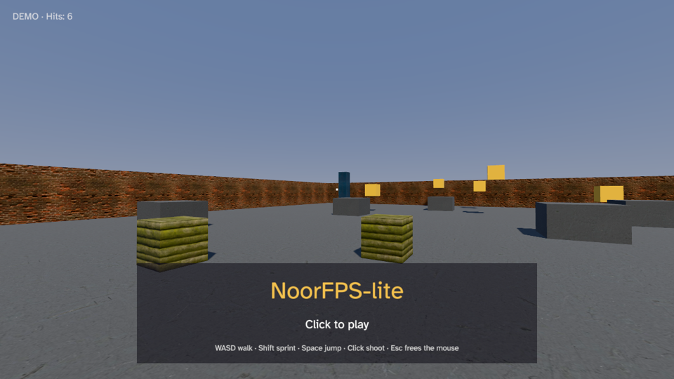

# NoorEngine Devlog #030 — The Showroom

**Date:** 2026-11-17
**Build / commit:** Milestone 5, part 8 (milestone complete)

## This week we actually did

**Milestone 5 is done.** It started with a renderer that drew flat colours under one fixed lamp.
It ends with physical light, textures, materials, a material editor, skies from photos,
shadows, glass, anti-aliasing and compressed textures. The gate asked for a sample that shows
materials behaving predictably in different light, so we built a showroom.

*Real screenshots from the sample (each one is also a render test).*

**Same materials, four places.** Look at the chrome ball in each picture: it's a tiny round mirror
of wherever it stands. The gold row behind it does the same, blurring more and more towards the
right as the balls get rougher. The red plastic stays red everywhere, because plastic has its
own colour and only a thin shine of the room on top. That's what "predictable materials" means:
change the light, and everything changes the way real things would.

**The arena got walls.** NoorFPS-lite, the little shooter from Milestone 4, finally has brick
walls, a concrete floor, metal pillars and wooden crates. The wall needed textures, and now it
has them.

All the textures and HDRIs are CC0 from Poly Haven, used as they come.

## Build of the Week 🏆

**Real files find real bugs.** The very first real texture set we imported was called
`wooden_rough_planks`. The engine read "rough" as *roughness map* and imported the wood's colour
as if it were data. It would have looked too dark, and nobody would have known why. Now the last
word that names a role decides (`…_diff_1k` is a colour map, whatever the set is called). The
test pictures we made ourselves never had a name like that.

## Sage vs. Reality

**The vanishing screenshot.** Two of four showroom pictures came out stale. The player asked for a
screenshot of the last frame, but that frame was never shown, because the window was being
resized at that moment. Now the player draws the last frame again until it has its picture.

**Mossy crates.** "Those crates look green," said the reviewer (me). They are: Wooden Rough
Planks is mossy wood, and the renderer showed it faithfully. Not a bug, but maybe not a crate
either. Swapping it is a one-line change, left for whoever decorates the arena next.

## The review

[M5_REVIEW.md](../milestones/M5_REVIEW.md): the gate passes, with honest exceptions. There's no
material *graph* yet (the design leaves room for it), no bloom (the glowing ball looks like a
flat disc), no reflections of the room itself, and no shadows from lamps. It was tested on one
graphics card.

## Next engineering target
**Milestone 6: manual creation tools.** Brushes, CSG, and building a small house in the editor.
The materials are ready to be painted onto it.

## Bad Ideas Works Award for Questionable Decisions
**Winner:** Building a showroom with nothing to sell but shiny balls.
**Defence:** Every serious engine has a wall of balls. Ours also has a glowing one and a mossy crate.
