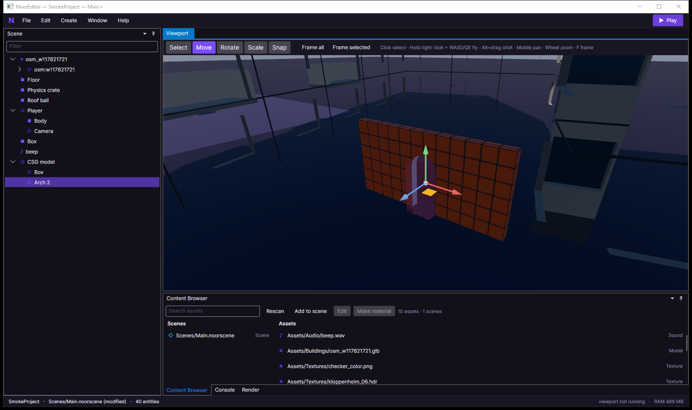

# NoorEngine Devlog #032 — A Door in a Wall

**Date:** 2026-11-17
**Build / commit:** Milestone 6, part 2

## This week we actually did

**Brushes are in the editor.** Last time the CSG maths worked in tests only. Now:
**Create ▸ Brush ▸ Box** makes a wall. **Create ▸ Brush ▸ Arch** makes a doorway shape that
cuts through it. Move the arch with the gizmo and let go: the doorway moves with it.

*A real screenshot from the editor test: the cutting brush is drawn see-through red so you can
see and grab it. (The dark shapes around it are the big apartment building the test scene
already has.)*

- **Brushes are ordinary entities** inside a "CSG model". Undo, saving, duplicating and the
  Inspector all work on them like on anything else. Shape and operation are picked from lists, the
  material from the project's materials.
- **The order is the recipe.** A model's brushes are applied top to bottom in the Scene panel.
  Move the doorway above the wall (Alt+Up) and it cuts nothing, because there was nothing there
  yet when it cut.
- **Click a wall, get its brush.** The finished model remembers which brush made which face, so
  clicking a doorway's edge selects the arch, not the whole house.

## Build of the Week 🏆

**The test measures the hole.** The editor test cuts a doorway and checks the wall's volume:
4 × 3 × 0.3 m minus exactly one arched door, to a thousandth of a cubic metre. Then it moves the
door above the wall and the volume goes back to 3.6 m³. Then undo, and the hole comes back. The
test doesn't need to see the doorway: it measures it.

## Sage vs. Reality

**Integers are not doubles.** The first run of the editor test crashed on the brush's size. I'd
written `[4, 3, 0.3]`, two whole numbers and a decimal, and C#'s JSON reader refused to read the
whole numbers as decimals. Every size is written as a decimal now, and the reader accepts either.

**"Arch 2" with no Arch 1.** New brushes were numbered by how many brushes the model had, so the
first arch after a box was "Arch 2". Now they're numbered per shape.

## Not yet
- One material per brush. A different material per face (brick outside, plaster inside) is part 3.
- While you drag a brush, it moves but the cut doesn't follow until you let go.
- Games don't draw CSG yet. Cooking the models into real meshes, with collision, is part 4.

## Next engineering target
**Part 3: surface materials and UVs.** Click a single face, give it a material, slide and turn its
texture.

## Bad Ideas Works Award for Questionable Decisions
**Winner:** A door that does nothing when you put it first.
**Defence:** That's not a bug, that's how doors work. You need a wall before you can have a doorway.
