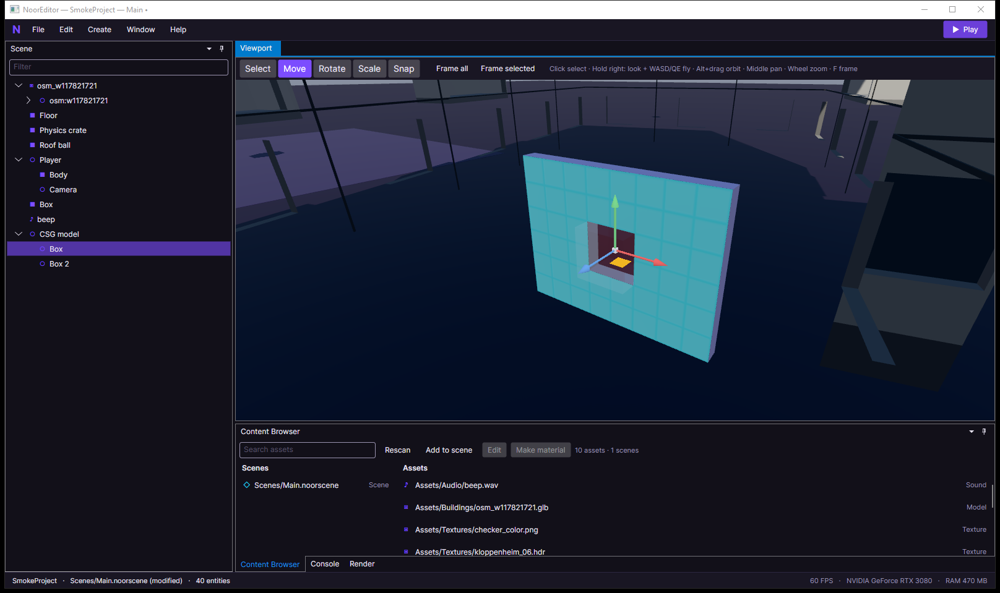

# NoorEngine Devlog #033 — Brick Outside, Plaster Inside

**Date:** 2026-11-17
**Build / commit:** Milestone 6, part 3

## This week we actually did

**Every face can have its own material.** A wall brush has six faces: front, back, top, bottom and
two ends. Before today they all wore the same material. Now you click a face and give it its own:
brick on the outside, plaster on the inside, stone along the top.

*The editor test: two clicks picked the wall's front face (outlined in cyan). It wears the tiles
material, and a window was cut afterwards. The tiles stayed where they were.*

- **Click, click.** The first click on a model selects the model, the second the brush, and now
  also the **face** under the mouse. It lights up cyan, and the Inspector's new **Faces** section
  shows it first, open.
- **Per face:** a material, and how the texture sits: repeats per metre, offset, rotation.
- **How sharp is it?** Each face shows its texel density: "1024 px per metre: a 1024 px texture
  that repeats every 1 m". Two walls side by side should have similar numbers, or one will look
  blurry next to the other. Level artists check this all the time; now the editor tells you.
- **Turned walls.** Textures normally follow the world's grid, so cuts line up with what's around
  them. A wall turned 37° would then get sheared bricks. Set the face to **aligned to brush** and
  the bricks turn with the wall.

## Build of the Week 🏆

**The test clicks like a person.** The editor test frames the wall, works out where its front is on
screen, and clicks there twice through the viewport's test pointer. Then it checks that the front
face (face number 4) was picked, gives it a material, and cuts a window. The front keeps its tiles,
and the window's own faces don't pick them up.

## Sage vs. Reality

**Two clicks, not one.** Clicking a brick wall selects the whole house first, which is right
most of the time: you usually want to move the house. The second click goes down to the wall and
its face. The test does the same.

**No drag and drop yet.** Dragging a material from the Content Browser onto a face would be the
nicest way to do this. The 3D view is a native window inside the editor, and it doesn't accept
drops yet. For now the material is picked from a list in the Inspector.

## Next engineering target
**Part 4: cook, collide, export.** Games get the finished walls as real meshes with collision, so
a character can walk through the doorway. The house can also be saved as a GLB for Blender or
Godot.

## Bad Ideas Works Award for Questionable Decisions
**Winner:** Teaching a wall to tell you how blurry it is.
**Defence:** Somebody has to. The wall had the numbers all along.
