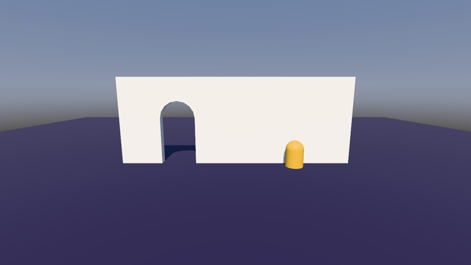

# NoorEngine Devlog #034 — Walking Through

**Date:** 2026-11-18
**Build / commit:** Milestone 6, part 4

## This week we actually did

**Brushes work in games now.** Until today, walls built from brushes lived only in the editor.
Now a built game draws them and bumps into them.

*A real frame from the new test: a built game, two "walkers" that only walk straight ahead. The
one on the left went through the doorway and is behind the wall now. The one on the right walked
into the wall and stopped there, 0.47 m from its centre, which is the wall's half thickness plus
its own radius.*

- **Cooking.** Games never run the cutting maths. The editor turns each model into a small finished
  mesh file when you save or press Play, and `noor_cli build` does it for every game it builds.
  Each file remembers which version of the brushes it came from, so the game can tell you if
  it's out of date.
- **Collision.** A new model collides with its own shape by default: walls stop you, doorways let
  you through. The Inspector shows how many triangles that costs, and warns when it gets heavy.
- **Export GLB.** One button writes the model as a Noor Interchange asset for Blender, Godot or
  NoorMD: a GLB with its textures inside and a hidden collision copy, plus the little `.noor.json`
  that says what it is.

## Build of the Week 🏆

**The goldens earned their keep.** Halfway through, six picture tests failed at once: every scene
with textured materials had lost its textures. The cause was one line in the wrong place. In
C++, a class builds its parts in the order they're listed, and I'd listed a new part above the
material library. It took the list of textures before the library could see it. Nobody would
have noticed in a plain test scene. The picture tests noticed within a minute.

## Sage vs. Reality

**The wall that wasn't drawn.** The first run of the doorway test passed the walking checks:
one walker stopped, one went through. The screenshot showed an empty floor. The wall was solid but
invisible. The code that collects what to draw skipped every entity that had none of the
components it knew, and a CSG model was one of those. Now the test also checks that the middle of
the picture is white wall, so a wall that's solid but invisible can't pass again.

**Honest manifests.** The export writes `"gltf_validator": "not_run"`, because the Khronos
validator isn't wired in yet. The spec asks for honest over green. Our own importer reads every
export back in the tests: the meshes, the collision node, the embedded texture and the triangle
count.

## Next engineering target
**Part 5: terrain.** Heightfield tiles, from a heightmap or a seed, that you can walk on. Then
sculpting and painting.

## Bad Ideas Works Award for Questionable Decisions
**Winner:** Testing a doorway by sending two people at a wall and seeing who gets hurt.
**Defence:** Nobody got hurt. One of them is just standing there, thinking about it.
