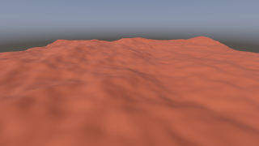
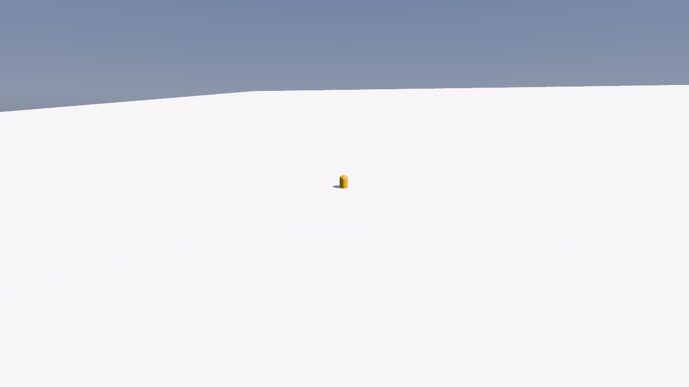

# NoorEngine Devlog #035 — Ground Truth

**Date:** 2026-11-18
**Build / commit:** Milestone 6, part 5

## This week we actually did

**NoorEngine has ground now.** Not a flat purple floor: real terrain, with hills.

*A real frame from the new render test (small, because the picture tests are 320 × 180): noise
terrain, seed 11, 30 m tall, with the tiles material. No sculpting yet: every hill here came from a
number.*

- **Terrain from a seed.** Pick a seed, a height and how big the hills should be. The same seed
  is built to give the same hills on every machine, down to the last bit. The tests check that
  (so far on one compiler, in Debug and Release).
- **Terrain from a picture.** A greyscale PNG becomes a landscape: black is low, white is high.
  16-bit pictures give smooth slopes; 8-bit ones give little steps.
- **Create ▸ Terrain** in the editor. Change the seed in the Inspector and the hills reshape.
- **You can walk on it.** In the editor's Play mode and in built games, characters stand on the
  terrain, and walk up and down slopes.

*The other new test, less pretty but more honest: a built game, a 20 m ramp made from a 16-bit
picture, and a "walker" that walks uphill for four seconds. At the end its feet were within 2 mm of the ground.
That is Jolt rounding its height field, not the walker cheating.*

## Build of the Week 🏆

**Same seed, same hills, on any machine.** The obvious way to make terrain noise uses `sin` and
friends, and those can give slightly different answers on different compilers and CPUs. Slightly
different hills means a multiplayer map that disagrees with itself. Thornwake taught us this. So
the noise uses only integer hashing and plain + − × ÷. The test pins seed 7's fingerprint, and the
Debug and Release builds agree to the last bit.

## Sage vs. Reality

**Four tests that tested nothing.** ctest treats `;` as a separator. So a test called "terrain:
tiles meet; normals match" became two names that matched nothing. ctest ran nothing and reported a
pass. It had happened four times (CSG, textures, terrain) before I spotted it. Now the build itself
refuses a test name with a `;` in it.

**What you see is what you stand on.** A square of terrain can be cut into two triangles along
either diagonal. Jolt (the physics) picks one. If the renderer had picked the other, characters
would float a little above the drawn ground or sink a little into it. The mesh uses Jolt's
diagonal, and a test checks that the height lookup lands exactly on the drawn triangles.

**Honest numbers.** Generating 2 × 2 tiles takes about 35 ms. Each tile's mesh costs 5.5 MB, which
is fat. It's fine for a 512 m map but not for a 4 km one, so LOD and a lighter vertex format are on
the list.

## Next engineering target
**Part 6: sculpting.** Raise, lower, smooth and flatten with a brush. Regenerating the hills must
keep your edits.

## Bad Ideas Works Award for Questionable Decisions
**Winner:** Verifying a mountain by sending a capsule up it for four seconds and measuring its shoes.
**Defence:** Under 2 mm off. The capsule wants a medal.
