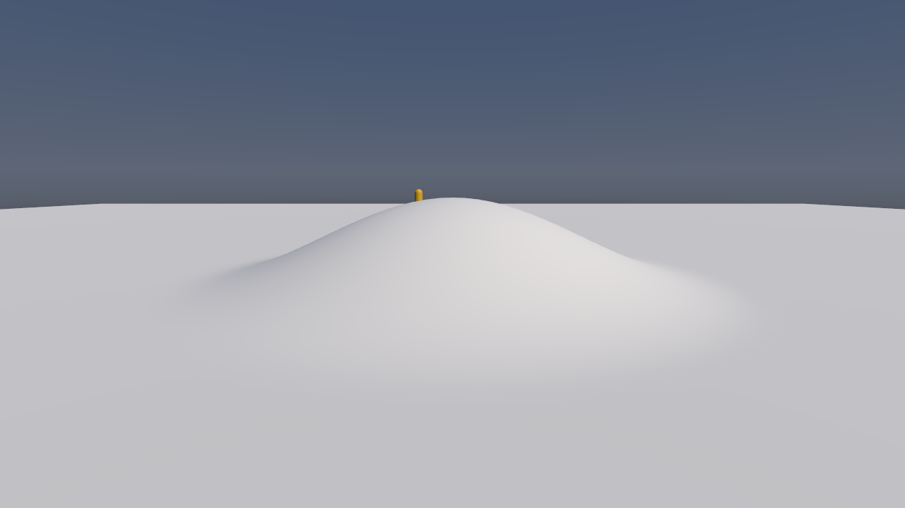

# NoorEngine Devlog #036 — Making Mountains

**Date:** 2026-11-18
**Build / commit:** Milestone 6, part 6

## This week we actually did

**You can sculpt the ground now.** Select a terrain, press Sculpt, and drag.

*A real frame from a built game. The terrain underneath is completely flat: the hill exists only in
its sculpt layer. The yellow "walker" walked over from the left for ten seconds and is standing near
the top. Its feet are 8 mm from the exact height of the hill there.*

- **Four brushes.** Raise, Lower, Smooth and Flatten, each with a radius, a strength and a soft or
  hard edge. A circle on the ground shows where the brush will land.
- **One stroke, one undo.** Ctrl+Z takes back a whole stroke. It only remembers the patch of ground
  you touched, not the whole terrain.
- **Your edits survive a new seed.** The generated hills and your hand-made changes live in
  separate layers. Change the seed and the hills underneath change, but your mountain stays where
  you put it, now on top of the new ground. The spec calls this "non-destructive"; a test checks it.
- **It all goes into the game.** Saving writes a small `.noorsculpt` file next to your assets.
  Built games load it and collide with it. In the editor, Play collides with your sculpting even
  before you save.

## Build of the Week 🏆

**The walker on the hill.** The best test of "did the sculpting make it into the game" isn't
reading the file back. It's building the game, running it, and seeing if someone can stand on the
hill. So the test does exactly that, and the walker ended up 8 mm from where the maths says the
ground is.

## Sage vs. Reality

**The ball that knew a secret.** In the editor test I dropped a ball on a sculpted hill and
expected it to stop at 10.5 m. It stopped at 8.5 m. I suspected Play was reading the old saved
file. It wasn't. I'd forgotten my own safety rule: a single brush dab counts at most a quarter of a
second, so one slow frame can't raise a sudden mountain. The test asked for 4 m of hill and got 2 m,
exactly as designed. The ball was right; my arithmetic was wrong.

**Two grounds, one place.** The first sculpting screenshot was covered in red and blue speckles. A
flat terrain at 0 m sat exactly where the editor draws its ground grid, and the GPU couldn't decide
which one was in front. When a scene has a terrain, the terrain is the ground now, so the grid
steps aside.

**Honest numbers.** In a Debug build of the editor, rebuilding one 256 m tile after a dab takes
about 33 ms (2.3 ms in Release). A brush on the corner of four tiles touches all four. The engine
only rebuilds the tiles that changed. Rebuilding just the brushed patch inside a tile comes later,
when it's worth it.

## Next engineering target
**Part 7: painting.** Grass here, rock there, a dirt path between them, painted with the same brushes.

## Bad Ideas Works Award for Questionable Decisions
**Winner:** Proving a mountain is real by building an entire game and sending a capsule up it.
**Defence:** The capsule now has a view.
