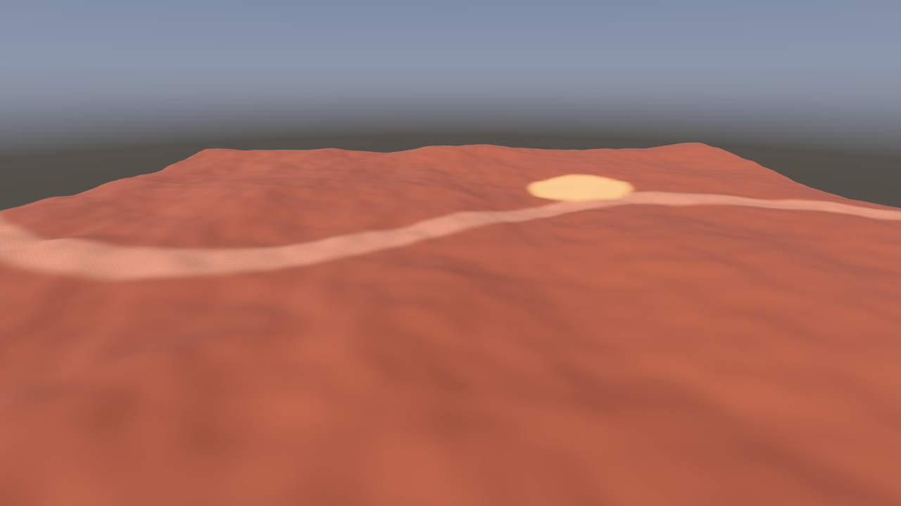
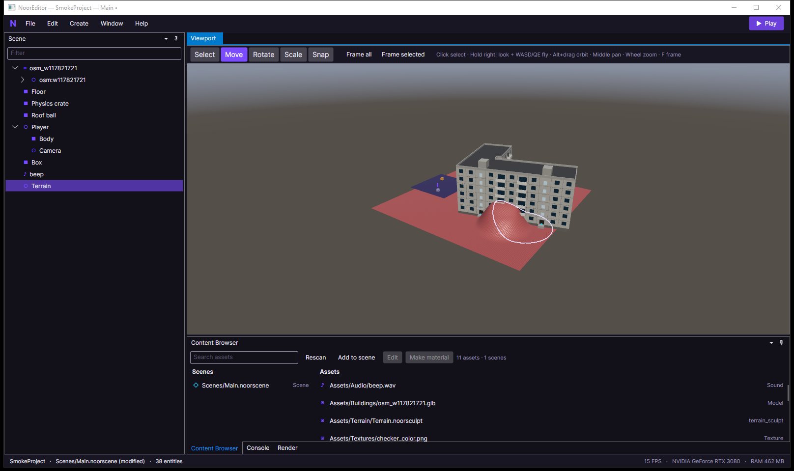

# NoorEngine Devlog #037 — Paint the Town

**Date:** 2026-11-18
**Build / commit:** Milestone 6, part 7

## This week we actually did

**Terrains get materials now: several, painted by hand.**

*A real frame from the new render test: three materials on one terrain, tiles for the ground, brick
for the path, a glowing material for the pool, blended where they meet. The path and the pool were
painted into the terrain's paint layer; nothing here is a separate object.*

- **Up to four materials per terrain.** Pick a material, press Paint and drag. A material the terrain
  doesn't have yet becomes its next layer. Each layer has its own tiling, so grass can repeat small
  and rock can repeat big.
- **One undo per stroke**, saved to a small `.noorpaint` file next to the sculpt layer. Built games
  load it.
- **The same brush on buildings.** With Paint on, clicking a face of a CSG wall gives that face the
  material. Same tool, same material, one click.
- **The blend happens on the GPU.** Each terrain tile is a single draw that mixes four materials
  pixel by pixel: colour, bumps, shininess and glow. No new pipeline: the material slots fit in space
  the draw already had.

*Bonus: the first time we've seen the sculpt brush on screen (last week's screenshot missed it). A
test pointer raised that hill; the circle follows the ground.*

## Build of the Week 🏆

**The picture tests didn't move.** Painting rewired the main surface shader: every material now
goes through one shared function, and terrains blend four of them. All ten existing render tests
still matched their reference images, so nothing else in the engine looks any different.

## Sage vs. Reality

**Dotted lines.** The first test stroke painted two blobs instead of a stripe. The test pointer
jumps 120 pixels at a time, and the brush only painted where the pointer was on each frame. A real
mouse moving fast does the same. Now, when the pointer jumps further than a quarter of the brush
between frames, the brush fills in the gap. A new test sculpts a line by jumping 40 m in one frame
and checks the middle got raised.

**The invisible stripe.** Before the dotted lines, the painted stripe didn't show up at all. I
checked the saved file: the paint was there. The test had painted right behind the six-storey
building in the middle of the picture. The test now paints in front of it, and it also checks the
saved file, so "painted but out of sight" can't fool it again.

**The stale player.** While checking the colours I ran a copy of the player left over from an
earlier test and got a perfectly white terrain. Then I ran the real one.

**Honest limits.** Weights live at the height samples, 1 m apart by default, so a painted edge is
about a metre soft. Fine for paths and meadows, too blurry for road markings. Finer weight maps are
the upgrade path; the file format wouldn't change.

## Next engineering target
**Part 8: the sample.** Grass, rock and a dirt path on sculpted hills, a stone house from brushes,
and maybe a few oaks fresh out of NoorMD. Then the Milestone 6 review.

## Bad Ideas Works Award for Questionable Decisions
**Winner:** Hiding the evidence behind a six-storey building and then asking why nobody could see it.
**Defence:** The building has a very nice path now. Probably.
