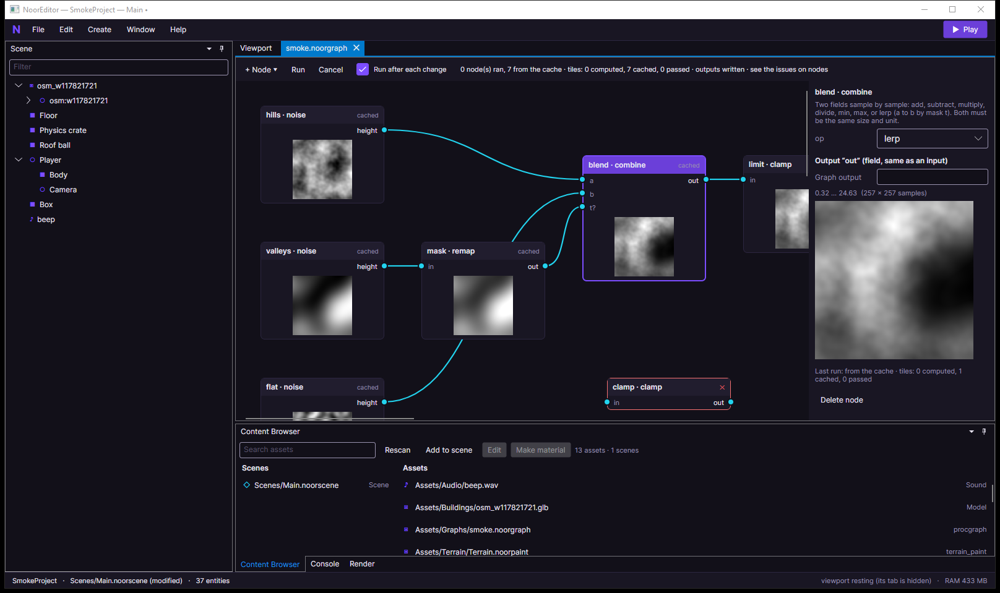

# NoorEngine Devlog #042 — Wires

**Date:** 2026-11-18
**Build / commit:** Milestone 7, part 4

## This week we actually did

**The procedural graph has an editor.** No more editing graphs as text files.

*A real screenshot from the editor's smoke test: the hills graph, every node showing a preview of
what it makes. "blend" is selected; the side panel shows its setting and a bigger preview. The
lonely "clamp" at the bottom has a red ✕: its input isn't connected.*

- **Nodes, pins and wires.** Add a node from the list, drag it by its title, and drag from an
  output's dot to an input's dot to link them. Fields are cyan, numbers gold.
- **It runs as you edit.** A quarter of a second after you stop, the graph runs in the background,
  and thanks to the cache only what changed runs again. Each node shows how long it took or
  "cached", and a little picture of what it made.
- **Problems sit on the node.** An unconnected input, the wrong unit, a loop: the node gets a red
  border and a ✕, and the side panel says what's wrong in plain words.
- **Undo, and nothing to save.** Ctrl+Z and Ctrl+Y work inside the tab, and every change is saved
  at once. The editor asks the engine to format the file, so a graph saved here is byte for byte
  what the command-line tool would write.

## Build of the Week 🏆

**Change one thing, run four.** The smoke test changes the height of the "hills" node. Exactly four
nodes run again: hills, the blend after it, the clamp after that, and the terrace at the end. The
other three come from the cache. It also passed first time, which I'm choosing to be pleased about
instead of suspicious.

## Sage vs. Reality

**A change of plan, written down.** The plan said graph edits would go through the scene's undo
history. In practice graphs are assets, like materials, and the material editor already has a
proven way to edit an asset file with its own undo. So the graph editor does the same, and the
engine keeps the parts that matter: checking, formatting and running. That's recorded in the
decision record (ADR-014), with the reason.

**A race nobody would have seen.** Background runs looked up asset files in the live asset list,
which a Rescan on the main thread could change at the same moment. They now take a snapshot of the
list when they start.

**The badge on the wrong side.** The first screenshot had "cached" on the left of each node's title.
A layout setting was on the label instead of the box around it. The screenshot caught it; the fix
was one line.

## Next engineering target
**Part 5: trees and rocks coming in from NoorMD**, in the new NoorEngine export mode: one asset per
tree, with its levels of detail and the recipe that made it.

## Bad Ideas Works Award for Questionable Decisions
**Winner:** Building a node editor whose nodes draw little pictures of themselves.
**Defence:** It's the only way to know what "remap" did without reading the manual. There is no manual.
