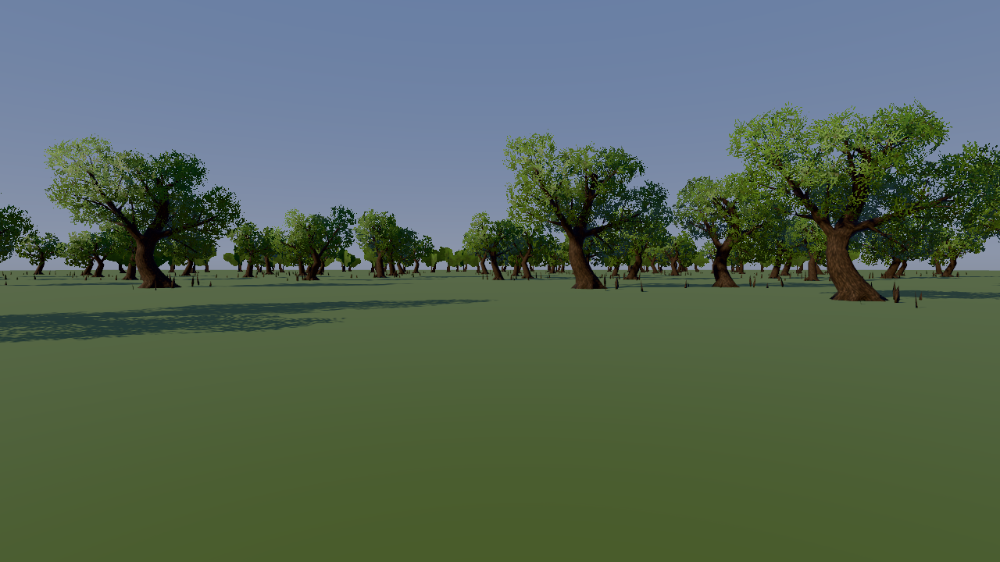

# NoorEngine Devlog #044 — A Forest at Sixty

**Date:** 2026-11-18
**Build / commit:** Milestone 7, part 6

## This week we actually did

**2,000 oaks went from 5 frames a second to 60.**

*The test forest's golden render: 120 NoorForm oaks. Close trees are full detail; from 29 m they
switch to a lighter level, from 72 m a lighter one still, and past 181 m they're 8-triangle
billboards. You're not supposed to be able to tell.*

- **Instancing.** Two thousand copies of the same tree used to be thousands of separate draw calls.
  Now the renderer notices on its own that they share a mesh and a material, and draws each group in
  one go. 4,784 draw calls became 24. Nothing else in the engine had to change.
- **Culling.** Trees behind the camera aren't drawn any more. (They weren't visible before, but
  they were drawn anyway. Very generous of us.)
- **Levels of detail.** Each tree picks its level from its distance, using the distances NoorMD wrote
  into its manifest. A zoomed-in camera keeps detail further away, and so does a bigger tree. 30.5
  million triangles became 0.43 million. It works in the editor too.
- **Shadows** get the same treatment, per shadow cascade: only the trees that can cast into a
  cascade are drawn into it, in batches.

## Build of the Week 🏆

**Measuring first.** Before changing anything, I built the 2,000-tree forest and measured it: 192 ms a
frame. The surprise was where those milliseconds went. **189 of them weren't the GPU at all.** They
were the CPU working out where every part of every tree is, by looking up each one's parent one at
a time, on every frame. That's the kind of thing that's invisible with 50 objects and deadly with
10,000. One function later it took 9 ms. Only then did instancing matter.

| | Before | After |
|---|---|---|
| Frame | 192 ms (5 FPS) | 16.7 ms (60 FPS) |
| GPU | 22 ms | 2.5 ms |
| Draw calls | 4,784 | 24 |
| Triangles | 30.5 million | 0.43 million |

## Sage vs. Reality

**The spikes weren't what I thought.** The first forest picture had small dark spikes all over the
ground. I was sure they were far trees whose leaves had faded away, a classic problem with
see-through textures at small sizes. I fixed that problem properly (far leaf textures now keep
their density). The spikes stayed. A scene with one single oak finally showed what they were:
the oak's own **root knees**, standing a few metres around its trunk, because the recipe asks
for them. Seen from 40 m in a sparse forest, they look like spikes. Authored content, not a bug.
It's noted for NoorMD (oaks don't usually have knees). The leaf fix stays: it's correct, and it
will matter for finer foliage.

**Two tests started failing, and they were right to.** The editor's checks counted triangles before and
after a change. Now that hidden things aren't drawn, moving the camera changes the count, so the
checks were comparing two different views. They now compare like with like.

**Not done:** trees switch level with a "pop", with no cross-fade, and a tree standing exactly on a
switching distance can flicker between two levels. And the CPU still spends about 6 ms a frame
reading 10,000 tree entities. That's the next part's job: forests will be lists of trees, not
thousands of entities.

## Next engineering target
**Part 7: scatter.** A graph node that plants trees and rocks by itself: spaced naturally, off steep
slopes and paths, more where you paint a meadow. The trees you place or delete by hand stay that way
when you change the seed.

## Bad Ideas Works Award for Questionable Decisions
**Winner:** Spending an afternoon making far-away leaves keep their density, to fix spikes that turned
out to be roots.
**Defence:** The leaves needed it anyway, and now the roots have been formally identified. Science.
