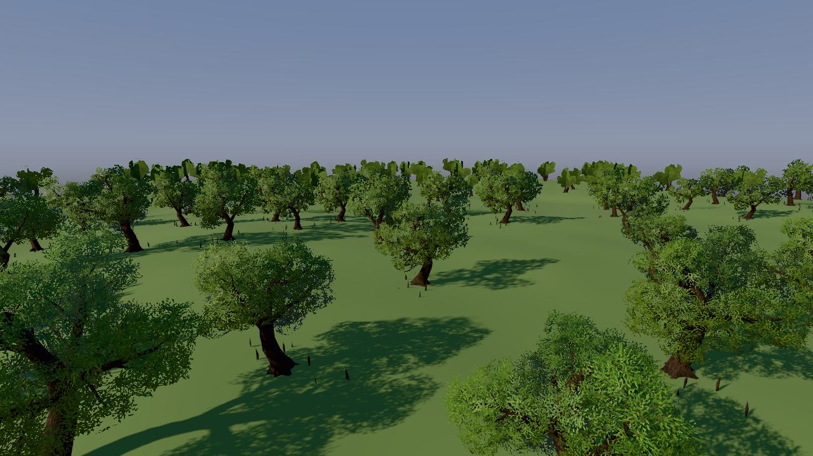
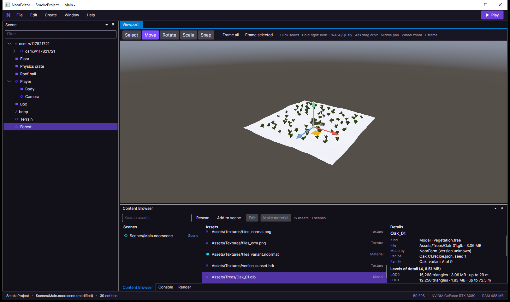

# NoorEngine Devlog #045 — Planting Season

**Date:** 2026-11-18
**Build / commit:** Milestone 7, part 7

## This week we actually did

**One graph now makes the hills and plants the forest on them.**

*The new golden render: one procedural graph makes these hills, finds the gentle slopes, keeps a
path and a clearing free, and plants oaks there. Every tree stands on the ground, at its own angle
and size.*

- **A scatter node.** Give it a model, a density and a spacing, and it plants copies naturally:
  never too close together, never in a grid, turned and sized at random. Feed it a mask and it plants
  only where the mask allows, more where the mask is stronger. Masks come from the nodes we already
  had (slope, height band) and a new **exclude** node that keeps paths and clearings free. A
  **merge** node joins species, so rocks keep out of the oaks' way.
- **Same seed, same forest, everywhere.** Each spot on the ground gets its own random numbers, so a
  tree never depends on the others, and even the rotations use maths that gives the same bits on
  every machine. A Debug and a Release build write byte-identical forests, and a test pins it.
- **A file anyone can read.** A forest comes out as plain JSON: one line per tree (which model,
  where, which way, how big, and a stable id). To prove it, a test reads it with a tiny program
  that contains no engine code at all.
- **Forests in scenes, edited by hand.** A *scatter* entity shows the forest, standing on a terrain.
  In the Inspector you get two brushes: **Plant** (drag on the ground, a tree every few metres) and
  **Remove** (drag over trees you don't want). Each stroke is one undo step. And when the graph
  changes (a new seed, a denser forest), your planted trees stay planted and your removed trees
  stay removed.

*In the editor, from above: the forest on the default terrain, with a clearing the graph keeps free.
The tree in the middle of the clearing was planted by hand.*

## Build of the Week 🏆

**The seed test.** One test plants a tree, removes another, regenerates the forest with a new seed,
then switches back to the old one. The planted tree is there all three times. The removed tree never
comes back. The same check runs through the editor API too: remove, undo, redo, plant along a drag,
change the seed, save. It passed first time, which this week has made me trust a little more.

## Sage vs. Reality

**The forest was thinner than I asked for, and that's correct.** My first test asked for one tree per
100 m² with trees at least 8 m apart, and expected about 377. It got 210. That's a fact of geometry,
not a bug: when trees are placed at random and must keep their distance, they jam long before
the space is full. Close to that limit, many candidates have no room. Well under the limit you get
what you ask for. The node's help says so, and the docs show the numbers.

**What "deleted trees stay deleted" really means.** Every tree has an id, and a removal remembers
it. With a new seed the whole forest moves, so those trees don't exist any more and can't come
back. Go back to the old seed and they're still removed. Trees you planted are yours and always
stay. Saying it plainly beats pretending removals are holes in the ground.

**Not done:** scattered trees have no collision yet (you can walk through them), you can't move a
single tree (remove it and plant another), and a terrain's live sculpting only moves the trees once
it's saved.

## Next engineering target
**Part 8, the milestone's finale:** Hillside grows a forest around the house, kept off the path, with a
meadow painted by hand. Then the Milestone 7 review against its gate.

## Bad Ideas Works Award for Questionable Decisions
**Winner:** Writing a sine function by hand so a tree turns by exactly the same angle on every computer.
**Defence:** Nobody will ever notice a tree turned by a billionth of a degree. A checksum would, and then
a multiplayer game would quietly disagree about where the forest is.
