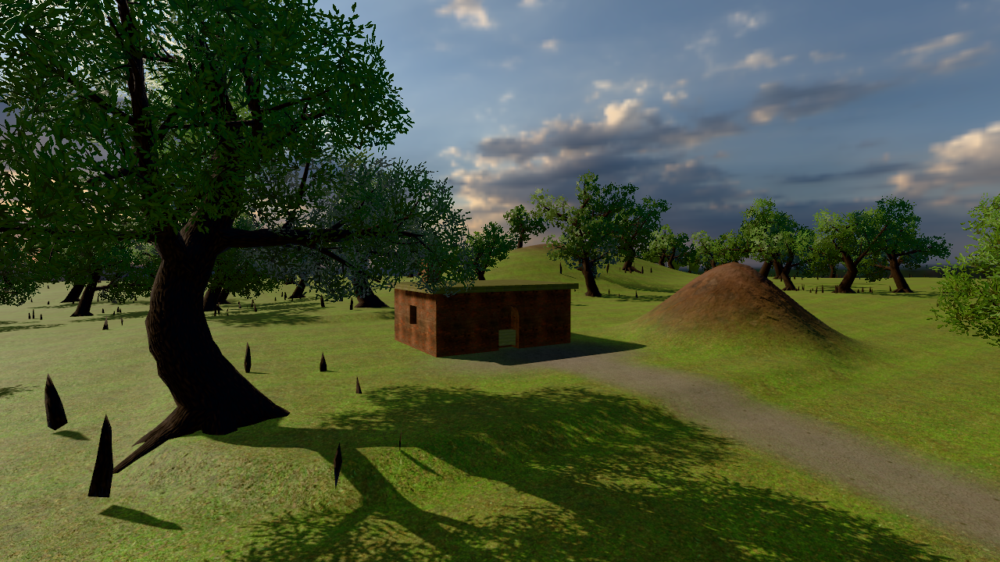

# NoorEngine Devlog #046 — The House in the Woods

**Date:** 2026-11-18
**Build / commit:** Milestone 7, part 8 · **Milestone 7 complete**

## This week we actually did

**Hillside got a forest, and Milestone 7 is done.**

*The Milestone 6 sample, now with 142 oaks of three kinds. A procedural graph placed every one of
them. None stand on the path, on the rock, in the house's yard, or between the camera and the house.*

- **Trees where the grass is.** A new node reads the terrain's paint as a mask. The meadow painted
  in Milestone 6 is where trees may grow, so they stay off the dirt path and the rock without
  anyone drawing an exclusion zone around them. (I added one anyway for the path, the yard and
  the camera's view, because trees right at a path's edge look odd and block the walk.)
- **Three kinds of oak.** Each variant gets its own scatter node, and they're merged so they keep a
  polite distance from each other.
- **Trunks you can bump into.** Scattered trees now collide in games: each tree's trunk capsule (the
  one NoorForm's export provides) becomes a physics body exactly where the trunk stands. The
  leaves don't collide, as they shouldn't.
- **The gate, as tests.** The Milestone 7 review checks all four promises against named tests:
  - the same results everywhere: pinned fingerprints, Debug equals Release, and the editor equals the
    command line;
  - hand-made work survives regenerating: sculpting, planted trees and removed trees;
  - a change only recomputes what it touches: tiles and nodes;
  - results are usable outside the engine: a reader with no engine code, and a built game.

## Build of the Week 🏆

**The walk.** The built Hillside game still walks its yellow walker up the path, through the doorway
and into the house. Now it does so through a forest whose trunks are solid, and it doesn't hit a
single tree, because the graph kept the path clear. That test didn't change at all, and that's the
point.

## Sage vs. Reality

**The command line couldn't find the paint.** Pinning the forest's result on the command line
failed: "the paint layer isn't in the project". It was. `noor_cli generate` had never been told how
to find asset files, so every graph reading one failed there, and only there. That's been true
since part 3's heightmap node, and no test ever ran such a graph through it. Fixed, and now one does.

**My first trunk test hit nothing.** I dropped rays straight down onto each tree's position and missed
every trunk. Of course I did: the oak's trunk stands about a metre from the point it's placed by,
which I found and reported back in part 5. The collision was right; the test was aiming at the
wrong spot. It now aims at the trunk, and checks that three metres to the side is just ground.

**The knees are back.** Every oak in the pack has root knees, and in the foreground of this view
they're hard to miss. It's how the trees were made, so they stay, and NoorMD can regenerate the
oaks without them.

**What Milestone 7 didn't do:** rocks (there are no NoorMD rocks in the new layout yet), trees grown
from their recipes inside a graph (that needs a headless NoorForm), and levels of detail that fade
instead of pop. All of it is in the review.

## Next engineering target
**Milestone 8**, per the roadmap. First, a short planning pass with Tom and Noor (and the ideas inbox:
NoorSky is waiting).

## Bad Ideas Works Award for Questionable Decisions
**Winner:** Letting a paint brush from last week decide where a forest grows this week.
**Defence:** Paint it green, get trees. It's the most natural user interface we've ever shipped, and
nobody had to design it.
