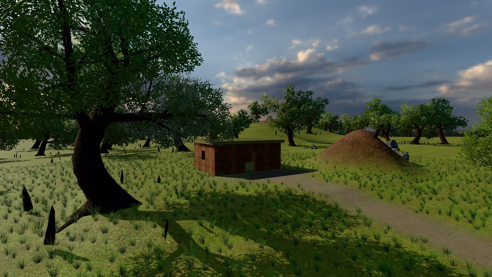

# NoorEngine Devlog #047 — Stones and Straws

**Date:** 2026-11-18
**Build / commit:** after the Milestone 7 review

## This week we actually did

**Hillside got rocks and a meadow, and Milestone 7 lost its last exception.**

*Twenty thousand clumps of grass, twenty-four rocks and 142 oaks, all placed by one procedural graph.
The path and the knoll stay clear because nobody painted grass there.*

- **Rocks.** Milestone 7 promised terrain, trees *and* rocks, and the review had to admit there were no
  rocks. Then NoorMD exported some. Each rock has three levels of detail and three convex collision
  pieces, so the physics finally learned **convex collision**: walk into a rock and it stops you, just
  like its outline. The graph puts them where the rock was painted (the ridge, the knoll) and drops a
  few into the meadow.
- **Grass.** Short and tall clumps, thick on the meadow around the house and the path. Grass needed
  two new switches: a **draw distance** (grass far away isn't drawn at all) and **no shadows** (twenty
  thousand tiny shadows add nothing but work).
- **Converter lessons.** Grass exports call themselves trees (their recipe knows better), and rock
  collision pieces need their flags moved into the right place. Both are now written up in the
  guide for NoorMD's export mode.

## Build of the Week 🏆

**From 37 FPS back to 60.** With the grass in, Hillside dropped to 37 FPS, and the reason wasn't the grass.
It was a bug from part 7: the terrain under the forest was being **rebuilt from scratch every frame**,
because the cache for terrain heights only keeps them while somebody else holds on to them, and in a
game nobody did. With 142 trees nobody noticed; with 20,000 clumps it cost 25 ms a frame. The scatter
now holds on to its ground. Collecting the scene went from 25 ms to under 3.

## Sage vs. Reality

**The Debug walk timed out.** The built Hillside game's walking test (a Debug build, with Vulkan
validation on) suddenly needed more than two minutes. In Debug, copying 20,000 grass positions every
frame took 50 ms. They're now shared instead of copied: 1.2 ms. The test went back to passing
without anyone raising its time limit.

**A test run that lied.** One measurement came back at 18 frames per second with no screenshot. The
window had a size of zero (hidden or minimized, most likely), so the player was dutifully waiting. The rerun was fine. Write down odd
numbers, then rerun them before believing them.

**Not done:** the grass ends in a hard line at its draw distance (a fade would be nicer), and the grass
doesn't sway (wind is still a future milestone).

## Next engineering target
**Milestone 8**, once the proposal's five questions are answered.

## Bad Ideas Works Award for Questionable Decisions
**Winner:** Teaching a game engine the difference between a tree and a blade of grass by reading the
grass's own recipe, because its export insists it's a tree.
**Defence:** It's a very confident blade of grass.
