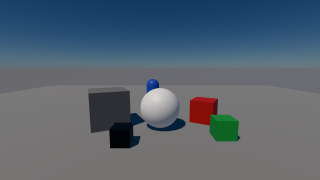
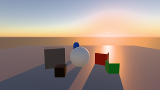

# NoorEngine Devlog #048 — The Sky Does the Maths

**Date:** 2026-11-18
**Build / commit:** Milestone 8A, part 1

## This week we actually did

**Milestone 8 started, and the first thing it did was look up.**

*The same scene, the same settings. The only thing that changed is where the sun is.*

- **A sky that knows where the sun is.** Until now a sky was three colours somebody picked. Now there's
  a physically based atmosphere: air molecules scatter blue light (that's the blue sky), haze scatters
  everything forwards (that's the glow around the sun), and ozone soaks up orange. You point the sun;
  the sky works out the rest.
- **The sun takes the colour of the air it crosses.** At noon its light is nearly white; near the
  horizon it has crossed so much air that it arrives orange-red. The sky, the sunlight and the light on
  every object come from the same model, so they can't disagree.
- **Knobs that mean something:** haze (`turbidity`), how bright the ground is, and how high you stand.
  A mountain top sees a darker sky, the way it should.
- **The sun's disc** is drawn in the sky, slightly darker at its rim, like the real one.

## Build of the Week 🏆

**Tested against physics, not against taste.** A sky is easy to make *pretty* and hard to make *right*,
so the tests compare it with numbers worked out by hand and with measurements:
- Straight up from sea level, the air lets through 94% of red light, 86% of green and 76% of blue: the
  textbook values, within 1%.
- Looking along the horizon, light crosses about 35 times as much air as looking straight up: Chapman's
  formula, within 5%.
- How bright the noon sky is overhead matches the international clear-sky formula (CIE) within the
  test's 35%: about 2,000 cd/m² with the sun 60° up.

## Sage vs. Reality

**Two of my tests were wrong, not the sky.** The first run failed three tests. One was a real bug: the
lookup table blurred the horizon with "underground" values and halved the light there. The other two
were my own guesses. I'd expected a brighter noon sky; the CIE's measurements agreed with the model,
not with me. And I'd expected the sky opposite a setting sun to stay blue just above the horizon. The
model makes it warm there, which is most likely the Belt of Venus (the pink band you see opposite a
sunset), though I haven't checked it against a measurement. The tests now check published numbers
instead of my guesses.

**Ozone isn't blue, it just eats orange.** I guessed ozone would make the twilight sky "30% bluer". The
printout said: it removes a third of the green, a bit of red, and leaves blue alone. That is exactly why
the evening sky stays blue (Hulburt worked it out in 1953). The test now checks that.

**The black band.** The first sunset had a hard dark stripe below the horizon: the sky's observer was
standing at height zero, so looking even slightly down hit the planet a few metres away with no air in
between. Below the horizon, the sky now stands for distant land seen through 20 km of haze.

**Not done:** the sky is computed on the CPU, and moving the sun costs about 120 ms. A fixed sun is
fine; a sun that moves smoothly (time of day) needs the GPU, which is part 2. And real hills don't fade
into the distance yet (aerial perspective, part 3).

## Next engineering target
**Part 2:** the sky's lighting rebuilt on the GPU, so the sun can move, and a `time_of_day` setting.

## Bad Ideas Works Award for Questionable Decisions
**Winner:** Simulating 100 km of air, three kinds of scattering and the ozone layer, to colour seven
boxes and a ball.
**Defence:** They've never looked better.
