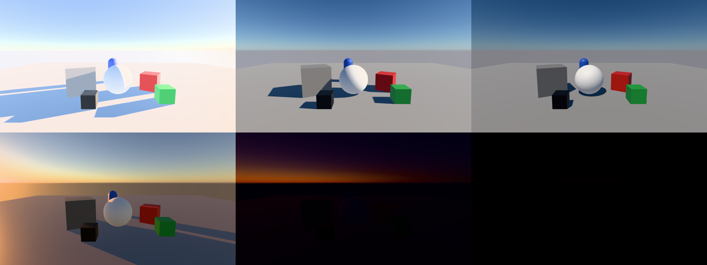

# NoorEngine Devlog #049 — A Day in Eight Seconds

**Date:** 2026-11-18
**Build / commit:** Milestone 8A, part 2

## This week we actually did

**The sun moves now, and the sky keeps up.**

*5:30, 8:00, 13:00, 19:36, 21:12 and midnight at 50° north in midsummer. Same scene, same settings; only
the clock changes. (The first picture is overexposed: getting exposure right across a whole day is a
later part.)*

- **A clock for the sun.** The environment has a `time_of_day`, plus the latitude and the day of the
  year, so the sun rises in the east, stands in the south at noon (north in the southern hemisphere) and
  sets in the west. It's checked against textbook astronomy: at 50° north in midsummer the noon sun
  stands at 63.4°.
- **The sky on the graphics card.** Last time, moving the sun meant 120 ms of CPU work: fine for a sun
  that stays put, useless for a day. Now the GPU rebuilds the sky, its reflections and the soft light
  from all around in **0.16 ms**, every frame the sun moves. These are NoorEngine's first compute
  shaders.
- **Same answer, faster.** The GPU version is a line-by-line port of the CPU one, and it has to draw last
  week's reference pictures. It does: the average difference is 0.02 out of 255.

## Build of the Week 🏆

**Dawn to dusk in eight seconds, at 60 FPS.** A test scene with a tiny Lua script drags the clock from
5:00 to 21:00 while the engine measures every frame: 480 sky rebuilds, each about 0.16 ms on the GPU,
the frame rate pinned at 60. The plan had a whole step for spreading the work over several frames in
case it was too slow. That step went in the bin, because it wasn't too slow.

## Sage vs. Reality

**The GPU did no work and still halved the frame rate.** The first GPU version ran at 31 ms a frame,
even though the GPU was busy for under half a millisecond. The cause was a single "wait for the previous
frame" in the wrong place. Before redrawing the sky, each frame waited for the previous one to finish
*drawing*, and the previous one was waiting for its turn on the screen. So every frame waited a whole
screen refresh for nothing. Now each frame has its own copy of the sky, and nobody waits for anybody.

**Then the frame rate wobbled anyway.** Even after the fix, some runs came out at 26–31 ms a frame. To
find out why, I ran three experiments: the script running without moving the sun, the sun moving
without the new sky, and the full thing. The slow run turned out to be the one where nothing moved at
all. So it was the desktop, not the engine: test windows that don't have focus get slowed down. The
test now judges what the engine controls (GPU time, CPU time, rebuilds) and prints the wall clock
without judging it.

**Not done:** fog and distant hills fading into the sky (part 3), clouds (part 4), the moon, stars and
exposure that follows the day (part 5).

## Next engineering target
**Part 3: fog and aerial perspective.** Distant hills fade into the same atmosphere, so the ground meets
the sky without a seam.

## Bad Ideas Works Award for Questionable Decisions
**Winner:** Teaching the engine the tilt of the Earth's axis, so that seven boxes and a ball can have a
correct midsummer.
**Defence:** Next winter they'll want snow.
