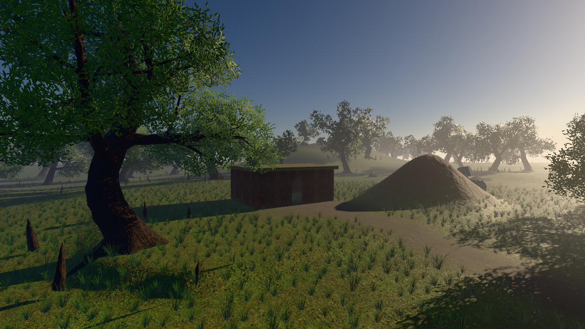

# NoorEngine Devlog #050 — The Far Hills

**Date:** 2026-11-18
**Build / commit:** Milestone 8A, part 3

## This week we actually did

**Distance has a colour now.**

*Hillside in haze: the same land, house and forest, a late afternoon in August. The oaks on the far side of
the valley aren't drawn any paler by hand. The air in between does it.*

- **Fog that knows about height.** The fog is thick at the bottom of the valley and thins as you climb, so
  hollows fill up and hilltops poke out. It glows towards the sun and takes its ambient light from the sky,
  so the same fog looks gold in the evening and grey-blue at noon.
- **Aerial perspective.** Real air turns distant things into sky, and now the engine does it with the same
  model that draws the sky. A small volume of "what the air adds, and how much gets through" is built for
  the camera every frame, in **0.025 ms**.
- **No seam where the land meets the sky.** The usual tell of a game world is the line where the fogged
  ground stops and the unfogged sky begins. Here the fog covers the sky too: looking along the horizon,
  both fade to the same colour. A unit test checks exactly that.

## Build of the Week 🏆

**Maths you can check with a pencil.** The fog's thickness along any line of sight has a closed-form
formula, so the shader doesn't have to march through the fog step by step. The tests compare the
formula with a brute-force sum of 200,000 tiny steps, for cameras inside the fog and above it, looking up,
down and level. They agree to 0.2%.

## Sage vs. Reality

**My first fog went to infinity.** The textbook formula makes fog denser and denser the further below its
height you go. A test ray aimed steeply downhill found a density of six hundred million. Now the fog is at
full strength below its height and thins above it, which is also what anyone actually wants from valley
fog.

**Two scenes, one house.** The haze scene reuses Hillside's land, house and forest, and the house is cooked
into a file named after its id. My first version gave everything new ids, and the house vanished. With
the same ids, the build tool then cooked the house twice. It now cooks a shared model once. It also
**refuses** one whose shape differs between scenes under the same id, because before, the last scene
quietly won.

**Not done:** fog has no shadows in it yet (no shafts of light through the trees; that's a later phase), and
aerial perspective needs the physically based sky (fog works with any sky).

## Next engineering target
**Part 4: clouds.** One or two layers that drift, catch the sunset on their edges and darken their bases.

## Bad Ideas Works Award for Questionable Decisions
**Winner:** Telling the engine that a 256-metre valley is thirty times deeper than it is, so the far
oaks can look properly far away.
**Defence:** Every landscape painter has done the same since the Renaissance. We just wrote it down as
`aerial_scale: 30`.
