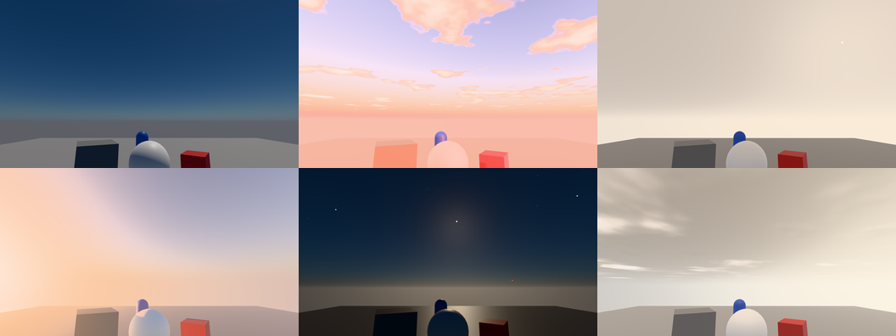
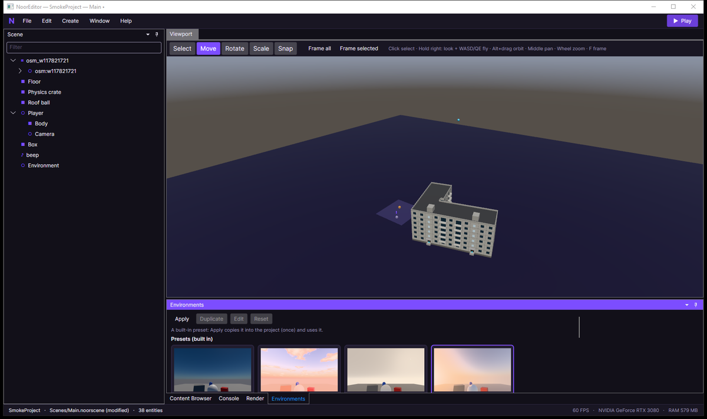

# NoorEngine Devlog #053 — Six Skies in a Box

**Date:** 2026-11-18
**Build / commit:** Milestone 8A, part 6

## This week we actually did

**Environments are things now, and they come in a box of six.**

*The six built-in presets: Clear Noon, Golden Evening, Overcast, Foggy Dawn, Moonlit Night and Stormy Coast. The
engine draws these pictures itself, from the same settings you get when you apply one.*

- **An environment in a file.** Everything that makes a sky (time of day, haze, fog, clouds, moon, stars, even the
  exposure) can live in an `.noorenv` file. A scene points at one, and can still change any setting just for
  itself.
- **Presets that can't be broken.** The six presets are built into the engine. Applying one copies it into your
  project, where you can change it as much as you like. The original never changes, and **Reset** gets it back.
- **A gallery in the editor.** The new Environments tab shows them all as pictures. Double-click to apply,
  duplicate one to try a variation, and edit any setting while the scene updates as you type. It's all one
  undo away.

## Build of the Week 🏆

**Pixel for pixel.** A test builds a game with a custom environment and compares it with the editor's project: the
same picture to the pixel (an average difference of 0.00) and the same automatic exposure to five decimal places.
What you see in the editor is what ships.

## Sage vs. Reality

**My overcast was a white-out.** The camera's light meter knew that clouds block the sun, and it forgot that the
light doesn't vanish: it comes down through the clouds as soft light. That's why an overcast day is still bright.
The meter thought it was dusk and turned the exposure up. While fixing that I found the same mistake in the
clouds themselves: a storm cloud let through as much light as a thin one. Both now use one textbook formula for
light passing through a thick cloud. Thick clouds go dark underneath, and grey days get metered properly.

**A storm needs gaps.** Stormy Coast first came out as flat beige. The clouds covered the whole sky, and the
camera brightened the darkness right back up, as a camera does. What makes a storm look like a storm is
*contrast*: dark masses with bright gaps. It's better now, but it's more "grey blustery day" than drama, and
these six looks want tuning by an artist's eye.

**A test that read freed memory.** One of my new tests looped over part of a temporary that C++ had already
thrown away. It found nothing there and failed, correctly but for the wrong reason. A classic, now fixed.

**Not done:** your own environments show their preset's picture marked "edited" (rendering a picture of any
environment needs an off-screen render path in the editor), and the presets' looks are a first pass.

## Next engineering target
**Part 7: weather zones.** Walk from a clear meadow into a foggy valley and the sky blends between the two.

## Bad Ideas Works Award for Questionable Decisions
**Winner:** Making it impossible to break a preset, by compiling the weather into the engine.
**Defence:** You can't spill coffee on a sunset that's made of C++.
