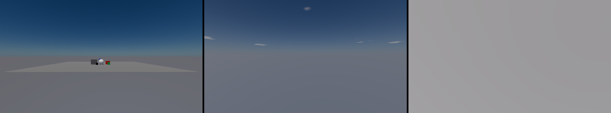

# NoorEngine Devlog #054 — Into the Fog Bank

**Date:** 2026-11-19
**Build / commit:** Milestone 8A, part 7

## This week we actually did

**The weather can be different over there.** A **weather zone** is a box (or a sphere) in the scene with an
environment of its own: a fog bank, a hazy valley, a storm over the hill. When the camera walks towards it, the
zone's sky, fog, clouds and light blend in over a distance you choose. Inside, it's fully on.

*Frames 60, 330 and 540 of a test walk: a camera script walks at 10 m/s from clear noon into a fog bank. The fog,
the clouds and the exposure blend on the way in.*

- **Anything blends.** Numbers blend smoothly, and colours blend in linear light, so halfway between black fog
  and white fog isn't a muddy middle grey. Hours take the short way round the clock: halfway from 23:00 to 01:00 is
  midnight, not noon. Switches (stars on or off, which kind of sky) flip at the halfway point. Seeds never blend,
  because half a seed is a different sky.
- **A zone only says what's different.** A fog bank that only sets fog keeps the scene's sky, sun and time of day.
  Zones can overlap, and a priority decides which goes on top.
- **Scripts can drive it.** A script can set a zone's weight directly (roll a storm in over two seconds), move the
  time of day, or change the environment. A test does exactly that with two little Luau scripts.
- **The editor** has **Create ▸ Weather zone** (a fog bank to start from), and the Inspector picks a zone's
  environment from the project's environments or copies a built-in preset into it.

## Build of the Week 🏆

**Smooth, measured, and the same in a built game.** A test walks a camera into the fog bank for 540 frames and
records the fog and the exposure on every frame. The fog only ever goes one way, no frame moves it more than 1.2%
of the way, and the exposure never changes more than 0.01 stops between frames. Then a built game repeats the walk,
and all 540 frames match the editor's project.

## Sage vs. Reality

**The first walk ran at 20 FPS.** Blending changes the haze a little every frame. The sky's light on the CPU side
comes from tables, built once per setting in about a quarter of a second. So every frame built brand new tables,
and the walk ran at 20 FPS. The fix was to stop asking for a new atmosphere every frame. The engine now keeps
atmospheres on a coarse grid of haze levels, builds the ones a scene can need in parallel when it loads, and
blends between the two nearest. Gathering a frame's scene went from about 240 ms to 0.5 ms, and the walk holds a
flat 60 FPS (16.66 ms a frame). The test now fails if that work stalls again.

**A fog bank that ate the sky.** The new script test found a real bug. A zone that only said "fog", fully on,
replaced the *whole* environment, the sky included, so the atmosphere switched off inside it. At 99% it was fine.
Only the last 1% was wrong. Fully on now follows the same rule as nearly on. This would have broken the editor's
new Weather zone template the first time anyone used it.

**Not done:** the editor blends by where the scene's camera is, not where you fly the editor's view. That's right
for a game, but it's surprising while you're editing. And the clouds still want to do more work (noted for later).

## Next engineering target
**Part 8: a sample and the 8A review.** Hillside under every preset, a space scene, the cost of each feature, and
an honest look back at the sky group.

## Bad Ideas Works Award for Questionable Decisions
**Winner:** Testing weather by making a camera walk into fog 540 times a run.
**Defence:** It's the only member of the team that never complains about the weather.
