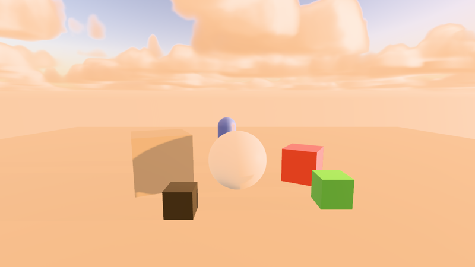
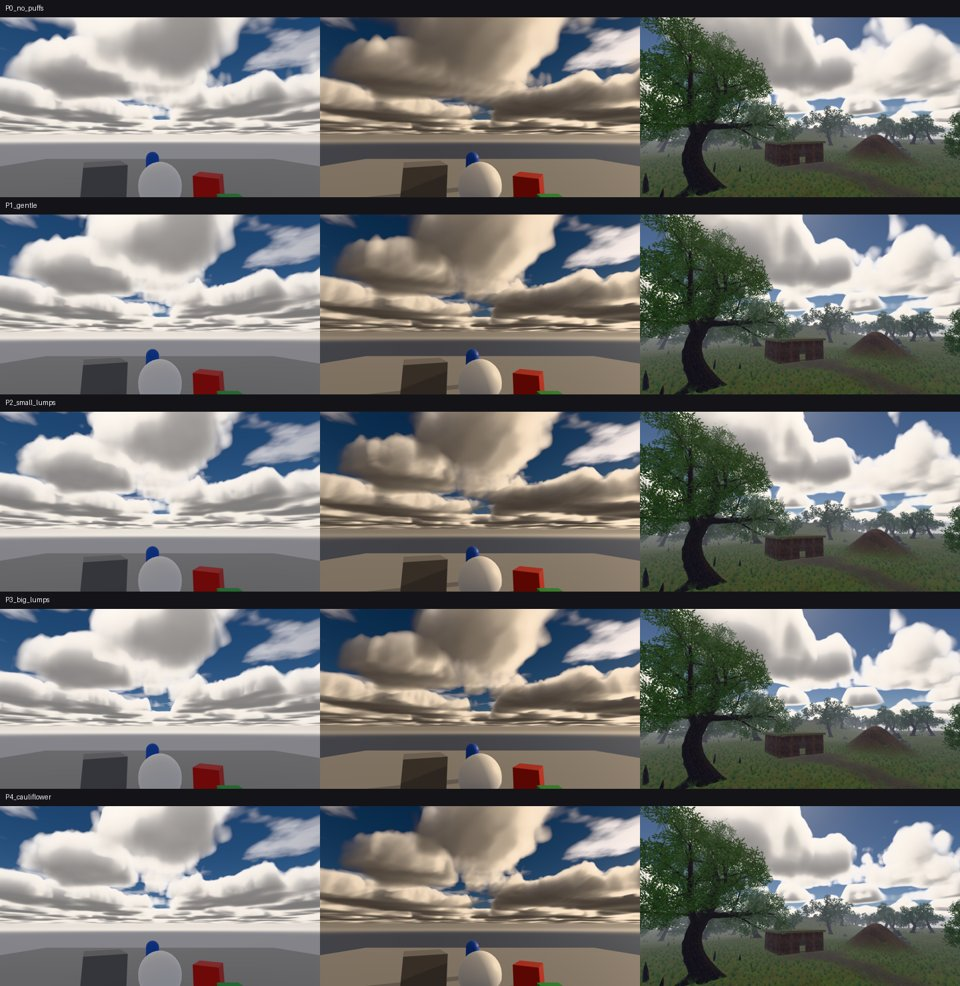

# NoorEngine Devlog #055 — Clouds with Depth

**Date:** 2026-11-19
**Build / commit:** Milestone 8A, part 7b

## This week we actually did

**The clouds stopped being painted on the sky.** Part 4's clouds are thin layers: detailed and cheap, but flat.
Near the horizon they squash into slivers, they have no lit sides, and nothing stands in front of anything else. A
cloud layer can now be a **volume** instead: a slab of real cloud, a kilometre and a half thick, marched through by
light.

*The same scene, the same seed. Above: flat layers. Below: the first layer as a volume. The thin cirrus up high
stays flat.*

- **One word in the environment.** `"cloud_type": "volume"` (and a thickness) turns a layer into clouds with depth.
  The same coverage, seed and wind put them in the same places as before, so switching styles doesn't move your sky.
- **The flat layers stay exactly as they are.** They're not the "low quality" option. They're a look of their own,
  for games that want a classic layered sky, and every old picture is pixel-identical.
- **Cumulus with cauliflower tops.** Flat bases, rounded domes, lumps on lumps (cellular noise, inverted), and light
  marched towards the sun. Tops and silver linings are bright, bellies grey, and thick clouds dark underneath.

*Golden Evening with a volume layer, drawn by a built game. A test checks it matches the editor's picture.*

## Build of the Week 🏆

**From 20 ms to 1.5 ms.** The cauliflower look first cost 20 milliseconds a frame, because it computed cellular
noise (27 neighbouring cells, three octaves) at every sample of every pixel. Now the GPU bakes the noise once into a
small 3D texture (it tiles, so 4 MB covers the sky). It marches the clouds at half resolution and lets the sky
scale them up. Measured: **1.50 ms** a frame at 1280×720, on target. A test fails if it ever goes above 2.5.

## Sage vs. Reality

**The look was picked, not guessed.** Lighting and lumps were each rendered as five variants, side by side, at noon,
in the evening and over Hillside. The winners: darker bellies with a brighter silver lining, and the strongest
cauliflower lumps. My first try at "puffy" barely changed anything. The soft noise only nibbled at the edges. Real
lumps needed a different kind of noise.

**Half the cost was a copy-paste the compiler did.** The sky shader looped over two cloud layers, and the compiler
pasted the whole cloud march in twice. A shader that big runs short of registers, and then every pixel slows down,
even the ones without clouds. Making the loop a real loop halved the cost (10.8 ms to 5.3) before any real
optimisation.

**A test that measured the wrong thing.** "Cloud near the top is brighter than near the base" compared the total
light along a look. With lumpy tops, a look near the top crosses gaps between domes and gathers less light, even
though each bit of cloud there is brighter. It passed by luck of the noise until the noise changed. It now measures
light per bit of cloud, which is the actual question.

**Not done:** no preset uses volumes yet. That's for deciding from pictures. You can't fly through them or see them
from above (that's phase C), and reflections see their flat coverage.

## Next engineering target
**Part 8: a sample and the 8A review.** Hillside under every preset, a space scene, the cost of each feature, and an
honest look back at the sky group.

## Bad Ideas Works Award for Questionable Decisions
**Winner:** Spending a day making clouds heavier, then a day making them lighter.
**Defence:** They're eleven times lighter on the GPU and look heavier than ever. That's called balance.
