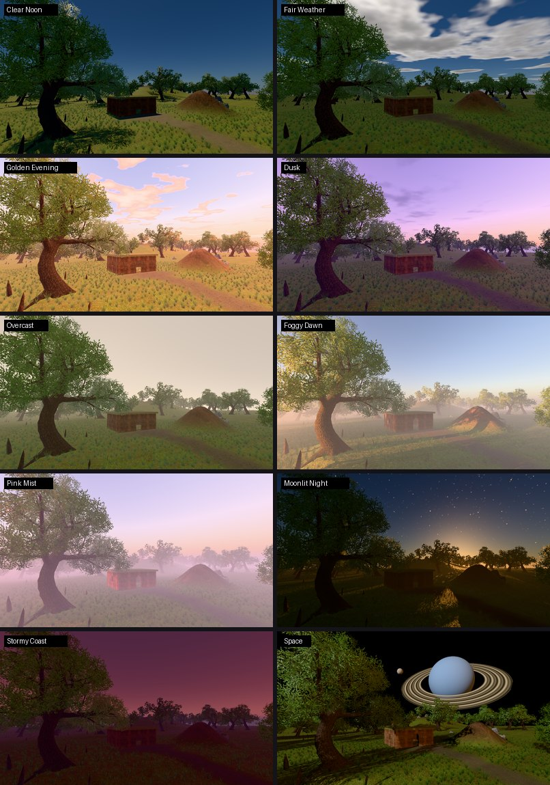

# NoorEngine Devlog #056 — Ten Skies, One Valley

**Date:** 2026-11-19
**Build / commit:** Milestone 8A, part 8 (the 8A gate)

## This week we actually did

**The sky group is done.** Two days ago a NoorEngine sky was a photo or three colours. Now it's a physically based
atmosphere with a sun that moves, fog, far hills fading into the air, clouds (flat or with depth), the moon and the
stars, space with ringed planets, environments in files with nine presets, and weather you can walk into. To check
it all works together, the Hillside valley got every sky:

*The same land, house and forest, ten times. The last one has no air at all.*

- **Nine presets, applied like a user would.** A script opens the sample and applies each preset through the editor
  API, the same call the Environments gallery's Apply makes. The sample now carries nine environment files, each
  remembering which preset it came from. Every scene is a golden render.
- **Hillside in space.** A black sky, a ringed planet and a small moon over the valley, and a second, orange sun.
  There are stars too, but a camera exposed for sunlit grass can't see them, so we don't fake them.
- **The review.** The [8A gate review](../milestones/M8A_REVIEW.md) checks every sky system for editor authoring,
  runtime, files, docs, performance notes and tests. The gate passes. The things that aren't done are listed there
  by name.

## Build of the Week 🏆

**The whole valley costs 1.1 to 2.0 ms a frame, under any sky.** That's terrain, 142 oaks, 20,000 grass clumps, the
house and shadows, at 1280×720 on an RTX 3080. A new script measures every scene. The sky itself barely shows in the
budget. What changes between presets is mostly how long the shadows are. The one sky feature you can see in the
numbers is volumetric clouds, at +0.7 ms.

## Sage vs. Reality

**Stormy Coast isn't stormy from the valley.** It was tuned on the test scene, which looks up into the clouds. From
Hillside's camera, looking along the land, its dark cloud deck melts into the red sky, and you get a crimson
gradient instead of a storm. It stays as it is for now. It's the best argument yet for letting a preset use the new
volumetric clouds.

**A file that shouldn't have been there.** Saving a scene leaves a backup beside it, and one of those had been
quietly committed with the sample since Milestone 6. Backups are now ignored.

**Not done** (all in the review): there are no quality settings, so the plan's "costs at low and high settings"
can't be written yet. Volumetric clouds are in no preset, and their edges want a second round. In the editor,
weather zones blend by the scene's camera. Planets aren't textured yet.

## Next engineering target
**8B: particles and sprites.** Rain, snow and dust for the weather we just built, effects, and sprite sheets with
8-direction billboards for creatures.

## Bad Ideas Works Award for Questionable Decisions
**Winner:** Putting a ringed planet over a meadow "to test the sky".
**Defence:** Every test needs a control group. Ours orbits.
