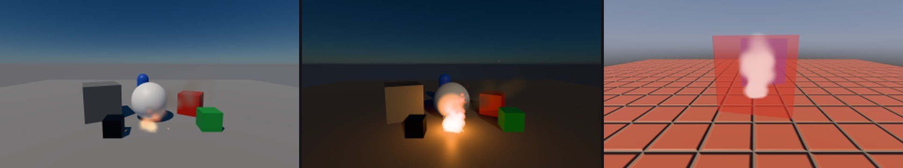

# NoorEngine Devlog #058 — Let There Be Sparks

**Date:** 2026-11-19
**Build / commit:** Milestone 8B, part 2

## This week we actually did

**Last time's invisible fire is visible.** The campfire from devlog #057 (fire from a cone, smoke from an effect file,
sparks in bursts, a breeze) now draws:

*Noon, night, and smoke between two panes of glass. All three are golden pictures now.*

- **Billboards.** Each particle is a little square that faces the camera. Sparks can stretch along their motion
  instead, so they streak.
- **Three ways to blend.** Smoke covers what's behind it. Fire and sparks add light and never darken anything. A third
  mode suits textures that already carry their own transparency.
- **They belong to the world.** Smoke is lit by the sun, sits in the shade of a cloud, and fades into fog with
  distance, all with the same shader code the rest of the scene uses. Effects can also glow (fire) and use flipbook
  textures.
- **Glass and smoke in the right order.** The third picture is the proof. Smoke behind red glass is tinted red, and it
  hides part of the blue pane behind it. Each effect is sorted together with see-through objects by distance, so they
  layer correctly.

## Build of the Week 🏆

**Ten thousand smoke puffs for half a millisecond.** A deliberately silly scene stacks 10,000 big, overlapping,
sorted smoke particles in front of the camera. It costs 0.58 ms of GPU time. The campfire costs 0.005 ms, which is
basically nothing. A test now holds both to a budget.

## Sage vs. Reality

**The night fire was a pile of white coins.** At night the camera exposes for moonlight, which makes the picture tens
of thousands of times more sensitive than at noon. The fire was set to 8,000 nits, a realistic value for flames. It
blew out to pure white, and every soft dot of fire became a hard white disc. That's physically honest: a camera
exposed for the moon would blow out a fire too. But it means one fire effect can't look right both day and night,
because the light meter only sees the sun, the sky and the moon, never lamps or glowing things. The night scene does
what a scene author would: a warm point light for the glow, and the flames turned down. A light meter that sees fire
is now in the ideas inbox.

**Housekeeping before building.** The particle shader needs everything the mesh shader knows about the frame: shadows,
sky light, fog, the air. Rather than paste a fourth copy, 152 lines moved into a shared file. Every one of the 41
golden-picture tests came out identical, which is how you know a move was really just a move.

**Not done:** the editor doesn't draw particles yet. That comes with part 4's Effects panel and its live preview.
Flipbook textures work, but no golden uses one yet, because the repo has no effect textures.

## Next engineering target
**Part 3: rain and snow.** Weather particles worked out in the shader, so hundreds of thousands cost almost nothing.
Walk into a weather zone and the rain starts.

## Bad Ideas Works Award for Questionable Decisions
**Winner:** Testing smoke by trapping it between two panes of glass.
**Defence:** It's the only way to be sure it isn't cheating.
