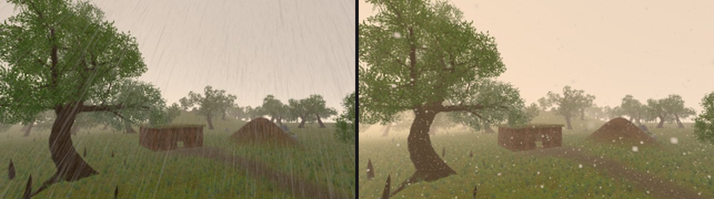

# NoorEngine Devlog #059 — It Never Rains Indoors (Except Here)

**Date:** 2026-11-19
**Build / commit:** Milestone 8B, part 3

## This week we actually did

**The weather got wet.** The environment now has three new numbers, `rain`, `snow` and `dust`, each from 0 to 1, blown
by the same ground wind as the smoke. Hillside in both:

*Rain at full strength, and snow. Both are golden pictures.*

- **200,000 raindrops cost 0.18 ms.** Nothing about them is stored or simulated. The GPU works out each drop's
  position from its number, the time and the wind, inside a box that follows the camera. A drop that falls out of
  the bottom of the box comes back in at the top, so the box never runs dry. Every drop is lit once (sky, sun,
  shadows) and fogged like the rest of the world.
- **Rain streaks, snow drifts, dust glints.** Rain falls at 9 m/s and is drawn as streaks along its motion, like a
  camera's motion blur. Snow falls at about 1 m/s and sways. Dust floats, and lights up when you look towards the sun.
- **Walk into the rain.** Weather zones from Milestone 8A blend rain like fog. The fog-bank walk test now also rains
  inside the bank. As the camera walks in, the rain grows from nothing to full, never more than 1.25% in one frame,
  never backwards, and the same in a built game.

## Build of the Week 🏆

**More rain never moves a raindrop.** Drop number *i* exists while *i* is below intensity × 200,000. When the rain
thickens, new drops are added and the existing ones stay exactly where they were. That's why the rain can start
smoothly instead of flickering into a different pattern every frame. It's also why it's deterministic: the same time
gives the same rain, so it can have golden pictures.

## Sage vs. Reality

**It rains indoors.** Drops don't know about roofs. Walk into the Hillside house in a storm, and it rains in the
living room. Stopping rain under cover needs a height map of what's overhead, which is a later step. Snow doesn't
settle on the meadow either: the snow golden is a green valley in a snowfall.

**Snow is grey.** Against a bright overcast sky, the flakes come out darker than the sky behind them. That looked
like a bug until I remembered that real snowflakes do that too: they're white against dark trees and grey against a
bright sky.

**The vertex shader needed to see the shadows.** Lighting each drop once per drop, instead of once per pixel of a
long streak, is what keeps the rain cheap. But the shadow map, the sky's light and the air were only visible to
pixel shaders. Opening them to vertex shaders took one line each, and all 46 golden pictures came out unchanged.

**The heredoc struck again.** A script that patched the test checker turned its `\n` escapes into real line breaks.
Fixed with proper edits, and noted, again.

## Next engineering target
**Part 4: the Effects panel.** Editing effects in the editor with a live preview, presets (fire, smoke, sparks, dust,
rain splash, magic), curves, and a seed you can roll.

## Bad Ideas Works Award for Questionable Decisions
**Winner:** Two hundred thousand raindrops and not a single bucket.
**Defence:** None of them exist until you look. It's the most environmentally friendly rain in the industry.
