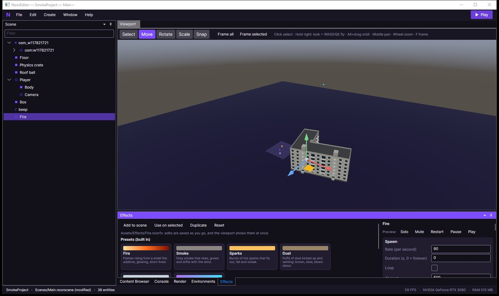

# NoorEngine Devlog #060 — Playing With Fire (Safely)

**Date:** 2026-11-19
**Build / commit:** Milestone 8B, part 4

## This week we actually did

**Effects can be made in the editor now.** Until today, a fire was a block of JSON typed by hand, and you only saw it
by running the game. The new **Effects** panel changes that:

*The Effects panel during the editor's own test: a fire has just been added to the scene, and the viewport is
previewing it.*

- **Six presets to start from:** Fire, Smoke, Sparks, Dust, Rain splash and Magic. Like the environment presets, they
  live inside the engine and never change. **Add to scene** copies one into your project and puts it on a new entity,
  in one undo step.
- **Every setting, grouped:** spawn, shape, life and speed, forces, over life and render. Size and fade over a
  particle's life are curves you edit as keys, with a little plot. Colour is a gradient with swatches. Every change
  saves straight away.
- **A live preview in the viewport.** While you edit, the viewport runs the scene's effects itself, so a change in the
  panel shows up immediately. **Solo** and **Mute** focus on one effect, **Restart** and **Pause** control time, and
  a dice button rolls a new seed: the same effect, different particles.

## Build of the Week 🏆

**One fire, two places, one set of code.** The editor and the game now share both the code that keeps track of
emitters and the code that turns them into draws. The editor's preview isn't an imitation of how a game draws
particles; it's the same code. Proven by the editor's own test, which adds a fire, waits for the preview to show
it, turns the rate down in the panel, and checks that the preview thins out at once, the file holds the new rate, and
the built-in preset is untouched.

## Sage vs. Reality

**The editor's viewport couldn't run anything.** It draws snapshots the document publishes, and in edit mode nothing
moves. Particles need time to pass. So the snapshot now carries every emitter, with its settings worked out (the
effect file plus overrides), and the viewport keeps its own little particle simulation running on its own clock.
That's a preview, not the game. In Play mode, and in built games, the game's own particles are the ones that replay
exactly.

**Ambiguity, the C# edition.** `Dock.Right` didn't compile, because the docking library also has something called
Dock. The editor's other panels already spell it `Avalonia.Controls.Dock`, and now this one does too.

**Not done:** the spec's effects graph and timeline. The module stack covers what 8B's effects need, and the graph
comes later, as planned.

## Next engineering target
**Part 5: sprites.** Sprite sheets sliced into frames, flipbook animation, and billboards that cast shadows: the
first step toward The Uncounted's creatures.

## Bad Ideas Works Award for Questionable Decisions
**Winner:** Adding a fire to a test scene and then deleting it, forty times a day.
**Defence:** Every single one was put out with Ctrl+Z. Responsible fire safety.
