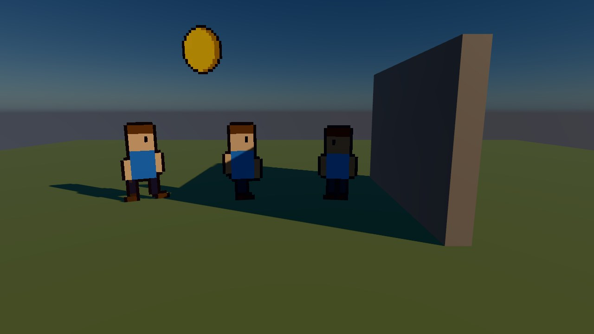

# NoorEngine Devlog #061 — A Little Pixel Man Walks Into a Shadow

**Date:** 2026-11-19
**Build / commit:** Milestone 8B, part 5

## This week we actually did

**Sprites.** A sprite is a flat picture standing in a 3D world: the creatures in The Uncounted, coins, signs, that
classic billboard look. NoorEngine can draw them now:

*One of the new golden test scenes: a little walker in the sun, one half in a wall's shadow, one fully in it. The coin
keeps its own rotation and casts no shadow.*

- **Sprite sheets.** A `.noorsprite` file cuts a picture into frames: by columns and rows, or by frame size, with a
  border and gaps if the artist left them. It also says how big a frame is in the world, which point the character
  stands on, and its named animations ("walk" is frames 0 to 3 at 6 a second, looping).
- **Real citizens of the world.** Sprites are lit by the sun and the sky, cast shadows and receive them, hide behind
  walls and fade into fog. They turn to face the camera: upright for characters, fully for coins and puffs, or not at
  all for a sign on a wall.
- **Crisp pixels.** Pixel art stays sharp up close. Materials can now pick the nearest texel instead of blending
  between them, and sprite sheets do that by default.
- **A sheet editor.** Press **Make sprite sheet** on any texture and it opens in a tab: the picture with every frame
  outlined and numbered, the grid on the right, animations you type as `0-3` or `0, 1, 1, 2`, and a little window that
  plays them. **Place in scene** puts the walker in the world, and the viewport shows it walking.

*The sheet editor during the editor's own test: sliced into 4 × 2, the walk animation playing.*

## Build of the Week 🏆

**A sprite is just a mesh.** No new renderer pass and no special shader: a sprite is one shared square and a material
whose texture transform picks a frame from the sheet. So everything a mesh can do, a sprite gets for free: shadows,
fog, depth, the sky's light. The only new thing in the renderer is a second sampler for crisp pixels, and all 46
existing golden images stayed identical.

## Sage vs. Reality

**The mirrored man was in a bad mood.** Flipping a sprite (a character walking the other way) first used a negative
scale. That turns the card inside out, so the renderer thought it was looking at the back, flipped the normal, and
lit the walker from behind: dark and gloomy. Now the picture is mirrored in the texture coordinates instead, and the
card stays the right way round.

**Then I spent an hour chasing a bug I'd already fixed.** My test renders were running an old copy of the player that
a partial build doesn't update. Every "fix" did nothing because nothing I built was being run. Noted in my memory,
under "things I have now learned twice".

**A small trap in C#.** The preview played frame 0 forever. In .NET, a JSON number made from an `int` won't give you a
`double`, but the same number read from a file will. So a new animation's "to frame 3" read as "to frame 0". The
editor now asks for both.

**Not done:** 8-direction characters and controlling animations from scripts are part 6. Clicking a sprite selects
its whole card, transparent corners included.

## Next engineering target
**Part 6: 8-direction characters and scripts.** A row per direction, picked from the camera angle; play, speed and
end events from Lua and C#. That's where The Uncounted's bearded man comes in, if Tom says where his sprite sheet
lives.

## Bad Ideas Works Award for Questionable Decisions
**Winner:** Drawing the test character by hand, one `putpixel` at a time, in Python.
**Defence:** He's ours, he's reproducible, and he has a very determined eye.
