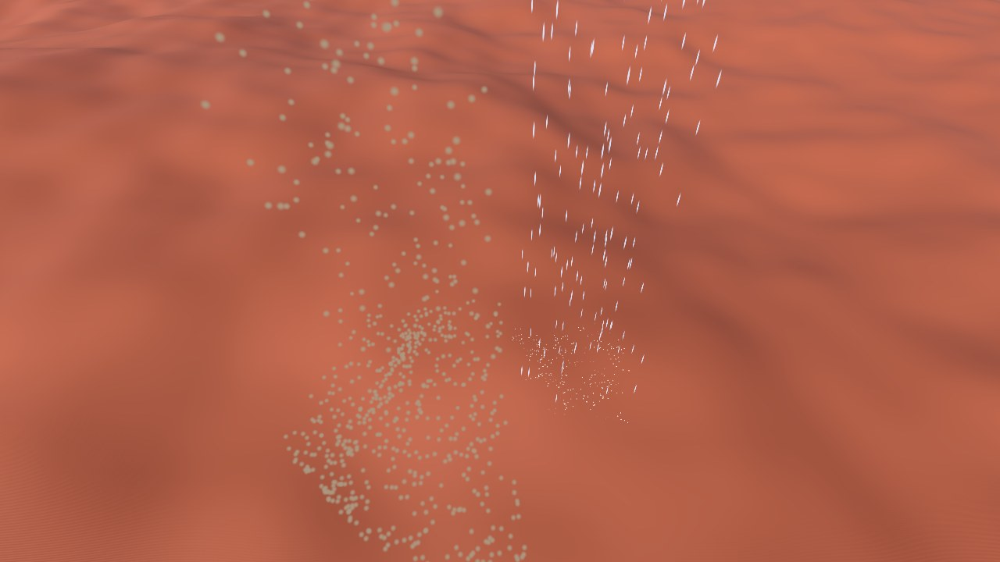
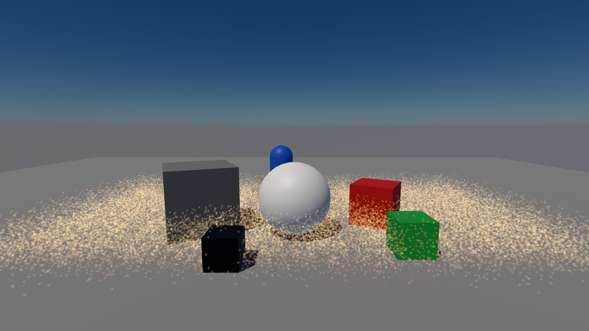

# NoorEngine Devlog #063 — Particles Finally Hit the Ground

**Date:** 2026-11-20
**Build / commit:** Milestone 8B, part 7

## This week we actually did

**Until today, every particle in NoorEngine was a ghost.** Sparks fell straight through the floor and rain disappeared
into the hills. Part 7 gives them something to land on:

*Gravel landing and settling on the hills (some of it rolls down the slope), and raindrops that end where they hit,
each one splashing. This picture is now a golden test.*

- **Collisions.** An effect can collide with the ground and with planes. The ground is the scene's terrain, and it's
  the exact surface you see: the same triangles the terrain is drawn with and the physics uses. So a pebble rests *on*
  the hill, never half inside it. Bounce, friction and "die when you hit" are three numbers in the Effects panel.
- **Sub-emitters.** Particles can start other particles where they land or die: a splash where each raindrop hits,
  embers where flames burn out, a puff of dust where a pebble lands.
- **Budgets.** One wild effect shouldn't be able to bring a game to its knees. Each emitter already had a cap; now
  the whole scene has one (100,000 particles), shared out in a fixed order so the same scene behaves the same way
  every time. Effects can also be hidden beyond a distance.

## Build of the Week 🏆

**Fifty fountains, one budget.** The new stress test has 50 spark fountains, each asking for 3,000 bouncing sparks:
150,000 in all.

The scene holds them to 98,750 (under its 100,000 budget) and holds back the other 105,000. Drawing all of them costs
0.18 ms of GPU time, and simulating them, collisions included, 1.0 ms of CPU. And it shares the budget out the same
way on every run, down to the last spark.

## Sage vs. Reality

**I cut my own test short. Again.** I piped a running test through a "show me the first 30 lines" filter, which killed
it halfway with a mysterious error. My notes say *never do that*. In bold. Notes now underlined twice.

**Invisible sparks.** The first budget picture showed no particles at all, though the report said 98,750 were alive.
For particles, "emission" is absolute brightness: a value of 2 is pitch black in daylight. The campfire uses 8,000.
The fountains now use 6,000, so the GPU cost we measure is the cost of sparks you can actually see.

**Mute forgot the children.** In the editor, a sub-emitter's particles are kept apart from their parent's, so muting a
fire left its embers glowing. Now every emitter knows which entity it belongs to, and Mute and Solo act on the whole
family.

**Not done:** particles don't collide with boxes and models yet (only terrain and planes). Sub-emitters can't have
sub-emitters of their own. The scene budget is fixed at 100,000 for now.

## Next engineering target
**Part 8: the 8B sample and review.** A stormy evening on Hillside: rain, a weather zone, a campfire with smoke and
sparks, and a sprite character walking about. Then the review of everything 8B promised.

## Bad Ideas Works Award for Questionable Decisions
**Winner:** Building a scene whose whole purpose is to ask for 50% more particles than it's allowed.
**Defence:** Every budget needs someone to test it. Fifty someones, in this case.
