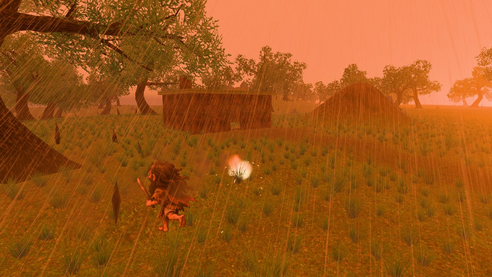

# NoorEngine Devlog #064 — A Storm on Hillside (8B Is Done)

**Date:** 2026-11-20
**Build / commit:** Milestone 8B, part 8: the sample and the review

## This week we actually did

**Milestone 8B is finished.** Eight parts ago NoorEngine had no particles and no sprites. Now it has effects you can
build in an editor, weather, sprite sheets, characters that turn to face the camera, scripts that drive all of it,
and particles that land where they fall. The last part puts everything into one scene:

*A stormy evening on Hillside, five and a half seconds in. This picture is a golden test now.*

- **The storm rolls in.** The scene starts as a calm evening. Then a weather zone fades in over four seconds: rain, a
  strong wind, low cloud and fog, all blending in together.
- **A campfire by the house.** Fire, smoke and sparks, made from the built-in presets exactly as the Effects panel
  makes them. The sparks land on the hillside and bounce.
- **Coth walks round the fire.** He's an 8-direction sprite riding on a character controller, so he follows the slope
  of the ground and always shows the right side of himself to the camera.

It was all built by a script that drives the editor's own API, so every step is something you could do by hand.

## Build of the Week 🏆

**The same storm in a built game, to the bit.** The built Hillside game plays the storm exactly as the project does:
108 particles with the same positions and speeds, 241 spark landings in both, and Coth walking. A storm made of
random-looking rain, wind, fire and a man on a slope, and it comes out identical every time.

## Sage vs. Reality

**The sample found a real bug on its first run.** The rain blew sideways in the storm, but the campfire's smoke went
straight up. Effects took their wind from the scene's calm evening and never noticed the storm's. Now they feel the
same wind the weather does, and the smoke streams off with the rain.

**And a quiet waste.** While I was in there: the particle system was re-reading the sky's settings file from disk 60
times a second. Not anymore.

**Coth sank into the hillside.** I put his picture half a body below his character, because I assumed a character's
position is its middle. NoorEngine's docs say it's the feet. The docs were right; Coth is back on his feet.

**Chasing a ghost.** One version of the scene measured almost a millisecond slower, and I nearly blamed the script.
Then I measured the scene with a quieter script: no difference. On a scene this size, the GPU's timings wobble by
about half a millisecond from run to run, so now the review says so instead of pretending to precision.

**The fire still needs help at night.** Automatic exposure brightens a dark evening but doesn't count the fire's own
light, so the fire burns out to white unless it's turned down. The sample turns it down; a proper fix is on the list.

## The 8B review

All eight parts pass the gate: each system has editor tools, runtime behaviour, saved files, docs, measured costs and
tests. The review lists what's left honestly: particles don't hit boxes and models yet, rain falls through roofs,
there are no quality settings, and only one graphics card has been tested. 46 golden pictures now, up from 36.
([M8B_REVIEW.md](../milestones/M8B_REVIEW.md))

## Next engineering target
**8C: skeletal animation.** Characters with real skeletons: walking, blending between animations, root motion, and
retargeting so one animation fits many rigs. Alden Wayfarer is the test character. It starts with a plan, as 8B did.

## Bad Ideas Works Award for Questionable Decisions
**Winner:** Sending a man without trousers to walk in circles round a campfire in a thunderstorm, as a benchmark.
**Defence:** Coth insists it's the best weather he's had in a thousand years. Three days, we reminded him.
